# What mdgrid can do

[日本語](../ja/features.md) · [Contents](index.md)

One screen and a few lines per feature. The how-to is behind each link. [Ways to see your notes](views.md) lists the screens; this page lists what you can do with them.

## By use case

Four starters are built in, and each one is a sample of a way to use mdgrid. The screens below open the sample ledgers made from them (`examples/tasks` and so on).

Tasks. One note per task, with status tabs (Open, Overdue, Doing, Waiting, Done), due date, priority and tags. A new note asks only for the due date and priority; the status and the created date are filled in for you. The name of a new note starts with today's date, like `20261118_`, so you can make a task with the same title on another day; the table and the name field hide that date, so you type only the title and the date is added for you. Setting the status to `done` fills the done date (`done_at`) with today. Next to the due date, the "Time left" column says how near it is: "in 3 days", "5 days ago". With its `start` and `due` columns, `C` shows it as a Gantt too.

Bookmarks. One note per bookmark, with its place written as `folder: bar > Dev > Web`; `T` shows them as a folder tree, and `o` on the tree screen opens the URL in your browser. In the table, `O` does the same. With the mouse, click a URL cell to select it and click it again to open it; a URL cut short with `…` by the column width still opens in full.

Reading. Books, articles, films and talks, one note each, with the tabs Queue, Now and Done, and columns for kind, author and rating.

People and meetings. Two linked tables, people (role, organization, contact) and meetings (date, attendees, next actions), with `R` for the relation map.

[Create a ledger from a starter](tasks.md#create-a-ledger-from-a-starter)

## Edit values in place

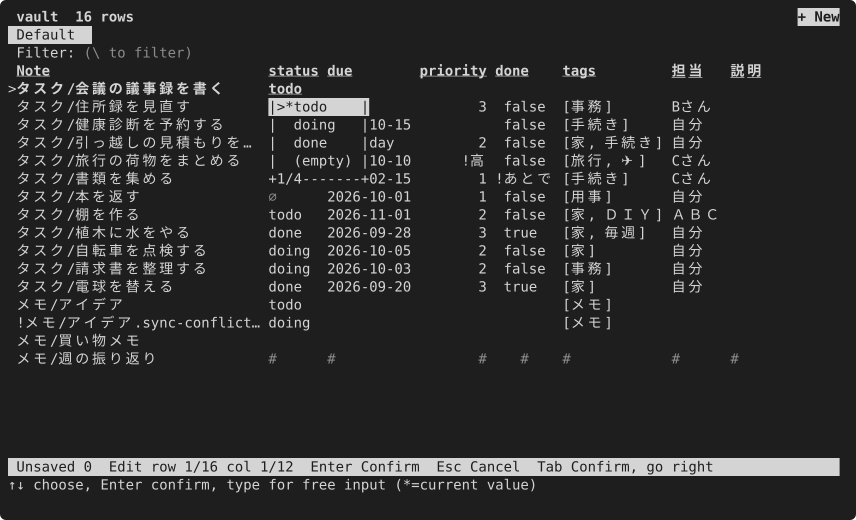

`Enter` on a cell. Text columns offer the values other notes use, and typing narrows them. Dates get a calendar, tags toggle on and off, checkboxes flip. A value that does not fit the column's type is shown with a `!` and left alone.

[Edit values and save](tasks.md#edit-values-and-save)

## Review the diff and save

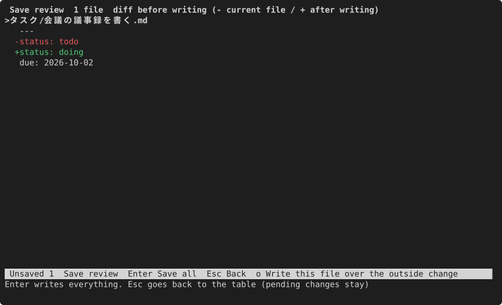

Edits are held as pending changes until `Ctrl+S`, which shows a diff per file before writing. Only the lines with changed values are written; other keys, their order, comments and the body stay byte for byte.

[Edit values and save](tasks.md#edit-values-and-save), [Write-back safety](../../safety.md)

## Edit many rows at once

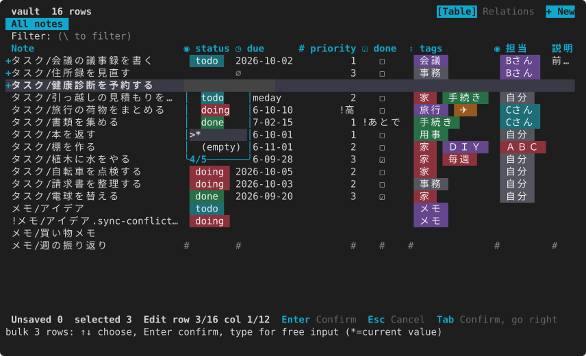

Mark rows with `Space` and set one value on all of them. Tags can be added or removed in bulk the same way, and marked rows can be handed to the next command.

[Edit many rows at once](tasks.md#edit-many-rows-at-once)

## Type dates in words

Type `tomorrow`, `next fri`, `eom` or `+2w` in a due date cell and you get that day, without counting on the calendar. As you type, the date it reads as appears next to the field, such as `2026-10-16 (Fri)`, and the calendar moves there, so you can check it before pressing Enter. Japanese words such as `明日` and `来週の金曜` work too, whatever language the screen is in. The same words work when you edit many rows at once and in filter values.

[Type dates in words](tasks.md#type-dates-in-words)

## Find, filter and sort

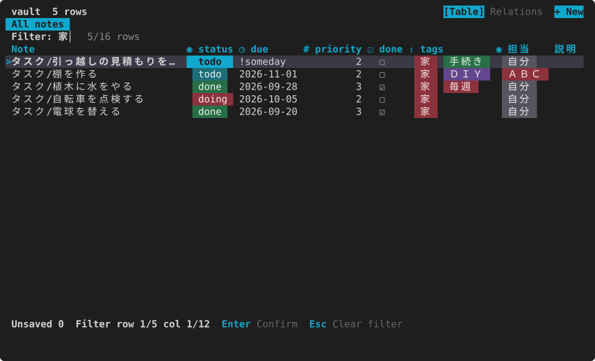

`\` narrows the rows as you type, `/` searches, `s` sorts by the column. Keep only the rows with the same value, count a column's values and keep one (`%`), hide the columns you do not need.

When a table has an order of its own, like news newest first, write it once in the workspace marker: views without a `sort`, a table without views, `--print` and the kanban cards all follow it. Sort by status from a heading and each status group stays in that order. The sort window marks those rules "default · marker", and "Back to default" brings the order back.

[Find, filter and sort](tasks.md#find-filter-and-sort), [default sort of a table](../../config.md)

## Filter with named conditions

Give a name to a condition such as "due within a week" and write it once in the config. One digit key then keeps only the matching rows, `Esc` clears them all at once, and `cond("name")` works in any expression. You can also hide rows you rarely need, such as plans far in the future, in every table. `mdgrid --count` prints how many rows match.

[Filter with named conditions](tasks.md#filter-with-named-conditions)

## Conditions and notices per ledger

"Not contacted lately" for a people ledger, "payment due soon" for a money ledger: write the conditions, notices and notifications one ledger needs in its marker, and they travel with the ledger. Digit keys start at 1 with the ledger's conditions, and the task conditions in your config stay out of ledgers that have no due date or owner columns. Put them in a starter's marker and every ledger made from it has them.

[Filter with named conditions](tasks.md#filter-with-named-conditions)

## Notices above the table

Show how many tasks are overdue, or a few lines you wrote yourself, in a small box above the header. Only people who write it in the config see it. Jump from the box straight to the rows, and print the same notices with `mdgrid --notices` for a tmux status line.

[Notices above the table](tasks.md#notices-above-the-table)

## Get notified when a row matches

Get an OS or terminal notification when a reminder time or a due date comes. Each row that starts to match a named condition is notified once, and rows that keep matching stay quiet. Register `mdgrid --notify` with your OS scheduler, and notifications arrive while mdgrid is closed too.

[Get notified when a row matches](tasks.md#get-notified-when-a-row-matches)

## Create routine runs

Write your recurring work (a weekly review, the invoices at the end of the month) as routine notes with a rule like `weekly mon`, and mdgrid makes the note for each run in another folder: "Weekly review 2026-11-23", linked back to its routine. The open screen shows the names and asks first; `mdgrid --runs` from your OS scheduler makes them while mdgrid is closed. Only the latest run is made, and nothing is overwritten.

[Create routine runs](tasks.md#create-routine-runs)

## Search across the workspace

Was that estimate in a task, or in a project note? Instead of opening one table after another, type the word into "Search across the workspace" in the palette. The matching rows from every table in the workspace show up per table, with the column and value that matched, and picking one opens its table with that row selected. The command is there only for people who turn it on in the config.

[Search across the workspace](tasks.md#search-across-the-workspace)

## Create a note

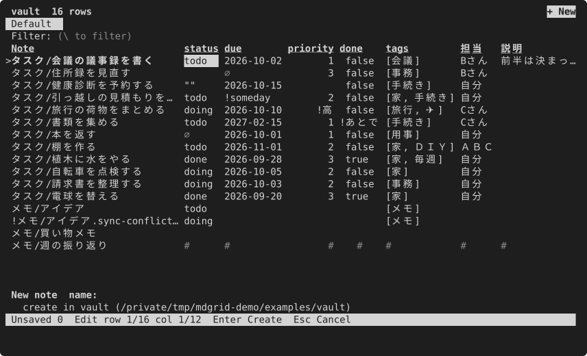

`a` (or "+ New" at the right end of the view bar) opens a form with the name and one field per column and writes one note. The fields take the same candidates and keys as editing a cell, so a link column such as a quote's source lets you pick from the notes of the linked table. The folder, the file name and the body template come from the workspace marker. It can also start the file name with today's date or a short id (`{uid}`), and put a UUID (`{uuid}`) in the frontmatter. Keep several body templates in a folder and the form lets you pick one.

[Create a note](tasks.md#create-a-note)

## Delete a note and bring it back

Press `u` right after creating a note by mistake and it moves to the trash; `Ctrl+R` brings it back. "Delete the note" does the same for a note that was already there. The file is never erased, so "Restore from the trash" still returns it to its place after you close mdgrid.

[Delete a note and bring it back](tasks.md#delete-a-note-and-bring-it-back)

## Shape a view and save it

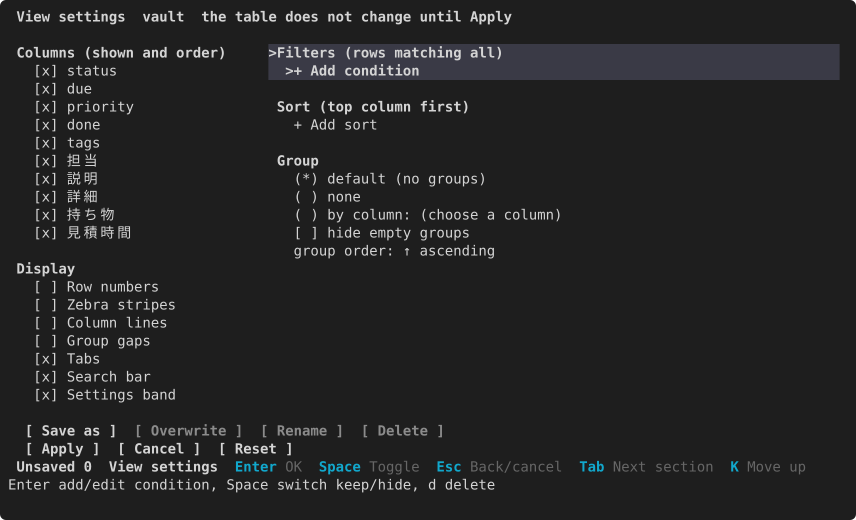

`o` sets the columns, filters, sorting, grouping and display; save it under a name and it becomes a tab. The sections are numbered, so `3` takes you straight to sorting. Choose "Set as default view" and the folder opens on that view next time.

Group by status and the groups come in the order of the column's allowed values (todo, doing, waiting, done), not the alphabet. Give those values a glyph and a name (`icons`, `labels`) and the headings, the kanban lanes, the cells and the detail view all read "○ To do". When you edit, each choice shows the value after its name ("○ To do todo"), so you see what gets written. The notes and `--print` keep `todo`.

[Shape a view and save it](tasks.md#shape-a-view-and-save-it), [Column rules](../../config.md#rules)

## Subtotals per group and number formats

Put summaries on a view grouped by month or by category, and each group heading shows that group's total on its right, lined up with the column. Folded groups keep it, so folding them all leaves a list of spending per month. The summary row under the table stays the grand total. Write `prefix = "¥"` and `thousands = true` under `[format.amount]` and the cells, the total and the subtotals all read `¥98,000`, while the notes and `--print` keep `98000`. To call "Filled 13" "Books 13", add `summary_labels` to the view.

[Number formats](../../config.md#format), [Summaries](../../obsidian-bases.md#summaries)

## See the schedule as a gantt

`C` turns the rows of the current view into bars from the start date to the due date. With parent/child rows and WBS, the numbers and the progress (the fill of the bar) stay the same, and a parent without dates gets the span of its children. `+` and `-` switch between day, week and month; `t` goes to today, and `r` switches the period between this week, this month, the quarter and everything. The bar on the bottom edge of the window (`◀ ▶`, the units, Today and the periods) does the same with a click. To reschedule, select a row and press `H` or `L` to move its bar by one unit, or `<` and `>` to shorten or extend its end. The dates are held as pending changes until you save, like edits in the table, and `u` undoes them. The start and end columns come from the marker, or are inferred from date columns named like `start` and `due`. In a table with `children` in the marker, a child bar that runs past its parent's dates puts a `!` at the end of both rows, and selecting one shows by how many days. With `gantt = "extend"`, stretching the child stretches the parent's end too.

[Gantt in the list of views](views.md#gantt), [Key bindings](../../keys.md)

## Move tasks across a kanban board

`B` shows every status at once: one lane per status, the tasks as cards. Press `L` on a todo card and it moves to doing, with its status rewritten as an unsaved change; `u` takes it back, and `Ctrl+s` shows the diff before anything is written. The lanes follow the allowed values of the status column, so an empty status still has a lane to move into.

Write `children = { key = "parent" }` in the marker's `[[table]]` and every view lists children indented under their parent. Move a parent's card to done (or set it in the table) and its unfinished children become done with it; one `u` takes it all back. You can also keep the parent open while children are left (`on_done = "refuse"`), or finish only the parent and be told how many are left (`"keep"`). Add `closed_by = "closed_by"` and the children closed together with their parent carry that mark, so setting the parent back can bring them back too (`on_reopen = "reopen"`) or ask you on the spot (`"ask"`). Children you finished yourself stay finished.

[Kanban in the list of views](views.md#kanban), [Key bindings](../../keys.md)

## Show values on kanban cards

When a card shows only a name, you keep going back to the table to see who wrote that book or when that meeting is. Write `card = ["author", "rating"]` in the marker's `kanban` and each card lists the author and the rating under the title, one per line. Dates follow your date format, values with a name in the rules show that name, and links show the name of the note they point to, just as in the table cells. Columns outside the view and computed columns work too, and a column with no value on that row gets no line.

A long title wraps onto a second line in its lane and is cut with `…` if it still does not fit. With cards of different heights, `j` and `k` scroll the lane until the selected card is fully in sight, and `H`, `L` and clicks work the same way.

[Kanban in the configuration](../../config.md), [Kanban in the list of views](views.md#kanban)

## See the numbers in a chart

`P` turns the rows of the current view into a chart: how many tasks per status, how many due dates per month, how much estimate per owner. `Tab` switches between bar, stacked bar, line, scatter and heatmap, and `x`, `y` and `b` choose the columns. `Enter` on a bar takes you back to the table with only the rows of that value, so you can go from the numbers straight to fixing the rows.

[Chart in the list of views](views.md#chart), [Key bindings](../../keys.md)

## Open a .base file

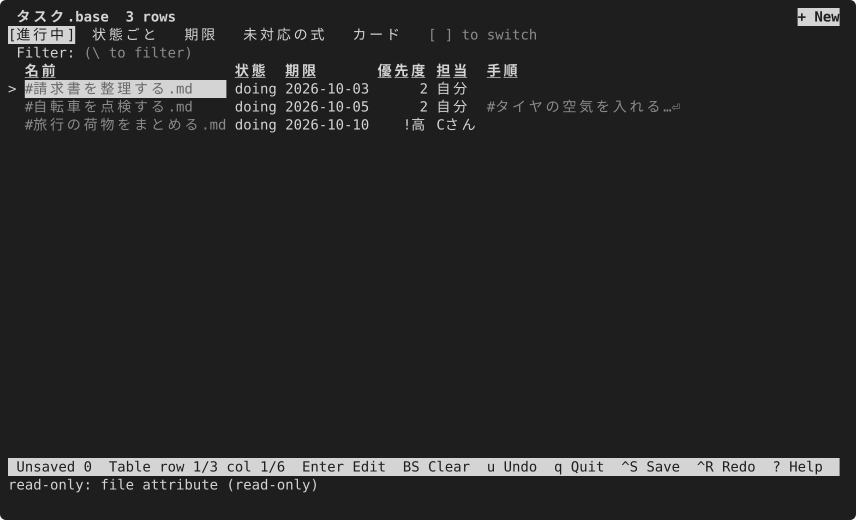

Pass a `.base` file and its table views line up as tabs. Filters, sorting, grouping, summary rows and part of the formulas are read; the `.base` is never written. You can also export the current view to a `.base`, or import a `.base` view.

[Open a .base file](tasks.md#open-a-base-file), [Obsidian Bases support](../../obsidian-bases.md)

## Link tables

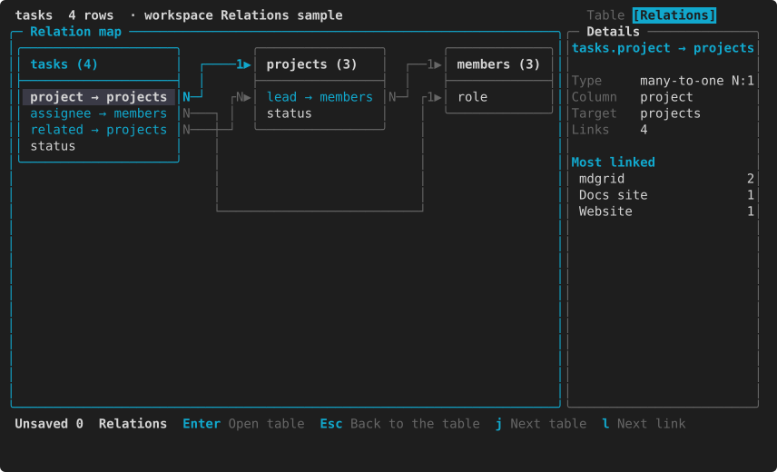

A link such as `project: "[[mdgrid]]"` turns folders into linked tables: pick a target by name, open it, list the notes that point here. Tables that belong together form a workspace, and `R` draws the relation map.

[Link tables with relations](tasks.md#link-tables-with-relations), [Group tables into workspaces](tasks.md#group-tables-into-workspaces)

## Read and gather values from linked notes

A reading note can show the author of the book it quotes, and a person can show the last day you met, taken from the meetings. A formula reads a value from the note a link points to (`source.asFile().properties.author`), and gathers values from the notes that link here, split by the column they link from: count them, or take the latest date or a total (`file.linkedFrom("attendees")` with `filter`, `map` and `max`). Nothing is written into the notes, so marking a meeting done updates the person's row too. Looked-up values look like the cells they come from: a note by its name, a date in your date format, a value with its name.

[Linked notes in Obsidian Bases support](../../obsidian-bases.md#linked-notes)

## Create a ledger from a starter

Pick "Create a ledger from a starter" from the palette (`:`), or run `--init-workspace --starter <name>`. It writes the marker, templates and samples into an empty folder, so you start with a table already shaped. Your own starters go in the same form.

[Create a ledger from a starter](tasks.md#create-a-ledger-from-a-starter)

## Use with other commands

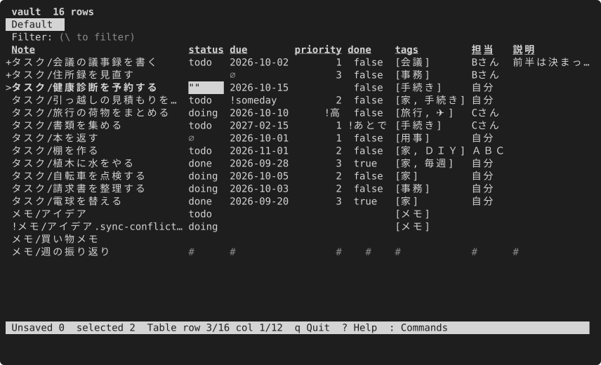

`--print` writes the table as CSV, TSV, JSON or Markdown; edit the CSV in a spreadsheet and bring it back with `--apply`; `--pick` hands the paths of the chosen notes to the next command; `--new-note` adds one note in the same shape as the form. In a ledger with several tables, add a table's name like `--table News` and every command works on that table; opening the table's folder directly gives that table too. A `.csv` or `.tsv` file opens directly as a ledger. For AI agents there is a skill that teaches these commands.

[Use with other commands](tasks.md#use-with-other-commands), [Open a CSV or TSV as a ledger](tasks.md#open-a-csv-or-tsv-as-a-ledger)

## Open read-only

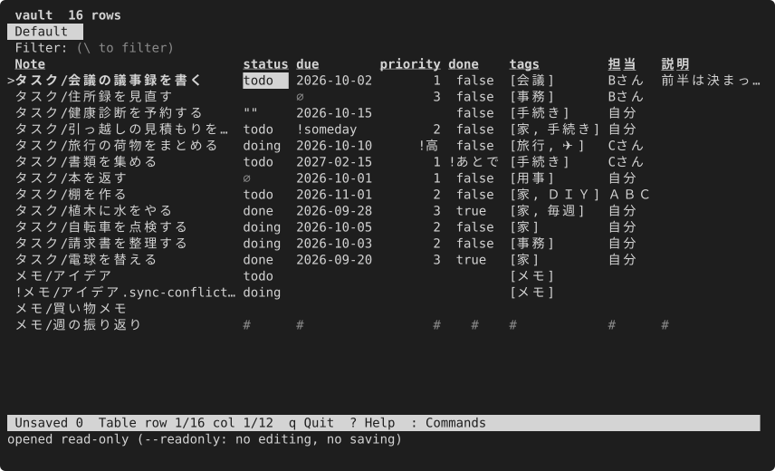

With `--readonly`, editing, saving and creating notes are off and nothing is written. Notes that cannot be written safely are read-only even in normal use: their cells show a `#`, and selecting one tells you why.

[When you cannot edit](tasks.md#when-you-cannot-edit), [Write-back safety](../../safety.md)

## Come back after the terminal is restored

In a Herdr pane, mdgrid reopens the same table and view when the Herdr server restarts, and the sidebar shows the table and view as the pane title. Elsewhere, such as in tmux, `mdgrid --continue` goes back to the last table and view opened in that folder.

[Come back to the same table when the terminal is restored](tasks.md#come-back-to-the-same-table-when-the-terminal-is-restored)

## Save what you see as a session

Give a name to the filters, sort and columns you built, and `mdgrid -s <name>` opens the table just like that. Only the setup is saved; cell values are read from the notes each time. `mdgrid --sessions` lists the names you saved.

[Save what you see as a session](tasks.md#save-what-you-see-as-a-session)

## Go back to a recent table

Go back to a table you never registered, in the view you were on. mdgrid remembers the last 20 tables you opened on the screen, newest first. **Recent tables** in the palette lists them with the view, when you last opened each and its folder. Plain `mdgrid` also shows the five newest under "Recent". In the shell, `mdgrid --recent` prints one per line, ready for fzf.

[Go back to a recent table](tasks.md#go-back-to-a-recent-table)

## Switch between favorite workspaces

Put the workspaces you go back and forth between, say work and a hobby, in your favorites. From the table, the gantt, the kanban or any other screen, `W` opens the list and one digit takes you there, to the table and view you last had open in that workspace. If you started in a plain folder, **Where you started** at the top of the list takes you back. With the mouse, clicking the workspace name in the header breadcrumb opens the same list. The workspace you are in goes into your favorites from the last line of the list, or with `a`.

[Switch between favorite workspaces](tasks.md#switch-between-favorite-workspaces), [Key bindings](../../keys.md#switch)

## Use it in nine languages

The screen, `--help`, warnings and the `--print-config` descriptions come in English, Japanese, Chinese (Simplified and Traditional), Korean, Spanish, French, German and Brazilian Portuguese. The language follows `LANG` and similar variables, or the `language` setting. Note values, column names and file names are never translated.

[The language setting](../../config.md#language)

## Choose a look

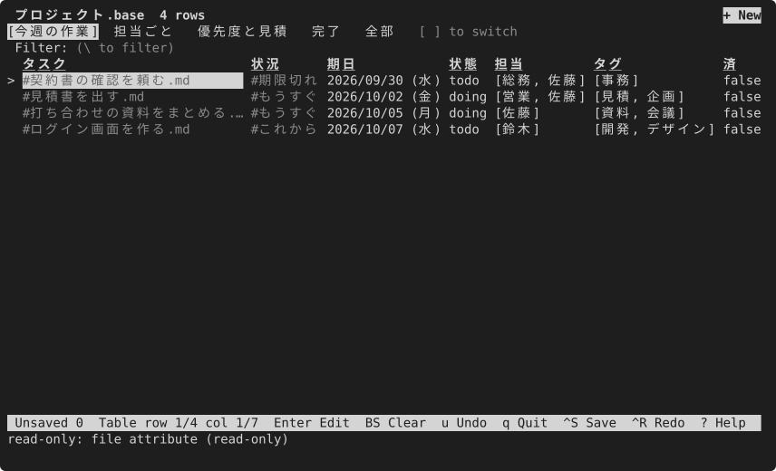

Color themes, the shape of chips and checkboxes, row numbers and column lines, the date format: all set in the config, and overridable per workspace, table or view. Compare them in the look catalog and paste the settings.

[Make it look the way you like](appearance.md), [Themes](themes.md), [Look catalog](../../catalog/index.html)

## Pick a theme on screen and choose your own colors

Press `o`, then `8`, for the Look section: pick a theme from the list and Apply shows it at once. Keep it globally and every table uses it, even a ledger whose marker names another theme. Custom, at the end of the list, starts from the current theme and lets you change the accent, the selected row and the other colors one by one, from sample colors or as `#rrggbb`.

[How to choose a theme](themes.md#how-to-choose), [Choose your own colors](themes.md#choose-your-own-colors-custom)

## Keys and the palette

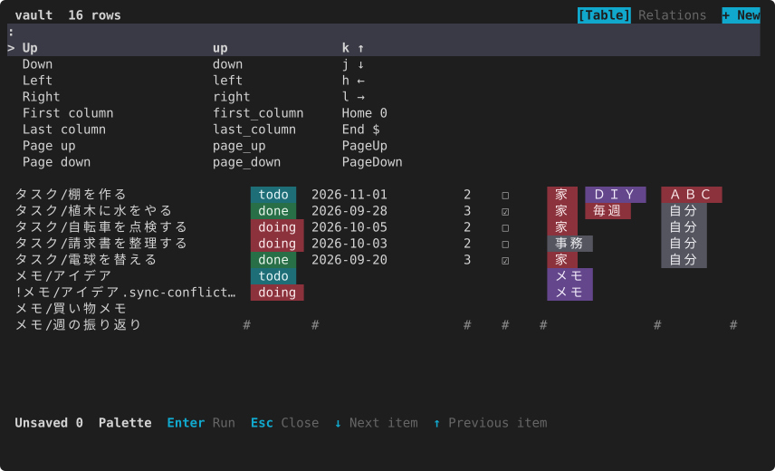

Vim keys and arrow keys both work. `x` lists what you can do on the cell, `:` finds a command by name, `?` lists every key, with the ones you can press now first: select one and press `Enter` to run it without remembering the key. Every key can be rebound.

[Key bindings](../../keys.md)

## See the keys of a window

Open the window for tags or the filter window, and its bottom edge lists the keys that work there, like `Enter Check / uncheck` and `Tab OK`. Clicking one does the same thing. Press Enter on each tag you want; the window stays open, so you can check several in a row. When you are done, press Tab or pick `[ OK ]` at the bottom.

[Key bindings](../../keys.md#list_select)

## Edit with vim keys

Write `vim = true` under `[keys]` in the config, and every input box gets vim's two modes. You start typing as usual; Esc switches to normal mode, where `w` and `b` jump by word and `dw` or `cw` fix a whole word. In the table, `dd` moves a note to the trash, `p` puts the value you copied with `y`, and `.` puts the last value into the next row too.

[Edit with vim keys](tasks.md#edit-with-vim-keys), [Key bindings](../../keys.md#input_normal)

## Stack tables

Compare two tables, such as tasks and projects, on one screen without switching back and forth. **Stack a table below** in the palette lists the tables of the current workspace and puts the one you pick below the current table. `Ctrl+w` `j` and `k` move between them, and finding, filtering, views and edits act only on the table marked with `▶`. Edits from every table pile up in one set of changes, and `Ctrl+S` shows one diff with a heading per table before it writes. Give an arrangement you like a name and it becomes a page you can open from the drawer or with `mdgrid -w <workspace> --page <name>`.

[Stack tables](tasks.md#stack-tables), [Key bindings](../../keys.md#table)
