# Task guides

[日本語](../ja/tasks.md) · [Contents](index.md)

- [Task guides](#task-guides)
  - [Edit values and save](#edit-values-and-save)
  - [Find, filter and sort](#find-filter-and-sort)
  - [Filter with named conditions](#filter-with-named-conditions)
  - [Notices above the table](#notices-above-the-table)
  - [Create routine runs](#create-routine-runs)
  - [Search across the workspace](#search-across-the-workspace)
  - [Edit many rows at once](#edit-many-rows-at-once)
  - [Type dates in words](#type-dates-in-words)
  - [Edit with vim keys](#edit-with-vim-keys)
  - [Create a note](#create-a-note)
  - [Open a .base file](#open-a-base-file)
  - [Shape a view and save it](#shape-a-view-and-save-it)
  - [Give a folder its own command](#give-a-folder-its-own-command)
  - [Register the tables you use and switch between them](#register-the-tables-you-use-and-switch-between-them)
  - [Save what you see as a session](#save-what-you-see-as-a-session)
  - [Come back to the same table when the terminal is restored](#come-back-to-the-same-table-when-the-terminal-is-restored)
  - [Go back to a recent table](#go-back-to-a-recent-table)
  - [Switch between favorite workspaces](#switch-between-favorite-workspaces)
  - [Link tables with relations](#link-tables-with-relations)
  - [Group tables into workspaces](#group-tables-into-workspaces)
  - [Stack tables](#stack-tables)
  - [Use with other commands](#use-with-other-commands)
  - [Choose a theme](#choose-a-theme)
  - [When you cannot edit](#when-you-cannot-edit)

`mdgrid` in the examples is the `target/release/mdgrid` you built, and `/tmp/mdgrid-sample` is the sample root folder copied in [Getting started](getting-started.md#open-the-sample-root-folder).

## Edit values and save

1. Select a cell and press `Enter`. The input depends on the column's type:
   - Text: pick from the values other notes have in this column (when there are at most `candidates` distinct values, 20 by default; otherwise just type), or type a new one.
   - Date: a calendar opens. `←` `→` move by day, `↑` `↓` by week, `PageUp` and `PageDown` by month. You can also type `2026-10-15`, `+3` for three days from today, or words such as `next fri` ([Type dates in words](#type-dates-in-words)). `Ctrl+T` is today.
   - Date and time: the same calendar, with a time field under it. `Ctrl+O` switches to the time field, where `↑` `↓` move 15 minutes and `Shift+↑` `Shift+↓` one hour. Changing only the day keeps each note's time; you can also type `2026-10-15T09:30`.
   - List (such as `tags`): toggle values from the list of values found in the root folder.
   - Checkbox: each `Enter` cycles empty → true → false → empty.これ
   - Number: only values that read as numbers are accepted.
2. Press `Enter` to confirm, `Esc` to cancel, or `Tab` to confirm and move right.
3. The edited cell is marked and `Unsaved` in the bottom bar goes up. Nothing is written yet. `u` undoes, `Ctrl+R` redoes.
4. `Ctrl+S` (or `:w`) opens the save review: a before/after diff for each file.
5. `Enter` writes everything. `Esc` goes back to the table without writing; the pending changes stay.

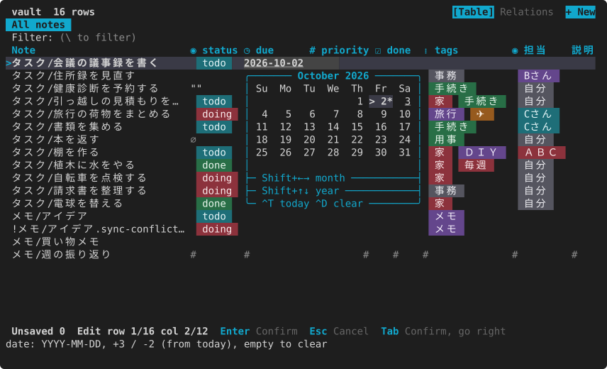

Date and time columns add a time field under the calendar (here on the meetings of the sample, `examples/studio/Meetings`). `Ctrl+O` switches to it; `↑` `↓` move 15 minutes and `Shift+↑` `Shift+↓` one hour.

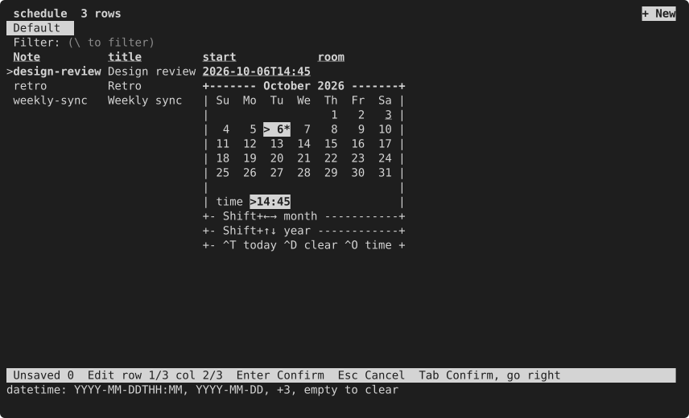

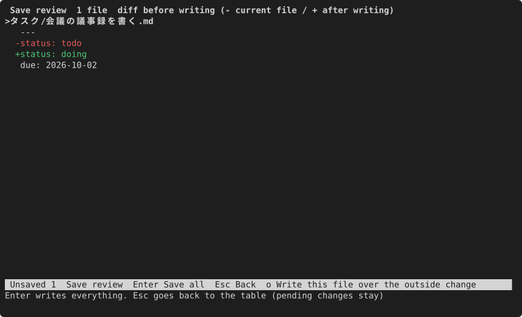

- To empty a cell press `Backspace` or `Delete`. Saving writes `key:` and keeps the key.
- `q` with unsaved changes asks: `s` save and quit, `d` discard and quit, `Esc` back.
- `K` shows every property of one note (details), long values in full; `Enter` edits one.
- Edit the body or values with line breaks in your editor with `e`; mdgrid re-reads the note when you return. The editor is the `editor` setting, else `$VISUAL`, `$EDITOR`, then `vi`.

mdgrid writes only the values you changed. A missing key gets one added line, and a note without frontmatter gets frontmatter added at the top (the body is untouched). If a note changed on disk before you save, the review shows it and lets you choose to write over it (`o`). The details are in [Write-back safety](../../safety.md).

If your notes live in a git repository, mdgrid can go on to git after a save. Set it in the config file (`config.toml`); by default it does nothing.

```toml
[git]
auto = "commit"    # off, add, commit or push (how far to go)
when = "save"      # save (after every save) or quit (once at exit)
message = "auto"   # auto (an automatic message) or ask (a one-line field after each save)
```

Only the notes mdgrid wrote (or created from the screen) enter the commit; other changed files are left alone. If git fails, the save stays done and one line says why. The items are described under [`[git]`](../../config.md#git--git-after-a-save).

## Find, filter and sort

| To | Keys |
|---|---|
| highlight a word and move between matches | `/`, type, `Enter`; then `n`, `N` |
| keep only rows containing a word | `\` and type (filters as you type and shows the count); `Esc` clears |
| keep only rows with the selected cell's value | `,` (`*` only highlights them) |
| sort by this column | `s` or click the heading (ascending → descending → off) |
| build a sort (several columns, directions, order) | `S` or the **Sort** button at the right of the filter bar |
| go to a row number | `:`, the number, `Enter` |
| hide a column / show it again | `-` / `+` |
| move a column / change its width | `H` `L` / `<` `>` |
| freeze the columns on the left while scrolling | `F` |

Search ignores case when the word is all lowercase. `Esc` clears the selection first, then the filter, then the search highlight.

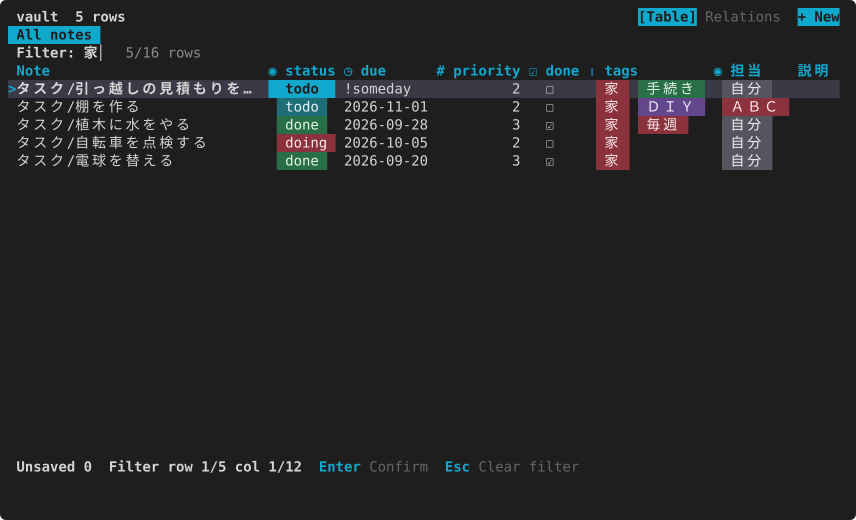

A sort is kept for the current view, so the table opens in the same order next time (the `.base` file is not changed). In the sort window you can add a rule (`Enter`, then pick a column), flip its direction (`Enter`), remove it (`d`) and reorder (`K`, `J`); every change applies right away. The quick filter `\` is temporary. To keep more, see [Shape a view and save it](#shape-a-view-and-save-it).

## Filter with named conditions

Write a condition you use often once, with a name, under `[conditions]` in the config. The [configuration reference](../../config.md#conditions--named-conditions) has every item.

```toml
[conditions.week]
expr = 'due <= today() + "7d" && status != "done"'
label = "Due this week"
key = 1
```

| To | Do |
|---|---|
| keep only the matching rows, or all rows again | press the condition's digit key (`1` above); two digits keep the rows that match both |
| combine it with other expressions | call it by name in an expression, as in `cond("week") && priority > 1` |
| filter by an expression now | `:`, pick "Filter by an expression", type it and press `Enter` (an empty one clears it) |
| always apply it in a view | in the filter section of `o`, set the condition to "only these" or "hide these" and apply |
| hide the matching rows everywhere | add `hide = true`; the settings band shows how many are hidden, and the condition's digit key shows them again |
| print how many rows match | `mdgrid --count --filter 'cond("week")'` (for a tmux status line or a shell prompt) |

Digit keys and the expression filter stay on when you switch views, and clear when you go to another table or open mdgrid again. Removing the item from the settings band clears them too.


## Notices above the table

Write `[[notices]]` in the config to get a notice box above the header. A count item counts the rows that match a [named condition](#filter-with-named-conditions); a note item shows the first lines of a note's body. The [configuration reference](../../config.md#notices--the-notice-box) has every item.

```toml
[[notices]]
cond = "overdue"
text = "{count} overdue"
scope = "workspace"

[[notices]]
note = "~/notes/inbox.md"
lines = 2
```

| To | Do |
|---|---|
| move into the box | `m` (or click it); `Left` and `Right` pick an item, `Esc` goes back to the table |
| see the rows | `Enter` on a count item: it narrows this table to the condition, or lists the tables with matching rows when it counts other tables too |
| add to your note | `Enter` on a note item opens the note in your editor; the box is read again when you come back |
| print it elsewhere | `mdgrid --notices` (one item per line, for a tmux status line, a shell prompt or the Herdr sidebar) |

The numbers are counted again when you open the table, after a save, when a note changes outside mdgrid and when the date changes. Items that count other tables show the table first and count in the background, with "…" until they are done.


## Get notified when a row matches

Write `[[notify]]` in the config to get notified, one row at a time, when a row starts to match a [named condition](#filter-with-named-conditions). Put the time you want to be reminded in a `remind` column, and an OS notification comes at that time. The [configuration reference](../../config.md#notify--notifications) has every item.

```toml
[conditions.remind]
expr = 'remind <= now() && status != "done"'
label = "Remind"

[[notify]]
cond = "remind"
text = "{title} (due {due})"
to = ["desktop", "terminal"]
```

| Destination | Where it shows |
|---|---|
| `"desktop"` (the default) | the OS notification; macOS, Windows and WSL use what the OS already has, Linux uses `notify-send` |
| `"terminal"` | your terminal's notification (iTerm2, kitty, Ghostty, WezTerm, foot, Windows Terminal); other terminals ring the bell. Inside tmux, turn on `set -g allow-passthrough on` |
| `"command"` | your own command (`command = ["program", "{title}", "{text}"]`), for example a tool that sends it to your phone |

A row is notified once, when it starts to match. It stays quiet while it keeps matching, and is notified again if it stops matching and later matches again. The rows that already match when you write the config are remembered without a notification. When four or more rows start to match at once, they arrive as one notification ("4 new"). While mdgrid is open, it checks when you open a table, after you save and every minute. If a notification can't be delivered, the reason shows at the bottom of the screen.

On macOS the notifications come from Script Editor, on Windows and WSL from Windows PowerShell. If you don't see them, allow that app in the OS notification settings.

**Get notified while mdgrid is closed**: `mdgrid --notify` checks once without the screen and sends the notifications. Register it with your OS scheduler, and notifications arrive while mdgrid is closed too. It shares its record with the open screen, so a row is never notified twice even when both check. If a notification can't be delivered, it prints the reason to standard error and exits with code 1.

The examples below all run every 5 minutes. Replace `home` with the name of your workspace and `/path/to/mdgrid` with what `command -v mdgrid` (`where mdgrid` on Windows) prints. A scheduler doesn't read your shell's settings, so if your shell changes `XDG_CONFIG_HOME` or similar, pass the config file with `--config` as well.

Linux (a systemd user timer): put two files in place and turn the timer on.

```ini
# ~/.config/systemd/user/mdgrid-notify.service
[Unit]
Description=mdgrid notify

[Service]
Type=oneshot
ExecStart=/path/to/mdgrid -w home --notify
```

```ini
# ~/.config/systemd/user/mdgrid-notify.timer
[Unit]
Description=mdgrid notify every 5 minutes

[Timer]
OnCalendar=*:0/5
Persistent=true

[Install]
WantedBy=timers.target
```

```sh
systemctl --user daemon-reload
systemctl --user enable --now mdgrid-notify.timer
```

From cron, OS notifications may not arrive, because cron's environment doesn't know where the desktop's notifications go (`DBUS_SESSION_BUS_ADDRESS`). If you use cron, pass it on the line (replace `1000` with what `id -u` prints).

```sh
*/5 * * * * DBUS_SESSION_BUS_ADDRESS=unix:path=/run/user/1000/bus /path/to/mdgrid -w home --notify
```

macOS (launchd): put `~/Library/LaunchAgents/local.mdgrid.notify.plist` in place and load it.

```xml
<?xml version="1.0" encoding="UTF-8"?>
<!DOCTYPE plist PUBLIC "-//Apple//DTD PLIST 1.0//EN" "http://www.apple.com/DTDs/PropertyList-1.0.dtd">
<plist version="1.0">
<dict>
  <key>Label</key>
  <string>local.mdgrid.notify</string>
  <key>ProgramArguments</key>
  <array>
    <string>/path/to/mdgrid</string>
    <string>-w</string>
    <string>home</string>
    <string>--notify</string>
  </array>
  <key>StartInterval</key>
  <integer>300</integer>
</dict>
</plist>
```

```sh
launchctl bootstrap gui/$(id -u) ~/Library/LaunchAgents/local.mdgrid.notify.plist
```

Windows (Task Scheduler): register it from the Command Prompt. A console window flashes each time it runs.

```bat
schtasks /Create /TN "mdgrid notify" /SC MINUTE /MO 5 /TR "C:\path\to\mdgrid.exe -w home --notify"
```

WSL (from the Windows Task Scheduler): cron inside WSL only runs while WSL is up, so call it from the Windows side. `wslg.exe` is the `wsl.exe` that opens no window, and comes with current WSL. Replace `Ubuntu` with the name `wsl -l` shows.

```bat
schtasks /Create /TN "mdgrid notify" /SC MINUTE /MO 5 /TR "wslg.exe -d Ubuntu --exec /path/to/mdgrid -w home --notify"
```

## Create routine runs

Write each piece of recurring work (a weekly review, the invoices at the end of the month) as a routine note, and the note for each run ("Weekly review 2026-11-23") appears in another folder. A run note is an ordinary note: it shows in the table, the kanban and the gantt as it is, and whether you finished it stays with that run.

In the ledger's marker `.mdgrid/workspace.toml`, add `runs` to the `[[table]]` of the routine table. `folder` is where the run notes go, and `rule` is the column that holds the rule. The [configuration reference](../../config.md#overrides-per-workspace-table-and-view) has every item.

```toml
[[table]]
name = "Routines"
path = "Routines"
runs = { folder = "Runs", rule = "recurrence", set = { status = "todo" }, copy = ["actor"] }
```

```markdown
---
recurrence: weekly mon
actor: both
---
```

Write one of these in the rule column. The English and the Japanese forms make the same runs.

| Rule | Date of the run |
|---|---|
| `daily`, `毎日` | every day |
| `weekly mon thu`, `毎週 月 木` | those weekdays (`mon` to `sun`, `月` to `日`); list as many as you like |
| `monthly 1 15`, `毎月 1日 15日` | those days; a month without a 31st has no run on the 31st |
| `monthly last`, `毎月 末日` | the last day of the month |
| `every 3d`, `3日ごと` | every 3 days from the date in the `start` column |

A note with an empty rule column is a routine that makes no runs. A rule that can't be read (`weekly someday`) gets a reason with the note's name and the value, and the other routines still make their runs.

A run note is named like `Runs/Weekly review 2026-11-23.md`. Its frontmatter has the link `routine: "[[Weekly review]]"`, the run's date `date`, and the `set` and `copy` values, and its body starts with a heading of the run's name. The `name` and `body` templates change the name and the body.

Only the latest run up to today is made, so after a while away you don't come back to a pile of runs you can no longer do. Each run is made once, and a note that already has the same name is never overwritten. Delete a run note you don't need, and that run counts as done: it isn't made again.

While mdgrid is open, it checks when you open a table and when the date changes. When runs are due, the bottom band says "2 routine runs are due". Click it, or pick **Create the routine runs** (`routine_runs`) in the palette (`:`), and the names of the notes to create are listed. Type `y` and Enter to create them; any other answer or Esc leaves them, and those runs aren't mentioned again that day. Opened read-only (`--readonly`), mdgrid shows neither the count nor the command.


**Create runs while mdgrid is closed**: `mdgrid <ledger> --runs` (`mdgrid -w <name> --runs` for a workspace) creates every due run without the screen and without asking, and prints the path of each note it created, one per line. It shares its record with the open screen, so a run is never made twice even when both check. A run it can't create gets its reason on standard error and exit code 1, and the next call tries again. Registering it with your OS scheduler counts as saying yes to those notes.

The examples below call `--runs` every 5 minutes and then [`--notify`](#get-notified-when-a-row-matches), so a new run note that matches a notification condition is notified in the same pass. If you already registered `--notify`, replace that registration with this one. Without `--notify`, drop that part; you can also make the interval longer, such as every hour. Replace `/path/to/notes` with the ledger's folder and `/path/to/mdgrid` with what `command -v mdgrid` (`where mdgrid` on Windows) prints.

Linux (a systemd user timer): put two files in place and turn the timer on. The `-` in front of the `--runs` line lets `--notify` run even when a run couldn't be created.

```ini
# ~/.config/systemd/user/mdgrid-routine.service
[Unit]
Description=mdgrid routine runs

[Service]
Type=oneshot
ExecStart=-/path/to/mdgrid /path/to/notes --runs
ExecStart=/path/to/mdgrid /path/to/notes --notify
```

```ini
# ~/.config/systemd/user/mdgrid-routine.timer
[Unit]
Description=mdgrid routine runs every 5 minutes

[Timer]
OnCalendar=*:0/5
Persistent=true

[Install]
WantedBy=timers.target
```

```sh
systemctl --user daemon-reload
systemctl --user enable --now mdgrid-routine.timer
```

From cron, pass the address of the desktop notifications, as for [notifications](#get-notified-when-a-row-matches) (replace `1000` with what `id -u` prints).

```sh
*/5 * * * * /path/to/mdgrid /path/to/notes --runs; DBUS_SESSION_BUS_ADDRESS=unix:path=/run/user/1000/bus /path/to/mdgrid /path/to/notes --notify
```

macOS (launchd): put `~/Library/LaunchAgents/local.mdgrid.routine.plist` in place and load it. It hands both calls to `/bin/sh`, one after the other.

```xml
<?xml version="1.0" encoding="UTF-8"?>
<!DOCTYPE plist PUBLIC "-//Apple//DTD PLIST 1.0//EN" "http://www.apple.com/DTDs/PropertyList-1.0.dtd">
<plist version="1.0">
<dict>
  <key>Label</key>
  <string>local.mdgrid.routine</string>
  <key>ProgramArguments</key>
  <array>
    <string>/bin/sh</string>
    <string>-c</string>
    <string>/path/to/mdgrid /path/to/notes --runs; /path/to/mdgrid /path/to/notes --notify</string>
  </array>
  <key>StartInterval</key>
  <integer>300</integer>
</dict>
</plist>
```

```sh
launchctl bootstrap gui/$(id -u) ~/Library/LaunchAgents/local.mdgrid.routine.plist
```

Windows (Task Scheduler): register it from the Command Prompt. `cmd /c` runs the two calls one after the other. A console window flashes each time it runs.

```bat
schtasks /Create /TN "mdgrid routine" /SC MINUTE /MO 5 /TR "cmd /c C:\path\to\mdgrid.exe C:\path\to\notes --runs & C:\path\to\mdgrid.exe C:\path\to\notes --notify"
```

WSL (from the Windows Task Scheduler): from the Windows side, hand both calls to `sh` inside WSL. Replace `Ubuntu` with the name `wsl -l` shows.

```bat
schtasks /Create /TN "mdgrid routine" /SC MINUTE /MO 5 /TR "wslg.exe -d Ubuntu --exec sh -c \"/path/to/mdgrid /path/to/notes --runs; /path/to/mdgrid /path/to/notes --notify\""
```

## Search across the workspace

When you can't remember which table a row is in, search every table of the [workspace](#group-tables-into-workspaces) at once. Without a workspace open, mdgrid searches your [registered tables](#register-the-tables-you-use-and-switch-between-them). Turn it on in the config first; without it the palette doesn't show the command.

```toml
[search]
across = true
```

1. Open the palette with `:` and pick "Search across the workspace" (`across_search`).
2. Type a word and press `Enter`. Results show up as each table is read, with "read 3 / 5" until all are done.
3. Pick a row with `Up` and `Down` and press `Enter`. Its table opens with the word in the search box and that row selected.

The results are grouped per table, and each row shows the note name and the column and value that matched. A row matches the same way as in the search box (`\`): without a capital letter in the word, case doesn't matter. `Esc` stops at any point and leaves you in the table you were in. Tables that cannot be read are skipped and named at the end. If you have unsaved changes, mdgrid asks whether to save first, as when you switch tables from the drawer.


## Edit many rows at once

To rename a note, use **Rename the note** in the action menu (`x`) or the palette (`:`). Links to the old name (`[[old name]]`) are rewritten as pending changes; review the diff with `Ctrl+S` and save.

1. Mark rows with `Space` (it marks and moves down). `v` marks a range, `Ctrl+A` all rows.
2. On one of the marked rows, open the cell of the column to change with `Enter` and choose the value.
3. Every marked row gets the same value. Rows that cannot take it (read-only notes, for example) are skipped, with the count and the reason.

In a list column, a value every row has shows as `[x]` and a value only some rows have as `[-]`. Each row keeps its other items.

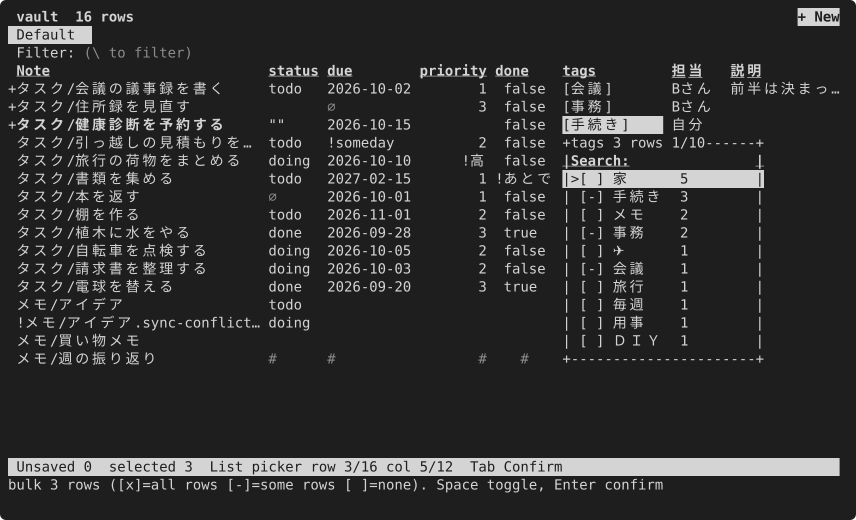

Nothing is written until you save, so the `Ctrl+S` diff lets you check all of it at once.

## Type dates in words

Date and datetime cells take date words as well as `2026-10-15` and `+3`. Type `next fr` and the field shows "not a date" next to it; add `i` and it changes to `2026-11-27 (Fri)`, with the calendar on that day. `Enter` makes it a pending change. If the words cannot be read, `Enter` keeps the field open and nothing is written to the note.


These are the words it reads, with the day each one gives when today is Saturday 2026-11-21. Japanese words work in any screen language.

| Type | Day |
|---|---|
| `today`, `tomorrow`, `yesterday`, `今日`, `明日`, `明後日`, `昨日` | 11-21, 11-22, 11-20, 11-21, 11-22, 11-23, 11-20 |
| `in 3 days`, `3d`, `+3d`, `3日後` | three days later (11-24) |
| `3 days ago`, `-2d`, `2日前` | that many days before (`-2d` is 11-19) |
| `in 2 weeks`, `+2w`, `2週間後` | two weeks later (12-05) |
| `in 1 month`, `+1m`, `1か月後`, `+1y`, `1年後` | the same day of the month (or the month's last day) |
| `fri`, `friday`, `金曜`, `金曜日` | the first Friday after today (11-27) |
| `this fri`, `今週の金曜` | Friday of this week (11-20) |
| `next fri`, `来週の金曜` | Friday of next week (11-27) |
| `next week`, `来週` | the first day of next week (11-22) |
| `next month`, `来月` | the first day of next month (12-01) |
| `eom`, `end of month`, `月末` | the last day of this month (11-30) |
| `end of next month`, `来月末` | the last day of next month (12-31) |

Weeks follow the [`dates.week_start`](../../config.md#datesweek_start) setting (Sunday by default). With `week_start = "mon"`, `this mon` typed on Sunday 11-22 gives 11-16.

In a datetime column, words change only the day and keep the time: `tomorrow` in a `2026-11-21T15:00` cell gives `2026-11-22T15:00`.

The same words work when you edit marked rows at once. In a filter value (`due` "< before" `tomorrow`, for example), the words become a date when you type them, using today's date, and the condition keeps that date: opening it tomorrow still filters on the same day.

## Edit with vim keys

If your fingers know vim, Esc closing the input and having no way to delete a word get in the way every time you fix a cell. Put this in your config file (`~/.config/mdgrid/config.toml`) and mdgrid's input boxes get vim's two modes:

```toml
[keys]
vim = true
```

Every one-line input box (a cell after `Enter`, the `/` find box, the `\` search box, the `:` palette, the name of a new note) opens in insert mode, and you type as usual. Esc keeps the box open and switches to normal mode: the bottom band changes from `-- INSERT --` to `-- NORMAL --` and the cursor becomes a block.

In normal mode, `h` `l` `0` `$` move by character and `w` `b` `e` by word. Words break where vim breaks them. `x` `X` `D` `dd` delete, `cw` `C` `cc` delete and let you type again, and `i` `a` `I` `A` go back to insert mode. `u` undoes your edits in the box one at a time. Esc again cancels the input, and Enter confirms in either mode.

The table gets three keys too.

- `dd` moves the note of the selected row to the trash after confirming its name. If you marked rows with `Space` or selected a range with `v`, it moves all of them (with a range selected, `d` alone is enough). One `u` brings them all back.
- `p` puts the value you last copied in mdgrid: a cell copied with `y` goes into the selected cell, a row copied with `Y` into the columns of the same name. `file.name` and computed columns stay as they are.
- `.` puts the value you last set in a single cell into the same column of the selected row. Set status to `done`, then `j` `.` `j` `.` marks the next rows done as well.

Values put with `p` and `.` are pending changes, so you check them in the `Ctrl+S` diff before anything is written. Counts such as `5j` are not used; digit keys are left for other features. The added keys are listed in [Key bindings](../../keys.md#input_normal), and you can rebind or remove them under `[keys.table]` and `[keys.input_normal]` like any other key.

The palette's `q!` throws the pending changes away and quits without asking. It works with or without vim mode.

## Create a note

1. Press `a`, or click `+ New` at the right end of the view bar. A form opens with the name and a field for each column.
2. Type a name. `sub/name` creates it in a subfolder (made if missing). `Enter` and `Tab` move to the next field, `Shift+Tab` back. With the mouse, click a field's row to move to it; the keys on the bottom row of the window (Create, Cancel and so on) and the candidates can be clicked too. With `name_head = "hide"`, the name prefix from `[new_note] name` (a date, for example) is not shown in the name field and is added when the note is made (`"show"`, the default, puts it in the field); each field takes the input for its type (candidates, calendar, list).
3. Press `Ctrl+S` from any field (or `Enter` on the last one). The file is created at once and its row is selected. `Ctrl+E` creates it and opens it in your editor.

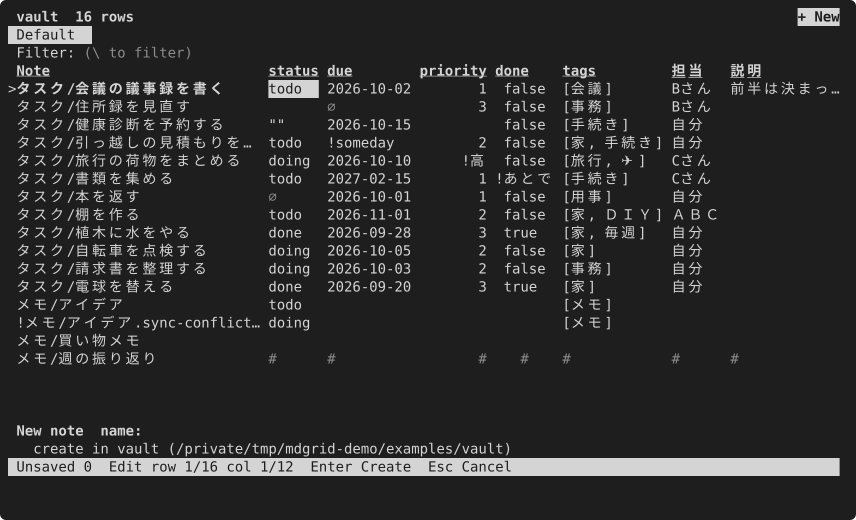

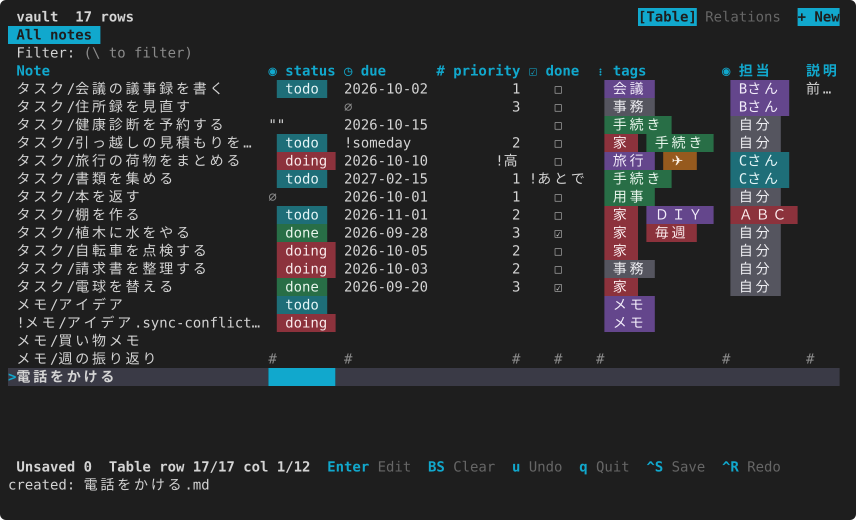

- With two or more folders open, you choose the folder first.
- In a view filtered to a single value, such as `status == "doing"`, the new note gets that value and stays in the view.
- mdgrid does not create notes outside the opened folders or over an existing name, and not at all with `--readonly`.
- The fields, required fields, preset values (with variables such as `{date+7}` or `{now}`), hidden values such as a creation date, a body template, and whether to use the form or go straight to the editor (`mode = "editor"`) are set in [`new_note`](../../config.md#new_note).

You can also create a note from the command line, without the screen. Scripts and AI agents can add tasks this way.

```sh
mdgrid ~/notes/tasks --new-note "Buy milk" --set due=2026-11-20 --set priority=p1 --set tags=home,errand
```

- It uses the same settings as the form (the folder, preset values and body template of `new_note`) and prints the path of the note it created.
- `--set column=value` is the same as typing into a field of the form, and can be repeated. The value is read by the column type. Separate list items with commas; an empty value (`--set status=`) leaves the column out.
- For an existing name, a name outside the folder, a value that does not fit the type, or an empty required column, it creates nothing, prints one line with the reason and exits with code 2.

## Delete a note and bring it back

If you created a note by mistake, press `u` right after creating it. The file is not erased: it moves to `.trash/` (the trash) inside the opened folder. If you want it after all, `Ctrl+R` puts it back where it was.

To clear away a note that was already there:

1. On its row, choose "Delete the note" from the action menu (`x`) or the palette (`:`).
2. Check the name, then type `y` and press `Enter`. The note moves to the trash and its row leaves the table. Any other answer, or `Esc`, does nothing.
3. To undo, press `u`. The note returns to its place and its row is selected.


After you close mdgrid you can still get a note back with "Restore from the trash" in the palette. It lists the notes in the trash with their name, original place and the time they were deleted; pick one and press `Enter`.


- If a note with the same name already exists at the original place, nothing is restored and mdgrid tells you. Neither note changes.
- A note with pending changes cannot be deleted. Save them or undo them with `u` first.
- If other notes link to the note, the confirmation shows how many. The links are not rewritten.
- mdgrid never empties the trash. To clear it, delete `.trash/mdgrid/` with your file manager.
- Deleting and restoring are not available with `--readonly` or in CSV and TSV tables.

## Open a .base file

```sh
mdgrid /tmp/mdgrid-sample/Tasks.base
mdgrid /tmp/mdgrid-sample/Tasks.base --view "This week"
```

The table views of the `.base` appear as tabs, and the first one (or the one named by `--view`) opens. Switch with `[` and `]`. mdgrid reads filters, order, sort, groupBy, limit, displayName and formulas; `Enter` on a group heading folds the group.

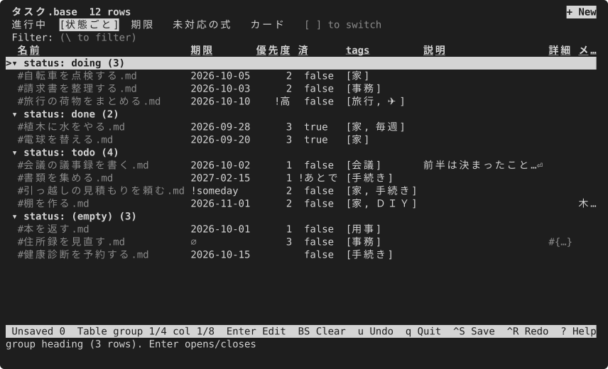

- A formula mdgrid cannot evaluate shows a dim `?` instead of a guess; select it to see which formula.
- Views other than table (cards, for example) do not open; mdgrid says why.
- mdgrid never rewrites a `.base` file.

What mdgrid reads — keys, operators, functions — is listed in [Obsidian Bases support](../../obsidian-bases.md).

## Open a CSV or TSV as a ledger

```sh
mdgrid /tmp/mdgrid-sample/equipment.csv
```

Pass one `.csv` or `.tsv` file and mdgrid opens it as a table: the first line names the columns, each following line is a row. Editing values, undo, the diff before saving, filters, sorting, grouping, saved views and `--print` work as they do for a folder of notes.

- Saving rewrites only the characters of the values you changed. Other lines, the quoting, the line endings (LF or CRLF) and a leading BOM stay as they were. A value is quoted only when it contains `,`, `"` or a line break.
- It is one file, so however many rows you change, the save review shows one diff for the file and writes it once. If the file changed elsewhere after you opened it, mdgrid does not write.
- `a` adds an empty row at the end of the file (written right away) and opens the input on its first column.
- Only UTF-8 is read. A Shift_JIS file, for example, does not open and mdgrid says why (save it as UTF-8 to open it). A line whose number of values differs from the header is read-only; select it to see why.
- Features that only make sense for notes (open in the editor, rename the note, rename or remove a key, add a column, links and the relation map, parent and child rows, export to `.base`) are not shown, and their keys only say why.
- Line endings may be LF or CRLF. A file whose lines end with a lone CR does not open; mdgrid says why. A repeated column name becomes `name#column number` from the second one on, and an empty one becomes `#column number`.
- With `--print --with-path` the path is the file and the row number, like `ledger.csv#2`, and `--apply` brings changes back to that row.
- Links between a CSV and notes (relations) are not supported yet. You can register a CSV table in the list of tables or a workspace and open it from there, but it is left out of links and the relation map.

## Shape a view and save it

`o` opens the view settings. The sections are listed on the left with numbers, and the right side shows the items of the one you picked. Press `3` to jump straight to Sort, or `Tab` to step through them in order. `h` moves into the list, where `j` and `k` pick a section and the right side follows along; `l` or `Enter` takes you back to the items. The side your keys work on has the `>` mark. The sections:

- Columns: which columns to show, and their order
- Filters: add conditions. Choosing a column lists its values with counts, and you tick the values to keep or hide
- Sort and group
- Tree (parent/child): when on, child notes with `parent: "[[Parent]]"` (the key can be changed) are indented under their parent. `Z` or a click on ▾ / ▸ folds or unfolds a parent. Sorting works among siblings, and a child whose parent is not in the table stays at the top level. With grouping, a child that lands in a different group from its parent gets `↳` before its name instead of an indent. In the same section, turn on WBS to number the rows (`1.2.1`) and build a table of values for the progress key (default `status`): type a percent and a label for each value (for example `100 Done`; `-` removes it). Rows without children show the label, parents show the average percent of their descendants. The table is saved with the view settings
- Display: row numbers, zebra stripes, column lines, tabs, the search bar, the settings band
- Views: the tabs above the table. `Space` shows or hides a tab, `K` / `J` move it, `Enter` makes it the default, renames or deletes it, and the last row turns the "[ ] to switch" hint on or off. These changes are saved to `views.toml` right away, without `Apply` (the view you are on cannot be hidden, and `.base` views cannot be renamed or deleted)
- Look: choose where to save ("Save to": global, this workspace, this table or this view), then pick the theme, parts and round pill ends with `Enter`; the theme and parts show where their current value comes from, such as `(this table)`. `Apply` shows them and keeps them in that place (`ui.toml`, `workspaces.toml`, `views.toml` or the view settings; `config.toml` and the workspace marker are never rewritten). "+ Save this look as a template" names the combination; pick a template to use it, `d` deletes it. "Remove the override of this place" goes back to the wider place

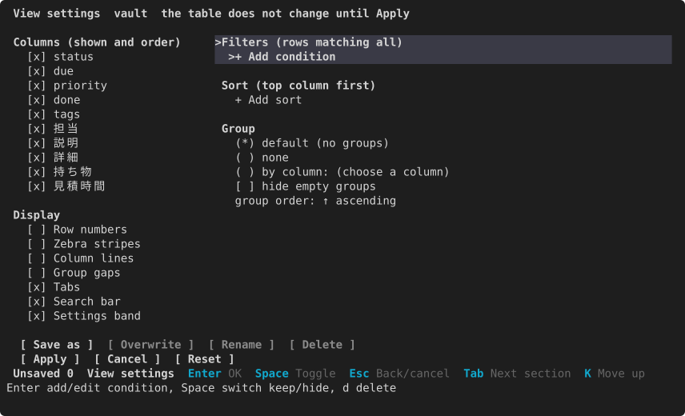

`Apply` applies it to the table; `Save as` keeps it as an mdgrid view. **Make this the default view** in the palette (`:`) or the action menu (`x`) makes the current view the one that opens next time (pick the first tab to go back to it). On the same screen, `Overwrite`, `Rename` and `Delete` manage saved views, and `Reset` returns the settings to the defaults. A saved view becomes a tab next to `Default table` (with `[display] tabs = "auto"` the tab row appears only from then on) and is written to `views.toml` in the config folder. The conditions in effect are shown in the settings band above the table; `f` moves into the band and `Backspace` removes one.

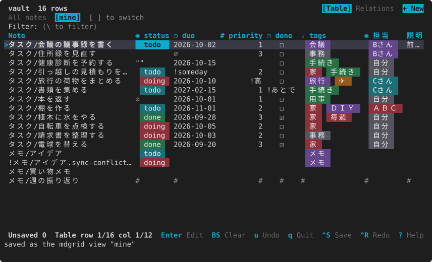

To go back and forth with Obsidian, use the palette (`:`):

- `export_base`: write the current view to a new `.base` you name (an existing `.base` is never rewritten)
- `import_base`: take a `.base` view in as an mdgrid view (the parts it cannot hold are listed as dropped)

With `--readonly`, view settings are not remembered.

## Give a folder its own command

mdgrid remembers each folder (or `.base`) you open: the columns you show and their order and widths, the filters, sorting and grouping set with `o`, the folded groups, and the views you saved as tabs. The next time you open the same folder, all of it comes back. So a shell alias is enough to turn a folder into a command of your own.

Add one line per folder to `~/.zshrc` or `~/.bashrc`:

```sh
alias tasks='mdgrid ~/notes/Tasks'
alias books='mdgrid ~/notes/Books'
alias meetings='mdgrid ~/notes/Meetings --readonly'   # only for looking
alias standup='mdgrid ~/notes/Tasks.base --view "By owner"'   # a .base, opened on one view
```

- Typing `tasks` opens the task table the way you left it.
- What is not remembered: the quick filter `\` and anything you change with `--readonly` (sorts from a heading or the sort window are remembered).
- In fish: `alias --save tasks 'mdgrid ~/notes/Tasks'`.

The output side works the same way with a shell function:

```sh
todo() { mdgrid ~/notes/Tasks --print --format md --filter 'status != "done"' --sort due; }
pick-task() { mdgrid ~/notes/Tasks --pick path; }
```

## Register the tables you use and switch between them

You can register a table you open often (a folder or a `.base`) under a name and a group. On that table, choose **register this table** in the palette (`:`), then set the name (the current view or folder name is filled in) and the group (pick one you already have or type a new one). If the name is taken, mdgrid asks before replacing it.

Once something is registered, running `mdgrid` with no arguments shows the list, grouped, on top of the current folder's table. Type part of a name, group or path to narrow it, and press Enter to open one (on its registered view).

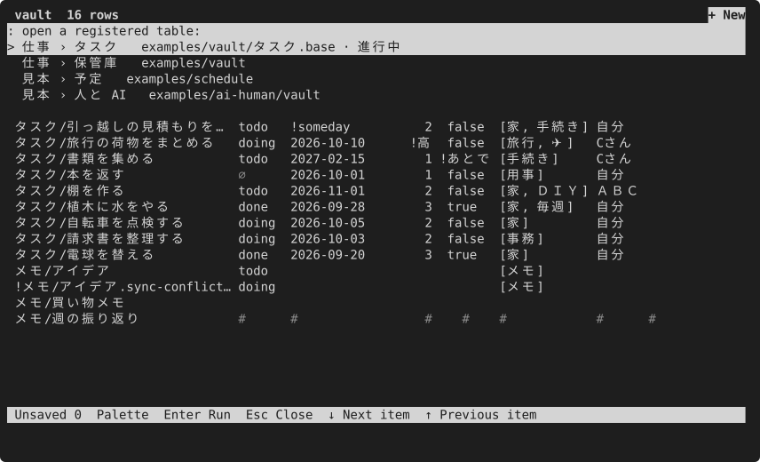

 The first row, "this folder", or Esc keeps the current folder. While a table is open, **open a registered table** in the palette shows the same list. If you have unsaved changes, mdgrid asks whether to save or discard them before switching.

Registrations live in `places.toml` in the config folder (`~/.config/mdgrid/places.toml`). You can also write it by hand:

```toml
[[place]]
name = "Tasks"
group = "Work"
path = "~/notes/Tasks"

[[place]]
name = "Books"
group = "Personal"
path = "~/notes/Books.base"
view = "Reading"
```

A leading `~` in `path` means your home folder. Rows that cannot be read (no `name` or `path`, or a repeated name) are skipped with a warning. Notes are never written.

## Save what you see as a session

Once a week you look at the tasks in progress that mention a meeting, sorted by due date. Building that again every time gets old. Give the filters, sort and columns a name as a session, and `mdgrid -s standup` opens the table just like that.

Narrow and sort the table and set the columns, then choose **Save session** in the palette (`:`) and type a name. If the name is taken, mdgrid asks before replacing it. Saving works on a table opened with `--readonly` too, since notes are never written.


A session holds the open table (a folder or a `.base`) and its view, the `\` filter, same-value filters, the expression filter, the conditions turned on with number keys (and the hide conditions you turned off), the sort, the order of the visible columns, the hidden columns, and whether the table was opened read-only. Cell values are not in it. The notes are read each time you open it, so values changed after saving show up as they are now.

```sh
mdgrid -s standup     # open that session
mdgrid --sessions     # list the saved sessions, name and folder, one per line
```

Sessions live in `sessions.toml` in the config folder (`~/.config/mdgrid/sessions.toml`). You can write it by hand, or keep it in your dotfiles and take it to another machine:

```toml
[sessions.standup]
folders = ["~/notes/Tasks"]
columns = ["title", "status", "due"]
hidden = ["priority"]

[[sessions.standup.filters]]
kind = "value"      # a same-value filter; also text (\ words), expr, cond (number-key condition), show (hide condition turned off)
key = "status"
value = "doing"

[[sessions.standup.sort]]
key = "due"
dir = "asc"
```

A name with characters other than ASCII letters, numbers, `-` and `_` goes in quotes, as in `[sessions."進行中"]` (a TOML rule). `~` is your home folder. Unknown items are skipped with a warning, and so are columns of the session that the table no longer has. An unknown name, a broken `sessions.toml` or a missing folder stops mdgrid with a one-line reason. `-s` cannot be combined with paths.

When you quit a table opened from a session, its columns and sort stay in the look mdgrid remembers for that folder, as with any change made on the screen. To change a session, save it again under the same name.

## Come back to the same table when the terminal is restored

Some tools put your terminal panes back after a restart of the computer. When such a tool restores a pane, mdgrid can reopen the same table and view you had. Only the table and the view come back: the selected row, the scroll position and unsaved changes do not.

Inside a [Herdr](https://herdr.dev) pane this works without any setup. mdgrid tells Herdr the command that reopens the current table and view, and tells it again whenever you move to another table or view. When the Herdr server stops and starts again, Herdr runs that command in the same pane. When you quit with `q` yourself, mdgrid hands the pane back, so nothing is reopened. Herdr lists it among its agents as `mdgrid`.

With several mdgrid panes open, the Herdr sidebar tells them apart. Each pane title shows the table and view, such as `Tasks · In progress`. It changes when you switch views and goes away when you quit with `q`. For a workspace table the title uses the name you gave it; otherwise it uses the `.base` file name or the folder name. A table with only one view shows just the table name.

To turn this off:

```toml
[terminal]
herdr = false
```

For tools that cannot take a command from mdgrid, such as tmux, use `mdgrid --continue`. mdgrid remembers the last table and view for each folder it was started in (in `~/.local/state/mdgrid/`), and `mdgrid --continue` in that folder goes back there. If nothing is remembered, or the table is gone, it opens as plain `mdgrid` does. With the tmux plugin [tmux-resurrect](https://github.com/tmux-plugins/tmux-resurrect), put this in `~/.tmux.conf` and restoring runs `mdgrid --continue` in the pane that had mdgrid:

```tmux
set -g @resurrect-processes '"~mdgrid->mdgrid --continue"'
```

Add `--readonly` to `--continue` to open read-only. It cannot be combined with paths or `--view`.

## Go back to a recent table

mdgrid remembers the tables (folders or `.base` files) you open on the screen, with the view you were on, newest first, up to 20. It is there so you can come back to a table you never registered or put in a workspace.

**Recent tables** in the palette (`:`) lists them. Each line has the table name and view, when you last opened it, and its folder. Type to narrow, and press Enter to open the table in the view you last had on it. The table you have open now is not listed. With unsaved changes, you are asked to save or discard first.


If you have registered tables, plain `mdgrid` with no arguments lists up to five recent tables too, under "Recent", right after "this folder (stay here)".

In the shell, `mdgrid --recent` prints them one per line, with the path, the view name and when you last opened it, separated by tabs:

```sh
$ mdgrid --recent
/home/u/notes/tasks.base	In progress	2026-11-21 09:30
/home/u/notes/projects		2026-11-20 18:02
```

To pick one with fzf and open it in that view:

```sh
line=$(mdgrid --recent | fzf) &&
  view=$(printf '%s\n' "$line" | cut -f2) &&
  mdgrid "$(printf '%s\n' "$line" | cut -f1)" ${view:+--view "$view"}
```

The list is kept with the screen state (`~/.local/state/mdgrid/recent.toml`); nothing is written to your note folders. Folders and `.base` files that are gone are dropped before the list or `--recent` shows them.

## Switch between favorite workspaces

When you go back and forth between workspaces, say one for work and one for a hobby, put them in your favorites. In the table list drawer (`w`), select the heading of another workspace and press `f`: the heading gets a `★`, and `f` again takes it out. For the workspace you are in, use **Add the current workspace to favorites** in the palette (if it is already a favorite, this takes it out).

On any screen (table, relation map, tree, gantt, kanban or chart), `W` (or **Switch workspace** in the palette) opens the list of your favorites, numbered in the order you added them. A digit goes to that one; `↑` `↓` and Enter go to the selected one. Esc closes the list and leaves you where you were.


You land on the table and view you last had open in that workspace during this run. The first time, it opens the table named in the marker's `open`, or the first table.

Once you have moved away from where you started (a plain folder, a `.base`, a detected root folder or a workspace), the list starts with **Where you started**. Choosing it takes you back to the table you started with, in the view you last had on it. Wherever you go, unsaved changes are offered for saving or discarding first.

Favorites are kept in order in `favorites` at the top of `workspaces.toml`: a workspace from `workspaces.toml` by its name, a marker workspace by the path of its root. You can write it by hand:

```toml
favorites = ["Work", "Hobby", "~/lab"]
```

Nothing is written to note folders or workspace markers. An entry whose workspace was removed, or whose marker root is gone, is left out of the list with a warning.

## Link tables with relations

A note can point at another note with a link in its frontmatter, so folders of notes work like linked tables (tasks → projects → clients). The note's file name is the key: there is no id column, and a list of links stands in for a many-to-many join table.

```yaml
project: "[[Clinic Booking App]]"     # one project
owner: "[[Leo Park]]"
depends_on:                           # many
  - "[[Design the booking screens]]"
  - "[Build the appointment API](Build%20the%20appointment%20API.md)"   # a Markdown link works too, and so does a plain path
```

- Link cells show the target note's name. A `[[…]]` whose note does not exist is shown with `?` in front.
- In a column whose values are mostly links, Enter lists the notes in the target's folder by name. The one you pick is written in the form the column already uses (`[[name]]` if none). In a list column you can tick several.
- `:open_link` (or **Open the link target** in the `x` menu) opens the target: in the same table it moves to the row; otherwise it opens the registered table that holds the note (or its folder) and selects the row. Unsaved changes are confirmed first.
- `:linked_rows` lists the notes that link to the current one, with the table and column they link from. Pick one to open it.
- Links work whether you open a folder or a `.base`, and may point outside the opened folder. Register the folders you link between (see above) so names resolve across them. A value counts as a plain-path link only if it contains `/` or ends in `.md` and the note exists, so ordinary words stay text.

The sample `examples/studio` links tasks, projects, clients, people and meetings this way: `mdgrid examples/studio/Tasks`.

**The relation map.** Press `R` (or pick **Relation map** in the screen type menu at the top right) to see the tables as boxes with their row counts and columns, and an arrow from each link column to the table it points at (`N` → `1`, or `N` → `N` for a list of links). A column that points inside its own table, like a task's `parent`, loops back to its own box. The columns in each box carry the same type marks as the headings, and link columns carry `↪`. `↑` `↓` pick a table, `←` `→` pick a link; the details and, on a tall terminal, the linked records follow the selection. The layout adapts to the terminal width. You can also click: a table selects it and a second click opens it, a line or an arrow selects that link, and a linked record opens its note. Press `R` again to go back to the table. The map covers the current workspace (see below), or the registered tables if there is none.

## Group tables into workspaces

A workspace is a named set of tables (folders or `.base` files). When the table you open belongs to one, links, linked rows, the relation map and the screen type menu at the top right use only that workspace's tables, so a root folder for work and one for hobbies do not mix. The breadcrumb in the header shows `<workspace> › <table>`.

In the palette (`:`): **create a workspace with this table**, **add this table to a workspace** (pick one or type a new name), **remove this table from a workspace**, and **open a workspace** (pick it, then one of its tables). From the shell (with no path, `--add-to` and `--remove-from` use the current folder):

```sh
mdgrid ~/notes/tasks --add-to Work
mdgrid ~/notes/projects --add-to Work --as Projects
mdgrid --workspaces                          # list them
mdgrid -w Work                               # open the first table of Work
mdgrid -w Work ~/notes/tasks                 # open this table within Work
mdgrid ~/notes/tasks --remove-from Work
mdgrid --remove-workspace Work               # the notes are not touched
```

Workspaces live in `workspaces.toml` in the config folder, next to `places.toml`:

```toml
[[workspace]]
name = "Work"

[[workspace.table]]
name = "Tasks"
path = "~/notes/tasks"

[[workspace.table]]
name = "Projects"
path = "~/notes/projects"
view = "Open"
```

To keep the workspace with the notes instead (for example in a repository you share), run `mdgrid --init-workspace` in its root (or `mdgrid <folder> --init-workspace`). It writes `.mdgrid/workspace.toml`; with no `[[table]]` in it, every folder of notes directly under the root is a table (a `.base` is not added automatically, because it covers the whole root folder; list it with `[[table]]` to include it). A `[[table]]` with both `name = "Plans"` and `path = "calendar"` shows as "Plans" in the drawer, in the header breadcrumb and in the list of recent tables.

To open a chosen table whenever the root folder is opened, write `open = "<table name>"` at the top level of the marker (the `name` of a `[[table]]`, or the folder name of an automatic table). For example, a ledger folder with a README or AGENTS.md next to its notes can open only its `.base`. Add `--raw` to see every note in the folder.

Which tables are in scope, first match wins: `-w` → the nearest `.mdgrid/workspace.toml` above the opened folder → the first workspace in `workspaces.toml` that holds the table → detection → the registered tables. Detection is set by `[workspace] detect` in the config (default `[".obsidian"]`; the old values `"vault"` and `"git"` are still read): the nearest root folder (a folder with `.obsidian/`), and with `".git"` also the repository root, counts as an unnamed workspace of the folders right under it. `detect = []` turns it off.

## Stack tables

When you want to keep an eye on the projects while you work through the tasks, you can put the other table below the current one on the same screen instead of switching back and forth.

1. In the table screen, choose **Stack a table below** in the palette (`:`) and pick a table of the current workspace. It is placed below the current table, and the screen is split top and bottom.
2. Each table has a title line, "table · view · rows", and the table your keys act on is marked with `▶`. `Ctrl+w` `j` and `k` move to the table below and above. Clicking a row or a title moves there too.
3. Finding with `/`, searching with `\`, filters, sorting, views with `[` `]`, editing a cell and a new note with `a` all act only on the `▶` table.
4. `Ctrl+w` `+` and `-` make the selected table a row taller or shorter, and `Ctrl+w` `c` (**Close this table** in the palette) takes it out.

Up to four tables can be stacked, and each needs its title and 3 rows. When the terminal gets too short, the tables other than the selected one fold to their title line, from the bottom up. Switching to the Gantt, kanban, chart or tree screen, and opening help or the palette, shows only the selected table on the whole screen; going back brings the stack back.

Edits pile up in one set of changes, whichever table you edit in. When two tables show the same note, a value you change in one shows as pending in the other, and `Ctrl+S` writes both edits at once. The save review lists the changes of every table with a heading per table and writes them all when you confirm. Closing a table that has pending changes asks whether to save or discard them.

### Save an arrangement as a page

Give a pair you compare often a name with **Save the arrangement as a page** in the palette, and it becomes a page of the current workspace. A page remembers the tables, their views and the height ratios, and is listed above the tables in the table list drawer (`w`). Choosing it opens the tables stacked. From the shell:

```sh
mdgrid -w work --page morning            # a workspace in workspaces.toml
mdgrid ~/notes --page morning            # a workspace marker .mdgrid/workspace.toml
```

Pages live in the workspace in `workspaces.toml` or in the marker `.mdgrid/workspace.toml`, so you can write or edit them by hand. Saving from the screen only appends to the end of a marker, leaving every other line and comment as it was.

```toml
[[workspace.page]]       # [[page]] in a marker
name = "morning"
tables = [
  { table = "Tasks", view = "Today", height = 2 },
  { table = "Projects", view = "Active", height = 1 },
]
```

In a Herdr pane, the pane title is the page name while a page is open, and restoring the pane opens the same page again. `mdgrid --continue` does the same. An arrangement stacked on the spot has no name, so it comes back as the selected table and view.

## Create a ledger from a starter

The common kinds of ledger (tasks, tasks shared with AI agents, bookmarks, a reading log, people and meetings) can start from a **starter**: a marker and note templates ready to use. `mdgrid --starters` lists them; `mdgrid <folder> --init-workspace --starter <name>` writes one (`--with-samples` adds a few sample notes). The folder is created if missing, and if any target file already exists nothing is written.

```sh
mdgrid --starters
mdgrid ~/notes/books --init-workspace --starter reading --with-samples
mdgrid ~/notes/books
```

In the screen, **Create a ledger from a starter** in the command palette (`:`) does the same: pick a starter, type the folder to create (relative to the open folder; the starter's name by default), answer `y`/`n` for the samples, and the new ledger opens. Esc cancels at any step.

`tasks-ai` is a ledger for work shared between people and AI agents. A task's `actor` (human, ai or both) splits it into the "People only" and "AI only" tabs, and the charts by status and by actor (`P`), the Gantt (`C`) and the Kanban (`B`) open as they are. A second table, "Routines", holds repeating work; the task for one round links to it from its `routine` column (switch tables with `w` or the breadcrumb, and press `R` to see the links). mdgrid does not create the next round: a person or an agent adds it, for example with `--new-note`.

Instead of copying a whole starter, a ledger's marker can just name the starter it is based on. What you write in the marker always wins, and the starter fills in the rest. When a newer mdgrid ships a newer starter, the new content takes effect without rewriting the marker.

```toml
# <ledger>/.mdgrid/workspace.toml
starter = "tasks"
options = ["ai"]          # parts of the starter: tasks has ai (split by who does it) and priority-words (high, medium, low)
starter_lang = "en"       # fix the language of the table and view names (default: the current language)

# Below are your own overrides; they win over the same items of the starter.
[rules.priority]
values = ["p1", "p2", "p3", "p4"]
```

Tables and views are matched by name: items you write in a view of the same name change only those items, and a view with a new name is added after the starter's. If the starter or an option cannot be found, mdgrid prints one warning line and opens with what the marker itself says. For now you write this kind of marker by hand (`--init-workspace --starter` still copies everything).

Your own starters live in the config folder under `starters/<name>/`, in the same shape as the built-in ones (`starter.toml`, `ledger/`, `samples/`). The quickest way to make one is to copy the `.mdgrid/` of a ledger you like into `ledger/`.

## Use with other commands

To save the table exactly as shown — with your filters, sorting and hidden columns — choose **Export the table to a file** in the command palette (`:`) and type a file name. The extension picks the format: `.csv`, `.tsv`, `.json` or `.md`. The first column is each note's path, so a CSV or JSON can come back with `--apply`.

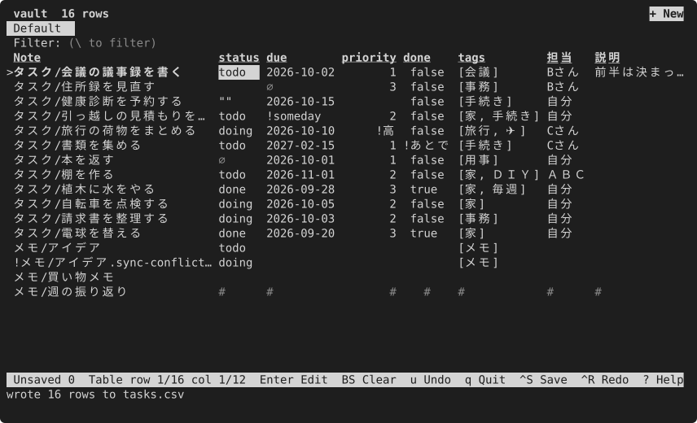

Print the table of a view to standard output without opening the screen (csv by default; notes are not written):

```sh
mdgrid /tmp/mdgrid-sample/Tasks.base --print
mdgrid /tmp/mdgrid-sample/Tasks.base --print --format json | jq .
mdgrid /tmp/mdgrid-sample/Tasks --print --format md > table.md
mdgrid /tmp/mdgrid-sample/Tasks --print --format tsv > table.tsv
```

When you `--print` a folder, there is no note-name column (the columns are the frontmatter keys only).

Pick rows on screen and print their paths or a column's values. The screen is read-only; `Enter` prints the marked rows (or the selected row) one per line and exits. `q` cancels, prints nothing and exits with status 1.

```sh
mdgrid /tmp/mdgrid-sample/Tasks --pick path | xargs -o vi    # open the picked notes
mdgrid /tmp/mdgrid-sample/Tasks --pick status
```

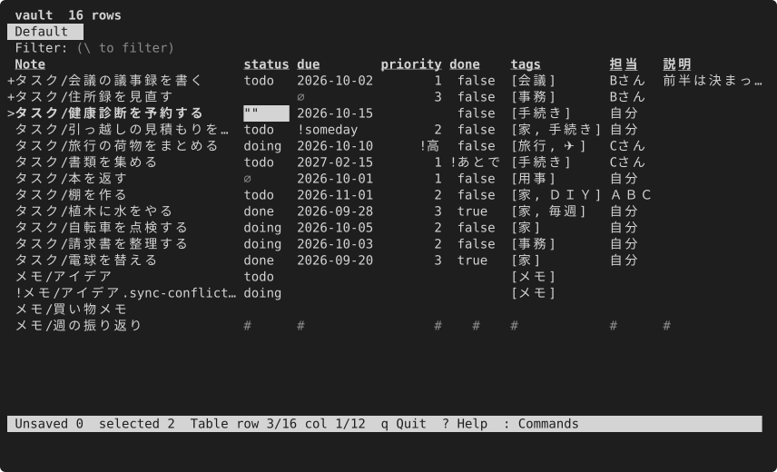

`y` (or `Ctrl+C`) copies the value of the cell to the clipboard. With rows selected, it copies the current column's values of those rows, one per line. `Y` copies the whole row as tab-separated text with a header.

To paste, select the cell to start from and use your terminal's paste (`Ctrl+V`, `Cmd+V` or whatever your terminal uses). Values separated by line breaks go down the rows, and values separated by tabs go right across the columns, so a range copied from a spreadsheet pastes the same way. Pasted values are pending changes until you save, and one `u` undoes the paste.

## Choose a theme

Add a line such as `theme = "nord"` to the config to change the screen colors. All seven themes and how to choose them are on the [Themes](themes.md) page.

## When you cannot edit

| What you see | Why | What to do |
|---|---|---|
| a row of `#` cells | the note's frontmatter cannot be written safely (a duplicate key, a BOM, mixed line endings, …) | select it to see the reason; fix it in your editor (`e`). All reasons: [Read-only notes](../../safety.md#read-only-notes) |
| `Enter` says read-only | a nested value, a block scalar, a `file.*` or `formula.*` column | [Read-only values](../../safety.md#read-only-values) |
| a value with line breaks cannot be edited | the one-line input cannot hold it | open the note with `e` |
| a date or number is refused | the date does not exist, or the value is not a number | the input stays open; type it again |
| `!` at the start of a row | a conflict file made by a sync tool, or a note that changed on disk while you had pending changes | clean up conflict files by hand; for a changed note, write over it (`o`) or drop your changes (`d`) in the save review |
| nothing can be written | opened with `--readonly` | open again without it |

If a note changes on disk while mdgrid is open, mdgrid re-reads it automatically (not while you are editing a cell). If it changed before you save, the save review shows it.
