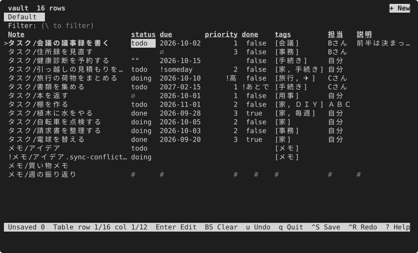
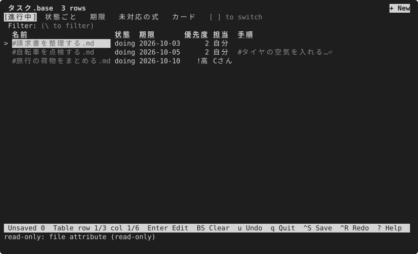
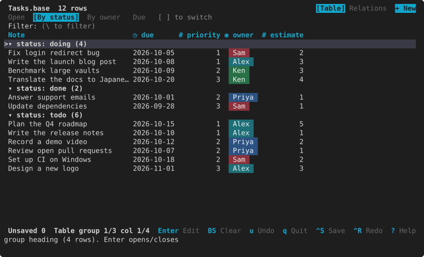
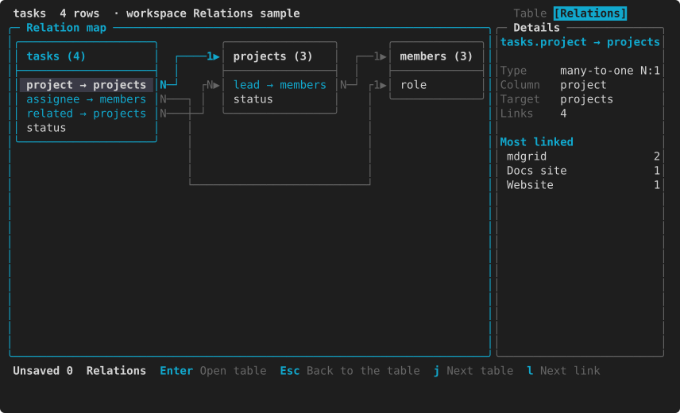
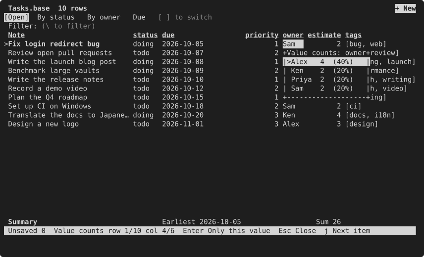
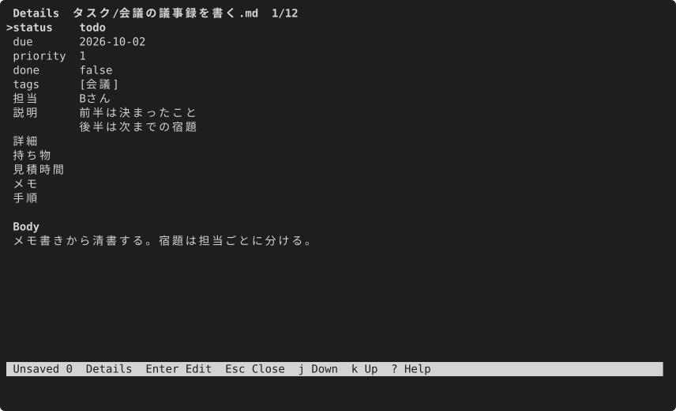
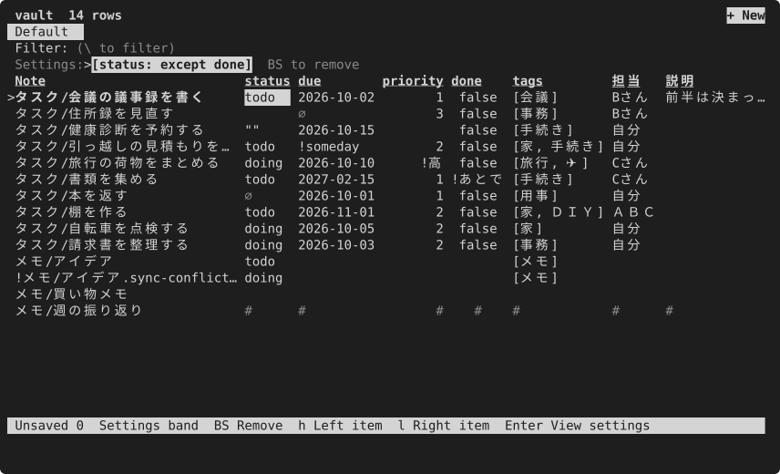
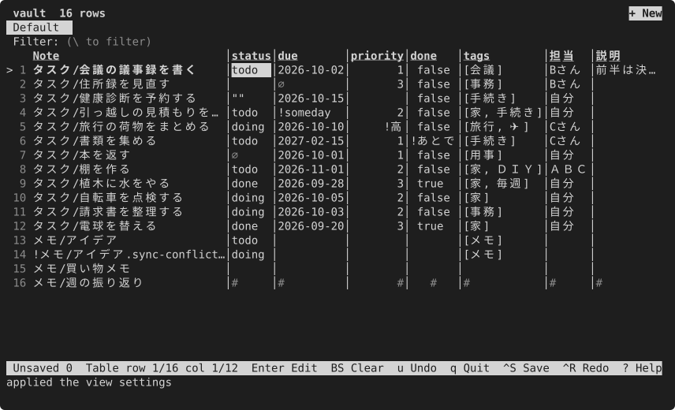
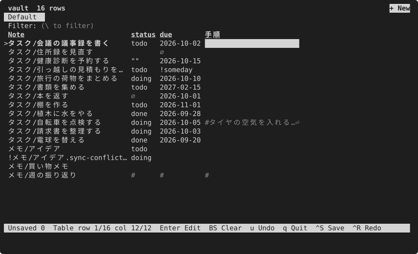
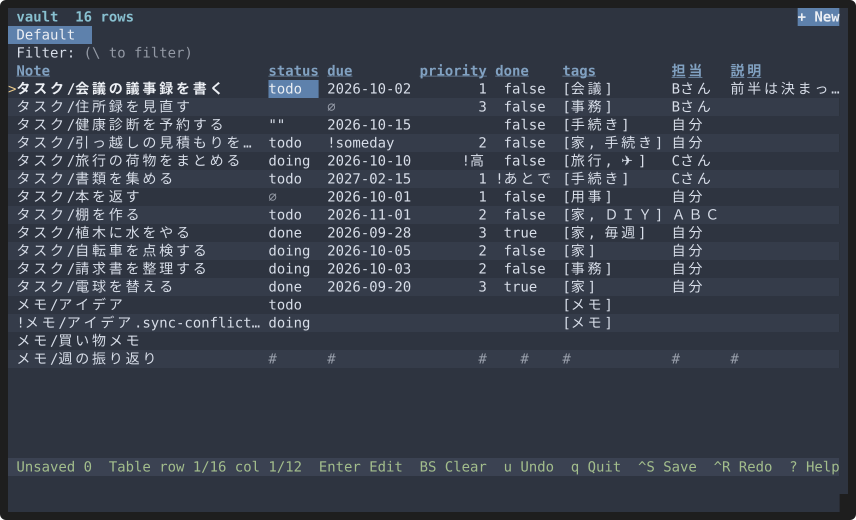

# Ways to see your notes

[日本語](../ja/views.md) · [Contents](index.md)

The same notes can be shown in several screens. Each one is a key away, or a few choices in the view settings. None of them writes to your notes, and `Esc` brings the table back. This page shows one screen per way of seeing; the links tell you how.

## Table

The basic screen. One row per note, one column per frontmatter key, the file name first. `Enter` on a cell edits it in place. The bar at the bottom shows how many changes are unsaved and which keys work right now.

[Getting started](getting-started.md#reading-the-screen) explains the parts of the screen.

## View tabs

A view is a named set of columns, filters and sorting. Views sit in tabs above the table; `[` and `]` switch between them. Open a `.base` file and its table views become tabs as they are. Views you make yourself are kept in the config folder, never next to the notes.

[Shape a view and save it](tasks.md#shape-a-view-and-save-it)

## Groups

Rows gather under heading rows, one per value of a column. `Enter` on a heading folds it. Groups from a `.base` look the same. Handy for going through tasks one status at a time.

[Shape a view and save it](tasks.md#shape-a-view-and-save-it) (the sort and group section of the view settings)

## Tree

Write `tree = { path = "folder" }` on the table in the workspace file (`.mdgrid/workspace.toml`), and `T` turns the paths in that column (`bar > Dev > Web`) into a folder tree: the tree with counts on the left, the notes of the selected folder on the right. Good for bookmarks and reference material; the built-in bookmarks starter is set up this way. The tree screen is there from 0.4.0.

[The `tree` setting](../../config.md), [Create a ledger from a starter](tasks.md#create-a-ledger-from-a-starter)

## Gantt

`C` turns the rows of the current view into bars on a time axis. The start and end columns come from `gantt = { start = "start", end = "due" }` in the workspace marker, or, without a setting, are inferred from date columns named like `start` and `due`. With parent/child rows and WBS in the view settings, the order, numbers and progress (the fill of the bar) stay the same, and a parent without dates gets the span of its children. `+` and `-` switch between day, week and month, `t` goes to today, and `r` switches the period between this week, this month, the quarter and everything. The bar on the bottom edge of the window (`◀ ▶`, the units, Today and the periods) does the same with a click. To reschedule, select a row and press `H` or `L` to move its bar by one unit, or `<` and `>` to shorten or extend its end. The dates are held as pending changes until you save, like edits in the table, and `u` undoes them. The gantt screen is there from 0.4.0.

The `gantt` section of [Key bindings](../../keys.md), [Configuration](../../config.md)

## Kanban

`B` lays out the rows of the current view as cards in lanes, one lane per status. The lanes follow the allowed values of the column (`[rules.status] values`), so todo, doing, waiting and done line up in that order, and a status with no cards still has its empty lane to move a card into. `H` and `L` move the selected card to the next lane and change its status; like an edit in the table, the change waits as unsaved until you save. The column comes from `kanban = { column = "status" }` in the workspace marker, or is inferred from a column named like `status`. The kanban screen is there from 0.4.0.

The `kanban` section of [Key bindings](../../keys.md), [Configuration](../../config.md)

## Chart

`P` counts the rows of the current view and draws a chart: tasks per status, estimates summed per owner, due dates per month, at a glance and without counting the table. There are five kinds, bar, stacked bar, line, scatter and heatmap; `Tab` switches between them, `x` picks the column to split by, `y` the value (a count or the sum of a number column) and `b` the breakdown column. Splitting by a number column gives counts per range (a histogram), and `%` on a stacked bar shows percentages. `Enter` on a bar narrows the table to the rows with that value. Charts you look at often can go in the workspace marker as `chart = { kind = "line", x = "due", unit = "month" }`, and with several of them `[` and `]` move between them; without a setting the screen guesses from columns such as status. The chart screen is there from 0.4.0.

The `chart` section of [Key bindings](../../keys.md), [Configuration](../../config.md)

## Parent/child indent and WBS

If notes carry `parent: "[[Parent]]"`, the parent/child section of the view settings indents children under their parent. `Z` folds and opens. Turn on WBS in the same section and rows get `1.2.1` numbers and a progress figure from the status column (a parent shows the average of its descendants). The sample notes have no parents, so there is no screen here; the [release recording](https://github.com/S6U5/mdgrid/releases/latest/download/demo-tree.gif) shows it moving.

[Shape a view and save it](tasks.md#shape-a-view-and-save-it)

## Relation map

`R` draws the tables of the workspace as boxes and the link columns as arrows. You can see which table points at which, and `Enter` opens the one under the cursor. A column that points inside its own table, such as a parent, loops back to its box, and the columns in each box carry their type marks.

[The relation map](concepts.md#the-relation-map)

## Stacked tables

Up to four different tables share the screen, one above the other. Each has a title line, "table · view · rows", and keys act only on the table marked with `▶`. `Ctrl+w` `j` and `k` move between them, and an arrangement can be saved by name as a page.

[Stack tables](tasks.md#stack-tables)

## Value counts

`%` lists every value of the current column with its count and share. `Enter` keeps only the rows with that value. Use it to see how many tasks are in each status, or whether one person has too many.

The `freq` section of [Key bindings](../../keys.md)

## One note in detail

`K` lists every key and value of the selected row top to bottom. For the moment when there are more columns than the screen is wide.

The `detail` section of [Key bindings](../../keys.md)

## Filter band

The filters, sorting and grouping in effect sit above the table as chips. `f` moves into the band and `Backspace` removes one. You never lose track of what the table is filtered by.

[Find, filter and sort](tasks.md#find-filter-and-sort)

## Row numbers, stripes and column lines

The Display section of the view settings adds row numbers, alternating row colors and column lines. Each view remembers its own.

[Shape a view and save it](tasks.md#shape-a-view-and-save-it)

## Frozen columns

`F` pins the columns up to the current one on the left. Scroll sideways and the file name and status stay in view.

The `table` section of [Key bindings](../../keys.md)

## Themes and part shapes

Twelve color themes, and a choice of shapes for chips and checkboxes. Only the look changes; the text and marks stay the same. Compare them in the [look catalog](../../catalog/index.html) and paste the settings it gives you into `config.toml`.

[Make it look the way you like](appearance.md), [Themes](themes.md)

## Easy to step back

`Esc` brings the table back from any screen (`q` as well in the tree and the relation map, `K` from the detail, `f` from the band). On the table itself `q` quits mdgrid. `?` lists the keys, `:` finds a command by name. Switching screens never touches a file; only saving does.
