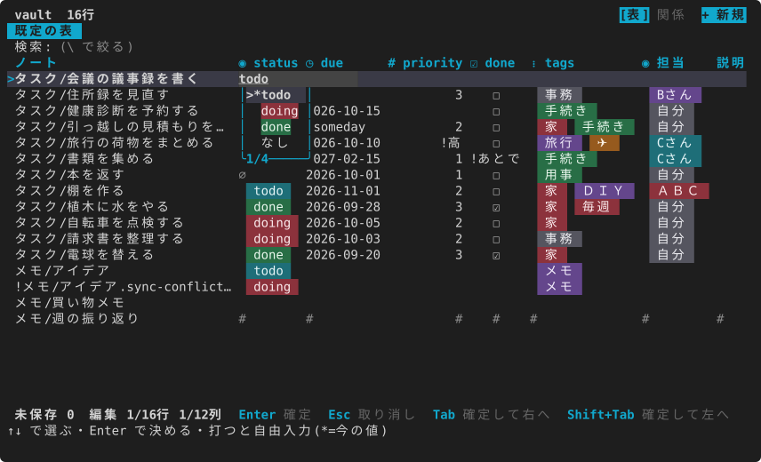
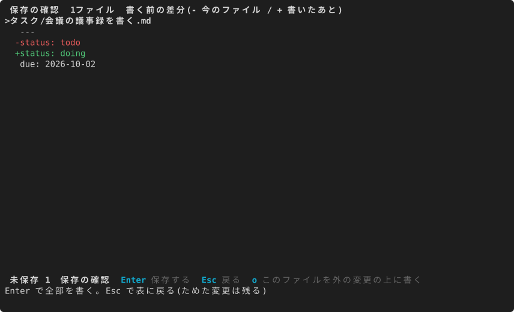
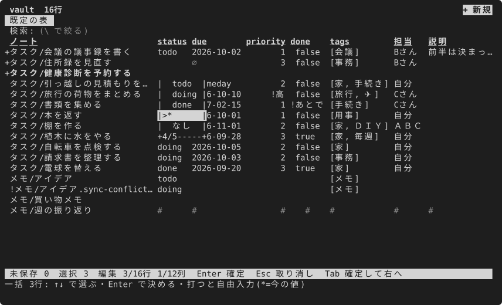
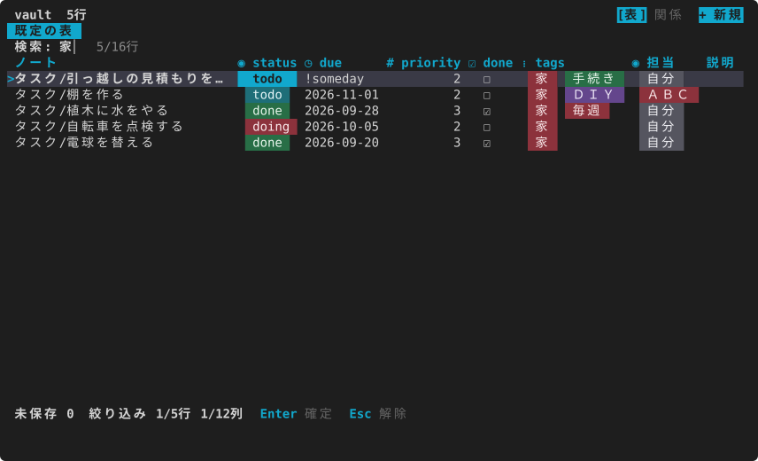
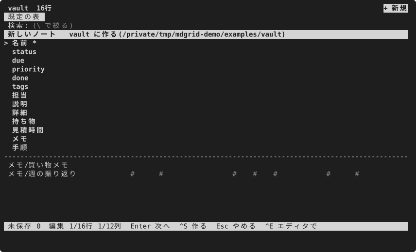
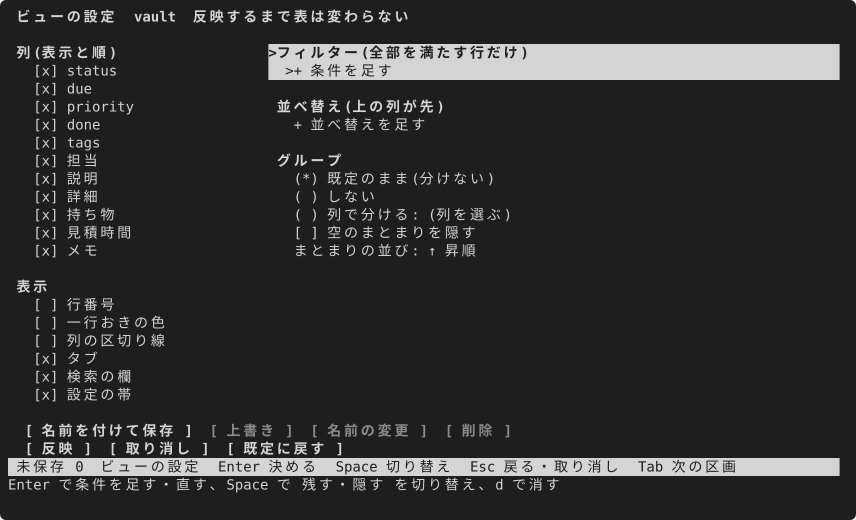
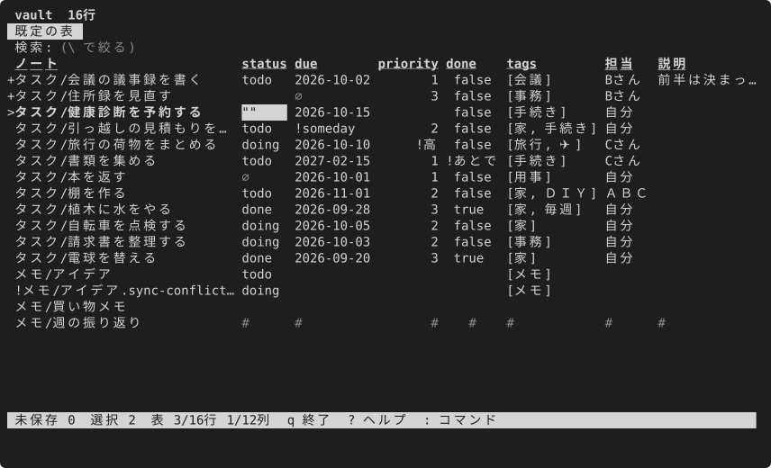
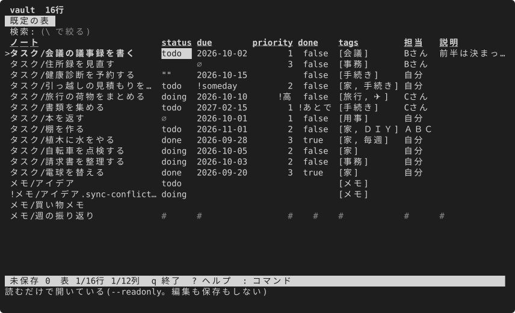
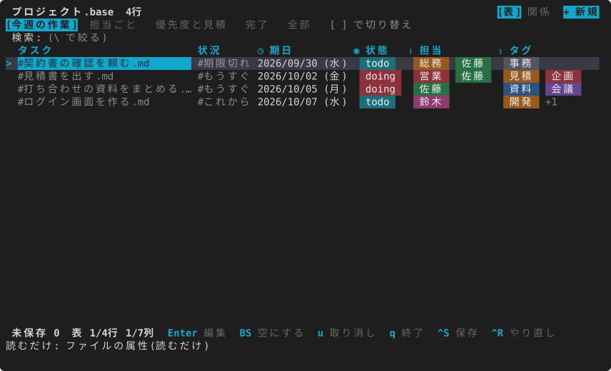
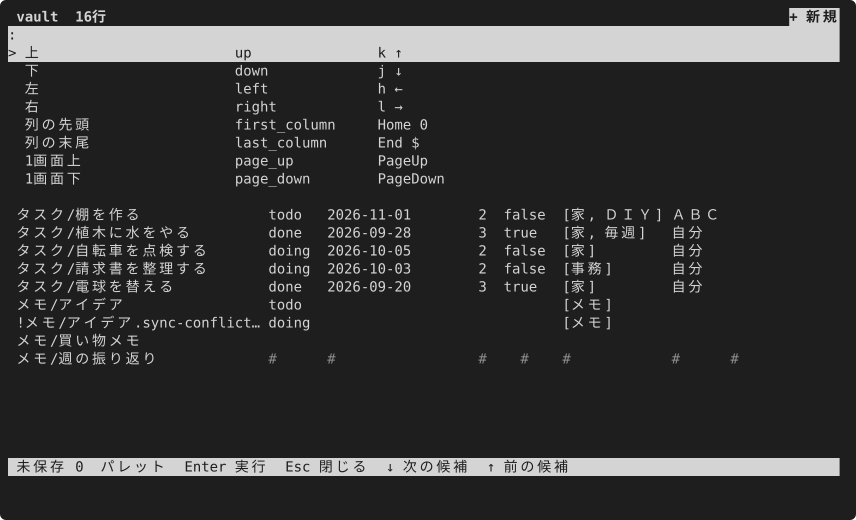

# できることの一覧

[English](../en/features.md) · [目次](index.md)

mdgrid でできることを、機能ごとに画面1枚と数行で並べました。やり方は各項のリンク先の手引きにあります。[見せ方の一覧](views.md)は画面の型の一覧で、こちらは「何ができるか」の一覧です。

## 場面で見る

組み込みのスターターが4つあり、それぞれが1つの使い方の見本になっています。下の画面は、そのスターターから作った見本の台帳(`examples/tasks` など)を開いたものです。

タスク。1件1ノートで、状態のタブ(未完了・進行中・待ち・完了)、期限、優先度、タグ。新しいノートは期限と優先度だけ聞き、状態と作成日は自動で入ります。

ブックマーク。1件1ノートで、置き場を `folder: bar > Dev > Web` のように書き、`T` でフォルダの木になり、木の画面で `o` を押すと URL をブラウザで開きます。

読書・視聴の記録。本・記事・映画・講演を1件1ノートで、読みたい・読んでいる・読んだのタブと、種類・著者・評価の列。

人と会議。人(役割・所属・連絡先)と会議(日時・出席者・次の行動)の2つの表がリンクでつながり、`R` の関係マップで見渡せます。

[スターターから台帳を作る](tasks.md#スターターから台帳を作る)

## 値をその場で直す

セルで `Enter`。文字の列は同じ列のほかのノートの値から選べ、打てば候補が絞られます。日付はカレンダー、タグは付け外し、チェックボックスは切り替え。列の型に合わない値は `!` を付けて見せ、勝手には変えません。

[値を直して保存する](tasks.md#値を直して保存する)

## 差分を見て保存する

直した値はまず「ためた変更」になり、`Ctrl+S` でファイルごとの差分を見てから書きます。書くのは直した値の行だけ。ほかのキー、キーの順、コメント、本文は1バイトも変えません。

[値を直して保存する](tasks.md#値を直して保存する)、[書き戻しの安全](../../safety.ja.md)

## まとめて直す

`Space` で行に印を付けて、同じ値を一度に入れます。タグの付け外しもまとめて。印を付けた行だけを次のコマンドに渡す、という使い方もあります。

[まとめて直す](tasks.md#まとめて直す)

## 探す・絞る・並べる

`\` で打つたびに行が絞られ、`/` で検索、`s` で列の並べ替え。同じ値の行だけを残す、列の値ごとの件数を見て1つに絞る(`%`)、要らない列を隠す、もできます。

[探す・絞る・並べる](tasks.md#探す絞る並べる)

## 新しいノートを作る

`a`(かビューの帯の右の端の「+ 新規」)で窓が開き、名前と列ごとの欄に値を入れて1枚作ります。置き場・ファイル名・本文の雛形は印の設定で決められます。

[新しいノートを作る](tasks.md#新しいノートを作る)

## ビューを決めて保存する

`o` で列・絞り込み・並べ替え・まとまり・表示を決め、名前を付けて保存するとタブになります。「既定のビューにする」を選べば、次に同じフォルダを開いたときはそのビューで開きます。

[見せ方を決めて保存する](tasks.md#見せ方を決めて保存する)

## .base を開く

`.base` を渡すと、その table ビューがタブに並びます。絞り込み・並べ替え・まとまり・集計の行と式の一部を読み、`.base` は書き換えません。今のビューを `.base` に書き出す・`.base` のビューを取り込む、もできます。

[.base を開く](tasks.md#base-を開く)、[Obsidian Bases の対応範囲](../../obsidian-bases.ja.md)

## リンクで表をつなぐ

`project: "[[mdgrid]]"` のようなリンクで、フォルダがつながった表になります。行き先を名前から選ぶ、行き先を開く、ここを指すノートを並べる。一緒に使う表はワークスペースにまとめ、`R` で関係マップ。

[リンクで表をつなぐ](tasks.md#リンクで表をつなぐリレーション)、[ワークスペースで表をまとめる](tasks.md#ワークスペースで表をまとめる)

## スターターから台帳を作る

パレット(`:`)の「スターターから台帳を作る」か、コマンドの `--init-workspace --starter <名前>`。空のフォルダに印・雛形・見本を書き出して、最初から表の形で始められます。自分のスターターも同じ形で置けます。

[スターターから台帳を作る](tasks.md#スターターから台帳を作る)

## ほかのコマンドと組む

`--print` で表を CSV・TSV・JSON・Markdown に出す、出した CSV を表計算で直して `--apply` で戻す、`--pick` で選んだノートのパスを次のコマンドに渡す。`.csv`・`.tsv` のファイルをそのまま台帳として開くこともできます。AI エージェント向けには、これらのコマンドの使い方を教えるスキルがあります。

[ほかのコマンドと組む](tasks.md#ほかのコマンドと組む)、[CSV・TSV を台帳として開く](tasks.md#csvtsv-を台帳として開く)

## 読むだけで開く

`--readonly` を付けると、編集・保存・新しいノートができなくなり、何も書きません。安全に書けないノートは、ふだんでもセルに `#` を付けて読むだけにし、選ぶと理由が出ます。

[直せないとき](tasks.md#直せないとき)、[書き戻しの安全](../../safety.ja.md)

## 見た目を選ぶ

色のテーマ、札やチェックボックスの形、行番号や区切り線、日付の形を設定で選びます。ワークスペース・表・ビューごとに上書きでき、見た目のカタログで見比べてから設定に貼れます。

[見た目を整える](appearance.md)、[テーマ](themes.md)、[見た目のカタログ](../../catalog/index.html)

## キーとパレット

Vim のキーも矢印も使えます。`x` でそのセルでできること、`:` でコマンドを名前から、`?` で全部のキー。キーは設定で変えられます。

[キーの割り当て](../../keys.ja.md)
