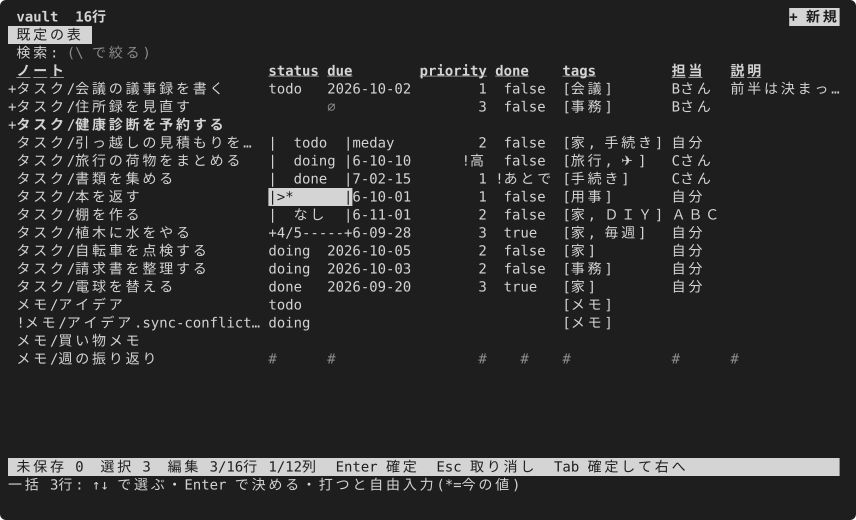
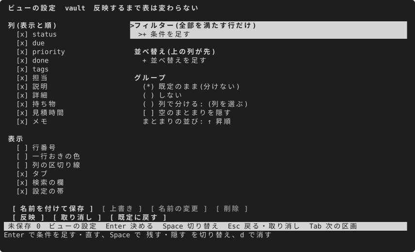

# できることの一覧

[English](../en/features.md) · [目次](index.md)

mdgrid でできることを、機能ごとに画面1枚と数行で並べました。やり方は各項のリンク先の手引きにあります。[見せ方の一覧](views.md)は画面の型の一覧で、こちらは「何ができるか」の一覧です。

## 場面で見る

組み込みのスターターが4つあり、それぞれが1つの使い方の見本になっています。下の画面は、そのスターターから作った見本の台帳(`examples/tasks` など)を開いたものです。

タスク。1件1ノートで、状態のタブ(未完了・期限切れ・進行中・待ち・完了)、期限、優先度、タグ。新しいノートは期限と優先度だけ聞き、状態と作成日は自動で入ります。新しいノートの名前は `20261118_` のように今日の日付で始まり、同じ題のタスクを別の日にも作れます。表にも、名前を打つ欄にもその日付は出さず、題だけを打てば日付が付きます。状態を `done` にすると、完了日(`done_at`)に今日が入ります。期限の隣の「残り」の列に、「あと3日」「5日前」のように期限までの近さが出ます。`start` と `due` の列があるので、`C` でガントにもなります。

ブックマーク。1件1ノートで、置き場を `folder: bar > Dev > Web` のように書き、`T` でフォルダの木になり、木の画面で `o` を押すと URL をブラウザで開きます。表のままでも `O` で開けます。マウスなら、URL のセルをクリックして選び、もう一度クリックすると開きます。列の幅で `…` に切れて見える URL も、切る前の全体が開きます。

読書・視聴の記録。本・記事・映画・講演を1件1ノートで、読みたい・読んでいる・読んだのタブと、種類・著者・評価の列。

人と会議。人(役割・所属・連絡先)と会議(日時・出席者・次の行動)の2つの表がリンクでつながり、`R` の関係マップで見渡せます。

[スターターから台帳を作る](tasks.md#スターターから台帳を作る)

## 値をその場で直す

セルで `Enter`。文字の列は同じ列のほかのノートの値から選べ、打てば候補が絞られます。日付はカレンダー、タグは付け外し、チェックボックスは切り替え。列の型に合わない値は `!` を付けて見せ、勝手には変えません。

[値を直して保存する](tasks.md#値を直して保存する)

## 差分を見て保存する

直した値はまず「ためた変更」になり、`Ctrl+S` でファイルごとの差分を見てから書きます。書くのは直した値の行だけ。ほかのキー、キーの順、コメント、本文は1バイトも変えません。

[値を直して保存する](tasks.md#値を直して保存する)、[書き戻しの安全](../../safety.ja.md)

## まとめて直す

`Space` で行に印を付けて、同じ値を一度に入れます。タグの付け外しもまとめて。印を付けた行だけを次のコマンドに渡す、という使い方もあります。

[まとめて直す](tasks.md#まとめて直す)

## 日付を言葉で入れる

期限のセルで `明日`・`来週の金曜`・`月末`・`+2w` と打てば、その日が入ります。カレンダーで日を数えなくて済みます。打っている途中から欄の横に `2026-10-16(金)` のように読んだ日が出て、カレンダーもその日へ動くので、Enter の前に確かめられます。英語の `tomorrow`・`next fri` も、画面の言語にかかわらず読みます。まとめて直すときと、絞り込みの比べる値でも同じ言葉が使えます。

[日付を言葉で入れる](tasks.md#日付を言葉で入れる)

## 探す・絞る・並べる

`\` で打つたびに行が絞られ、`/` で検索、`s` で列の並べ替え。同じ値の行だけを残す、列の値ごとの件数を見て1つに絞る(`%`)、要らない列を隠す、もできます。

[探す・絞る・並べる](tasks.md#探す絞る並べる)

## 名前を付けた条件で絞る

「期限が1週間以内」のような条件に名前を付けて設定に1回書けば、数字のキー1つで当たる行だけにでき、`Esc` でまとめて解けて、どの式でも `cond("名前")` で使えます。先すぎる予定のように、ふだん見ない行をどの表でも隠しておくこともできます。`mdgrid --count` で当たる行の数を外にも出せます。

[名前を付けた条件で絞る](tasks.md#名前を付けた条件で絞る)

## 台帳ごとに条件と知らせを持つ

人の台帳なら「しばらく連絡していない人」、お金の台帳なら「支払い日が近い」。その台帳だけの条件と通知の欄・知らせを、台帳の印に書いて台帳と一緒に配れます。数字のキーは台帳の条件から 1 を振り、全体に書いたタスクの条件は、期限や担当の列の無い台帳では出てきません。スターターの印に書けば、そこから作った台帳でもそのまま効きます。

[名前を付けた条件で絞る](tasks.md#名前を付けた条件で絞る)

## 通知の欄で知らせる

期限切れのタスクの数や、自分で書いた連絡を、ヘッダーの上の小さな欄に出せます。設定に書いた人だけに出ます。欄から当の行へすぐ移れ、`mdgrid --notices` で同じ知らせを tmux の帯などにも出せます。

[通知の欄で知らせる](tasks.md#通知の欄で知らせる)

## 新しく当たった行を知らせる

思い出したい時刻や期限が来た行を、OS の通知や端末の通知で知らせます。名前を付けた条件に当たり始めた行を1行ずつ知らせ、当たり続ける行は二度知らせません。閉じているあいだも、`mdgrid --notify` を OS の定期実行に登録すれば届きます。

[新しく当たった行を知らせる](tasks.md#新しく当たった行を知らせる)

## ルーチンの回を作る

毎週のレビューや月末の請求のような繰り返しの仕事を、`weekly mon` のような決まりと一緒にルーチンのノートに書いておくと、その回のノート(「週次レビュー 2026-11-23」)を別のフォルダに作れます。回のノートはルーチンへのリンクを持ちます。開いている画面は名前を見せて確かめてから作り、閉じているあいだは OS の定期実行から呼ぶ `mdgrid --runs` が作ります。作るのは一番新しい回だけで、既にあるノートは上書きしません。

[ルーチンの回を作る](tasks.md#ルーチンの回を作る)

## ワークスペースを横断して探す

あの見積もりの話、タスクに書いたか案件のノートに書いたか。そんなときは表を1つずつ開かずに、パレットの「ワークスペースを横断して探す」で語を打ちます。ワークスペースの表の全部から当たった行が、表ごとに当たった列と値を添えて並び、選べばその表がその行を選んだ状態で開きます。設定で入れた人だけに出るコマンドです。

[ワークスペースを横断して探す](tasks.md#ワークスペースを横断して探す)

## 新しいノートを作る

`a`(かビューの帯の右の端の「+ 新規」)で窓が開き、名前と列ごとの欄に値を入れて1枚作ります。欄はセルを直すときと同じ候補とキーで埋められ、抜き書きの出典のようなリンクの列なら、行き先の表のノートから選べます。置き場・ファイル名・本文の雛形は印の設定で決められます。ファイル名の頭に今日の日付や短い印(`{uid}`)を付けたり、フロントマターに UUID(`{uuid}`)を入れたりもできます。本文の雛形をフォルダに並べておけば、作るときに窓で選べます。

[新しいノートを作る](tasks.md#新しいノートを作る)

## ノートを消す・戻す

間違って作ったノートは、作った直後の `u` でごみ箱へ動き、`Ctrl+R` で戻ります。前からあるノートは「ノートを消す」でごみ箱へ。ファイルは消さないので、閉じたあとでも「ごみ箱から戻す」で元の場所に戻せます。

[ノートを消す・戻す](tasks.md#ノートを消す戻す)

## ビューを決めて保存する

`o` で列・絞り込み・並べ替え・まとまり・表示を決め、名前を付けて保存するとタブになります。区画には番号が付いていて、`3` を押せば並べ替えへ、と1打で移れます。「既定のビューにする」を選べば、次に同じフォルダを開いたときはそのビューで開きます。

状態の列でまとめると、まとまりは文字の順でなく、列の決まりに書いた値の順(todo・doing・waiting・done)に並びます。値に字と名前(`icons`・`labels`)を付ければ、見出しにもカンバンのレーンにも、表のセルや詳細にも「○ 未着手」と出ます。直すときの候補は「○ 未着手 todo」と値を添えて並ぶので、どの値を書くかも分かります。ノートに書く値と `--print` の書き出しは `todo` のままです。

[見せ方を決めて保存する](tasks.md#見せ方を決めて保存する)、[列の決まり](../../config.ja.md#rules)

## まとまりごとの小計と、数の見せ方

月ごと・分類ごとにまとめたビューに集計を書くと、まとまりの見出しの行の右に、そのまとまりの合計が列の位置にそろって出ます。畳んでも残るので、全部を畳めば月ごとの支出の一覧になります。表の下の集計の行は全体の合計のまま。金額の列に `[format.amount]` で `prefix = "¥"` と `thousands = true` を書けば、セルも合計も小計も `¥98,000` と読めます。ノートの値と `--print` は `98000` のままです。「空でない 13」を「冊数 13」と呼びたいときは、ビューに `summary_labels` を書きます。

[数の見せ方](../../config.ja.md#format)、[集計](../../obsidian-bases.ja.md#集計)

## ガントで見る

`C` で、今のビューの行が開始から期限までの横棒になります。親子の並びと WBS が効いていれば、番号と進み具合(棒の塗り)もそのまま。親に日付が無ければ、子の範囲が親の棒です。`+` `-` で日・週・月、`t` で今日へ。`r` で期間を今週・今月・四半期・全体と切り替えます。同じ操作は、窓の下の縁の帯(`◀ ▶`・単位・今日・期間)をクリックしても押せます。予定をずらすときは、行を選んで `H` `L` で棒を1単位動かし、`<` `>` で終わりを縮める・伸ばします。日付は表と同じく保存の前にためられ、`u` で取り消せます。開始と期限の列は印で決め、無ければ `start`・`due` のような名前の日付の列から推定します。印に `children` を書いた表では、子の棒が親の期間からはみ出すと両方の行の右端に `!` が付き、選ぶと何日はみ出すかが下に出ます。`gantt = "extend"` にすれば、子を延ばしたときに親の終わりも一緒に延びます。

[見せ方の一覧のガント](views.md#ガント)、[キーの割り当て](../../keys.ja.md)

## カンバンで状態を動かす

`B` で、全部の状態を1枚で見られます。状態ごとのレーンに、タスクが札として並びます。todo の札で `L` を押すと札が doing へ移り、状態が未保存の変更として書き換わります。`u` で戻せて、`Ctrl+s` で差分を確かめてから保存します。レーンは状態の列の決まりの順なので、札の無い状態にも動かす先のレーンがあります。

印の `[[table]]` に `children = { key = "parent" }` と書くと、どのビューでも子が親の下に字下げして並びます。親の札を done へ動かすと(表のセルで直しても)、まだ終わっていない子も一緒に done になり、`u` 1回で全部戻ります。子が残っているあいだは親を完了にしない(`on_done = "refuse"`)、親だけ済ませて残りの数を知らせる(`"keep"`)にも変えられます。`closed_by = "closed_by"` と書けば、親と一緒に閉じた子にその印が付き、親を戻したときにその子も戻す(`on_reopen = "reopen"`)か、その場で選ぶ(`"ask"`)ようにできます。自分で済ませた子は済んだままです。

[見せ方の一覧のカンバン](views.md#カンバン)、[キーの割り当て](../../keys.ja.md)

## カンバンの札に値を出す

札が名前だけだと、どの本を誰が書いたのか、会議がいつなのかを見るたびに表へ戻ることになります。印の `kanban` に `card = ["author", "rating"]` と書くと、札の題の下に著者と評価が1行ずつ並びます。日付は設定の形で、決まりに名前を付けた値はその名前で、リンクは行き先の名前でと、表のセルと同じ見え方です。ビューに出していない列や計算の列も書けて、値の無い列の行は出ません。

題が長いときはレーンの幅で2行まで折り返し、それでも入らなければ `…` で切ります。高さの違う札が並んでも、`j` `k` で選んだ札は全部の行が見える所まで流れ、`H` `L` で動かしても、クリックで選んでも同じように効きます。

[設定のカンバンの項](../../config.ja.md)、[見せ方の一覧のカンバン](views.md#カンバン)

## グラフで数を見る

`P` で、今のビューの行がグラフになります。状態ごとに何件あるか、月ごとに期限がいくつ来るか、担当ごとに見積もりがどれだけあるか。`Tab` で棒・積み上げ棒・折れ線・散布図・ヒートマップを切り替え、`x` `y` `b` で列を選び直せます。気になる棒で `Enter` を押すと、その値の行だけの表に戻るので、数を見てから中身を直すまでが続けてできます。

[見せ方の一覧のグラフ](views.md#グラフ)、[キーの割り当て](../../keys.ja.md)

## .base を開く

`.base` を渡すと、その table ビューがタブに並びます。絞り込み・並べ替え・まとまり・集計の行と式の一部を読み、`.base` は書き換えません。今のビューを `.base` に書き出す・`.base` のビューを取り込む、もできます。

[.base を開く](tasks.md#base-を開く)、[Obsidian Bases の対応範囲](../../obsidian-bases.ja.md)

## リンクで表をつなぐ

`project: "[[mdgrid]]"` のようなリンクで、フォルダがつながった表になります。行き先を名前から選ぶ、行き先を開く、ここを指すノートを並べる。一緒に使う表はワークスペースにまとめ、`R` で関係マップ。

[リンクで表をつなぐ](tasks.md#リンクで表をつなぐリレーション)、[ワークスペースで表をまとめる](tasks.md#ワークスペースで表をまとめる)

## つながったノートの値を引く・集める

抜き書きの行に出典の本の著者を出したい、人の行に最後に会った日を会議から出したい。式で、リンクの先のノートの値を引けます(`source.asFile().properties.author`)。この行を指すノートは、どの列から指したかで絞って数え、一番遅い日や合計を出せます(`file.linkedFrom("attendees")` に `filter`・`map`・`max`)。値はノートに書かないので、会議を済みにすれば人の行もそのまま変わります。引いた値はセルと同じに、ノートは名前、日付は日付の形、候補の値は名前で見えます。

[Obsidian Bases の対応範囲のつながったノート](../../obsidian-bases.ja.md#つながったノート)

## スターターから台帳を作る

パレット(`:`)の「スターターから台帳を作る」か、コマンドの `--init-workspace --starter <名前>`。空のフォルダに印・雛形・見本を書き出して、最初から表の形で始められます。自分のスターターも同じ形で置けます。

[スターターから台帳を作る](tasks.md#スターターから台帳を作る)

## ほかのコマンドと組む

`--print` で表を CSV・TSV・JSON・Markdown に出す、出した CSV を表計算で直して `--apply` で戻す、`--pick` で選んだノートのパスを次のコマンドに渡す、`--new-note` で画面と同じ形のノートを1つ足す。表をいくつも持つ台帳では、`--table ニュース` のように表の名前を添えると、どのコマンドもその表で動きます。表のフォルダを直に開いても、その表になります。`.csv`・`.tsv` のファイルをそのまま台帳として開くこともできます。AI エージェント向けには、これらのコマンドの使い方を教えるスキルがあります。

[ほかのコマンドと組む](tasks.md#ほかのコマンドと組む)、[CSV・TSV を台帳として開く](tasks.md#csvtsv-を台帳として開く)

## 読むだけで開く

`--readonly` を付けると、編集・保存・新しいノートができなくなり、何も書きません。安全に書けないノートは、ふだんでもセルに `#` を付けて読むだけにし、選ぶと理由が出ます。

[直せないとき](tasks.md#直せないとき)、[書き戻しの安全](../../safety.ja.md)

## 窓を立て直しても同じ表に戻る

Herdr の窓では、Herdr のサーバーを立て直したときに、mdgrid が前と同じ表とビューで開き直します。サイドバーの窓の題には、今の表とビューの名前が出ます。tmux などでは、`mdgrid --continue` がそのフォルダで最後に開いていた表とビューへ戻ります。

[窓を立て直したときに同じ表に戻る](tasks.md#窓を立て直したときに同じ表に戻る)

## 表示をセッションとして保存する

絞り込み・並べ替え・列を組んだ表示に名前を付けて保存しておくと、`mdgrid -s 名前` の1行でその表示のまま開きます。保存するのは表示の組み方だけで、セルの値は開くたびにノートから読みます。保存した名前は `mdgrid --sessions` で並びます。

[表示をセッションとして保存する](tasks.md#表示をセッションとして保存する)

## 最近開いた表へ戻る

登録していない表にも、さっきまで見ていたビューのまま戻れます。mdgrid は画面で開いた表を新しい順に 20 件まで覚えていて、パレットの **最近開いた表** で、名前とビュー・最後に開いた日時・置き場のフォルダの並んだ一覧から選べます。引数なしの `mdgrid` の一覧にも「最近」の5件が出ます。シェルでは `mdgrid --recent` が1件1行で出すので、fzf で選んで開けます。

[最近開いた表へ戻る](tasks.md#最近開いた表へ戻る)

## お気に入りのワークスペースを行き来する

仕事と趣味のように行き来するワークスペースをお気に入りに入れておくと、表でもガントでもカンバンでも `W` で一覧が開き、数字1つで移れます。移った先は、そこで最後に見ていた表とビュー。ワークスペースでないフォルダから始めても、一覧の先頭の「最初に開いた所」で戻れます。マウスなら、ヘッダーのパンくずのワークスペースの名前を押しても同じ一覧が開きます。今いるワークスペースは、一覧の末尾の行か `a` でお気に入りに入ります。

[お気に入りのワークスペースを行き来する](tasks.md#お気に入りのワークスペースを行き来する)、[キーの割り当て](../../keys.ja.md#switch)

## 9つの言語で使う

画面・`--help`・警告・`--print-config` の説明を、英語・日本語・中国語(簡体字・繁体字)・韓国語・スペイン語・フランス語・ドイツ語・ブラジルのポルトガル語で出せます。ふだんは環境変数 `LANG` などから選び、設定の `language` で決めることもできます。ノートの値・列の名前・ファイルの名前は訳しません。

[設定の language](../../config.ja.md#language)

## 見た目を選ぶ

色のテーマ、札やチェックボックスの形、行番号や区切り線、日付の形を設定で選びます。ワークスペース・表・ビューごとに上書きでき、見た目のカタログで見比べてから設定に貼れます。

[見た目を整える](appearance.md)、[テーマ](themes.md)、[見た目のカタログ](../../catalog/index.html)

## テーマを画面で選び、色を自分で決める

`o` のあと `8` で「見た目」の区画を開くと、テーマの一覧から選んで、反映ですぐその色になります。全体に残せばどの表もその色で、台帳の印に別のテーマが書いてあっても、自分で選んだほうが効きます。一覧の最後の「カスタム」では、今のテーマを元に、アクセントや選んだ行の地などの色を見本の色か `#rrggbb` で1つずつ変えられます。

[テーマの選び方](themes.md#選び方)、[色を自分で決める](themes.md#色を自分で決めるカスタム)

## キーとパレット

Vim のキーも矢印も使えます。`x` でそのセルでできること、`:` でコマンドを名前から、`?` で全部のキー。`?` の先頭に並ぶ今押せるキーは、行を選んで `Enter` でそのまま動かせます。キーは設定で変えられます。

[キーの割り当て](../../keys.ja.md)

## 窓の中で押せるキーを見る

タグを付ける窓や絞り込みの窓を開くと、窓の下の縁に、その窓で押せるキーが `Enter 入れる・外す`・`Tab 決める` のように並びます。縁の字をクリックしても同じことをします。タグは Enter で1つずつ入れていき、入れ終えたら Tab か、一番下の `[ 決める ]` で決めます。Enter では窓が閉じないので、続けていくつでも入れられます。

[キーの割り当て](../../keys.ja.md#list_select)

## vim のキーで直す

設定の `[keys]` に `vim = true` と書くと、入力の欄が vim と同じ2つのモードを持ちます。打ち始めはそのまま字が入り、Esc でノーマルのモードに移ると `w` `b` で語を移り、`dw` `cw` で語ごとに直せます。表では `dd` でノートをごみ箱へ、`y` で写した値を `p` で入れ、`.` で直前の値を次の行にも入れます。

[vim のキーで直す](tasks.md#vim-のキーで直す)、[キーの割り当て](../../keys.ja.md#input_normal)

## 表を縦に並べる

タスクとプロジェクトのように別の表を、行き来せずに同じ画面の上下で見比べられます。パレットの **下に表を並べる** で今のワークスペースの表を選ぶと、今の表の下に並びます。`Ctrl+w` `j`・`k` で表を移り、探す・絞る・ビュー・直すは `▶` の付いた表にだけ効きます。直した値は全部の表で1つにたまり、`Ctrl+S` で表ごとに見出しの付いた差分を見てから書きます。気に入った並べ方は名前を付けてページにすると、引き出しや `mdgrid -w <ワークスペース> --page <名前>` ですぐ開けます。

[表を縦に並べる](tasks.md#表を縦に並べる)、[キーの割り当て](../../keys.ja.md#table)
