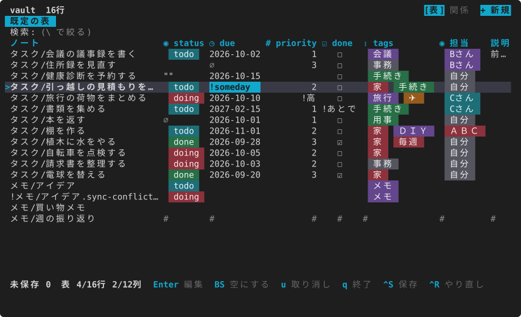
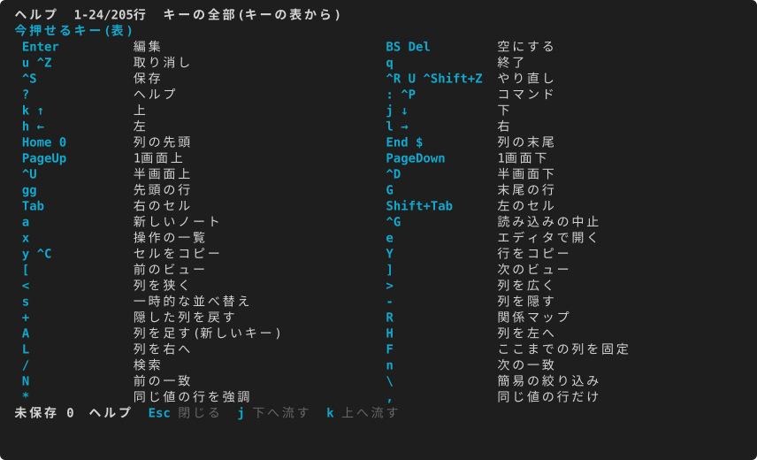
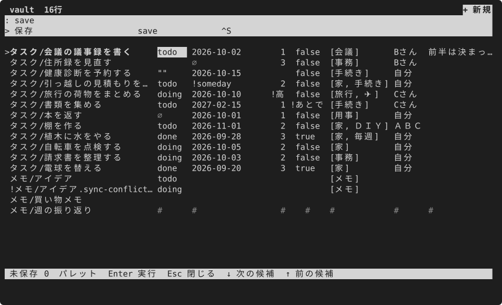

# はじめかた

[English](../en/getting-started.md) · [目次](index.md)

入れ方は3つから1つ選びます。見本を開いて、最初のセルを直して保存するまでが、このページの道です。

## 入れる

mdgrid は Rust 製の単体の実行ファイルです。[GitHub の Releases](https://github.com/S6U5/mdgrid/releases) から OS に合うアーカイブを落とすか、Rust 1.90 以上で次を実行して入れます。

```sh
cargo install mdgrid --locked
```

リポを clone して作るときは `cargo build --release` で `target/release/mdgrid` ができます。下の例は `target/release/mdgrid` で書いています。入れた `mdgrid` なら `mdgrid` だけで動きます。

シェルの補完と man ページも出せます(補完は bash・zsh・fish・elvish・powershell)。

```sh
mdgrid --completions zsh > ~/.zfunc/_mdgrid
mdgrid --man > ~/.local/share/man/man1/mdgrid.1
```

## 見本のルートフォルダで開く

リポには見本のルートフォルダ `examples/studio` があります。架空の制作会社 Northwind Studio のタスク・案件・顧客・人・会議の5つのフォルダで、ノートは互いにリンクでつながっています(ノートは英語。[見本の説明](../../../examples/README.md))。保存するとファイルが書き換わるので、一時フォルダに写してから開きます。

```sh
cp -R examples/studio /tmp/mdgrid-sample
target/release/mdgrid /tmp/mdgrid-sample/Tasks
```

ヘッダーに「Northwind Studio」、下にタスクの行が並べば成功です。`q` で終われます。

見本の日付は 2026年10月の初めです。この説明書の画面は、今日を 2026-10-06 として撮っています(`MDGRID_TODAY=2026-10-06`)。

写さずに見るだけなら `--readonly` を付けます。編集・保存・新しいノートができなくなり、何も書きません。

```sh
target/release/mdgrid examples/studio/Tasks --readonly
```

### 見本を全部試す

リポを clone すれば、見本を全部1つのコマンドで開けます。`demos/try.sh` は mdgrid をビルドし、見本を一時フォルダに写し、その中の設定で開き、終わると写しを消します。自分のノートと設定には触りません:

```sh
git clone https://github.com/S6U5/mdgrid && cd mdgrid
sh demos/try.sh studio      # 上の見本。[[リンク]] でつないだ5つの表。R で関係マップ
sh demos/try.sh workspace   # 同じ表のいくつかをワークスペースにまとめたもの(-w Work)
sh demos/try.sh configs     # 多くの機能を入れた設定で studio を開く
sh demos/try.sh quirks      # 扱いにくいノート(空・食い違う値・読むだけのノートなど)
sh demos/try.sh ai-human    # 人の仕事と AI の仕事に分ける .base
sh demos/try.sh places      # 登録した表
```

`--` のあとは mdgrid に渡ります。たとえば `sh demos/try.sh demo -- --readonly`。

引数を省くと今のフォルダを開きます。フォルダを複数並べることも、`.base` を渡してそのビューで開くこともできます([作業の手引き](tasks.md#base-を開く))。

## 画面の見方


上から順に:

| 場所 | 中身 |
|---|---|
| ヘッダー | 頭にパンくずのボタン(`w` か押すと表の一覧の引き出し。ワークスペースを使っているときは `<ワークスペース> › <表> ▾`、ここでは `vault ▾`)と行の数。右には画面の型のメニュー(**▦ 表 ▾**。つながった表があれば関係マップも選べる)と、ビューの設定を開く **⚙ 設定**。新しいノートを作る「+ 新規」はビューの帯の右の端 |
| ビューの帯 | 上下に1行ずつ余白を取った帯(余白は設定 `display.bar_padding`)。左にビューのタブ、右に検索の欄と、絞り込み・並べ替え・分類・列のボタン、右の端に「+ 新規」 |
| タブ | ビューの名前。「既定の表」のほかに、`.base` のビューや自分で保存したビューが並ぶ |
| 検索の欄 | `\` で入ると、打つたびに行が絞られる |
| 表 | 1行が1つのノート。先頭の列がノートのパス、あとの列がフロントマターのキー |
| 下の帯 | 未保存の変更の数、今のモード、選んでいる行と列、今押せるキー |
| メッセージ行 | 操作の結果や、読むだけの理由 |

セルの印:

| 印 | 意味 |
|---|---|
| `∅`(薄い) | 値が null(`key:` だけ) |
| `""` | 空の文字列 |
| 空欄 | そのノートにキーが無い |
| `!` が前に付く | 列の型に合わない値(日付の列の `someday` など)。並べ替えでは末尾 |
| `*` | 保存していない変更 |
| `#` | 読むだけのセル(安全に書けないノートか、ネストした値などの読むだけの値)。選ぶと理由が出る |
| `!` が行の頭に付く | 同期の道具が作った競合ファイルか、変更をためている間に外で変わったノート |
| `~` が行の頭に付く | 値を直したので今のビューでは別の位置に来るが、保存か移動まで元の位置に留めている行 |



列の型は `.obsidian/types.json` から読み、無ければ最初の空でない値から推します。型で入力の仕方が変わります(テキストは候補から選ぶ、日付はカレンダー、リストは付け外し、チェックボックスは切り替え)。色を使うときは、型が見た目にも出ます: 列の見出しの印(`#` 数・`◷` 日付・`☑` チェック・`⋮` リスト・`◉` 札)、チェックボックスは `☑`/`☐`、リストとくり返す短い値は色の付いた札([見た目を整える](appearance.md#セルを部品で見せるか文字で見せるか))。

## 最初に使うキー

| キー | 動き |
|---|---|
| `↑` `↓` `←` `→`(か `k` `j` `h` `l`) | 選ぶセルを動かす |
| `Enter` | セルを編集する |
| `Ctrl+S` | 差分を見て保存する |
| `u` / `Ctrl+R` | 取り消す / やり直す |
| `/` | 検索する |
| `\` | 語を含む行だけにする |
| `[` `]` | ビューを切り替える |
| `?` | 全部のキーを出す |
| `:` か `Ctrl+P` | コマンドを名前で探す |
| `q` | 終わる(未保存の変更があれば確かめる) |

マウスも使えます。行のクリックで選び、選んだ行のセルのクリックで編集を始めます。選んだ行のファイル名のクリックは `e`(エディタで開く)と同じです。列の見出しのクリックで並べ替え(ビューに覚えます)、列の境目のドラッグで幅を変え、ホイールで上下に動きます。トラックパッドの横のスワイプ(横のホイール)と shift+ホイールでは左右の列に動きます。

ヘルプ(`?`)は、先頭に今押せるキーを出します。



キーが思い出せないときはパレットで名前を打ちます。候補の横に割り当てたキーが出ます。



全部のキーと割り当て直しは [キーの割り当て](../../keys.ja.md) にあります。

## 設定

設定は無くても動きます。変えたいときは、全項目を既定値と説明付きで書き出して、そこから直します。

```sh
mdgrid --print-config > ~/.config/mdgrid/config.toml
```

置き場は `$XDG_CONFIG_HOME/mdgrid/config.toml`(無ければ `~/.config/mdgrid/config.toml`)か、`--config <パス>` で渡したファイルです。画面の言語は `language`(`auto`・`en`・`ja`)で、既定の `auto` は `LC_ALL`・`LC_MESSAGES`・`LANG` の順で最初の空でない値を見て、`ja` で始まれば日本語、ほかは英語です。全項目は [設定](../../config.ja.md) にあります。

次は [mdgrid の考え方](concepts.md)、そのあと [作業の手引き](tasks.md) へ。
