# 作業の手引き

[English](../en/tasks.md) · [目次](index.md)

- [値を直して保存する](#値を直して保存する)
- [探す・絞る・並べる](#探す絞る並べる)
- [名前を付けた条件で絞る](#名前を付けた条件で絞る)
- [通知の欄で知らせる](#通知の欄で知らせる)
- [ワークスペースを横断して探す](#ワークスペースを横断して探す)
- [まとめて直す](#まとめて直す)
- [日付を言葉で入れる](#日付を言葉で入れる)
- [vim のキーで直す](#vim-のキーで直す)
- [新しいノートを作る](#新しいノートを作る)
- [.base を開く](#base-を開く)
- [見せ方を決めて保存する](#見せ方を決めて保存する)
- [フォルダを自分のコマンドにする](#フォルダを自分のコマンドにする)
- [使う表を登録して切り替える](#使う表を登録して切り替える)
- [表示をセッションとして保存する](#表示をセッションとして保存する)
- [窓を立て直したときに同じ表に戻る](#窓を立て直したときに同じ表に戻る)
- [最近開いた表へ戻る](#最近開いた表へ戻る)
- [お気に入りのワークスペースを行き来する](#お気に入りのワークスペースを行き来する)
- [リンクで表をつなぐ(リレーション)](#リンクで表をつなぐリレーション)
- [ワークスペースで表をまとめる](#ワークスペースで表をまとめる)
- [表を縦に並べる](#表を縦に並べる)
- [ほかのコマンドと組む](#ほかのコマンドと組む)
- [テーマを選ぶ](#テーマを選ぶ)
- [直せないとき](#直せないとき)

例の `mdgrid` は、ビルドした `target/release/mdgrid` のこと。`/tmp/mdgrid-sample` は [はじめかた](getting-started.md#見本のルートフォルダで開く) で写した見本のルートフォルダ。

## 値を直して保存する

1. セルを選んで `Enter` を押す。入力は列の型で変わる。
   - テキスト: 同じ列のほかのノートの値から選ぶ(値の種類が設定の `candidates`、既定 20 以下のとき。多ければ打つだけ)。打てば自由入力になる。
   - 日付: カレンダーが開く。`←` `→` で日、`↑` `↓` で週、`PageUp`・`PageDown` で月を動かす。`2026-10-15` のように打っても、`+3`(今日から3日後)や `来週の金曜` のような言葉([日付を言葉で入れる](#日付を言葉で入れる))でもよい。`Ctrl+T` で今日。
   - 日時: 同じカレンダーの下に時刻の欄が出る。`Ctrl+O` で時刻の欄に移り、`↑` `↓` で15分、`Shift+↑` `Shift+↓` で1時間動かす。日だけを変えれば各ノートの時刻はそのまま。`2026-10-15T09:30` と打ってもよい。
   - リスト(`tags` など): ルートフォルダにある値の一覧から付け外しする。
   - チェックボックス: `Enter` のたびに 空 → true → false → 空 と回る。
   - 数: 数として読める値だけを受け付ける。
2. `Enter` で確定する。`Esc` で取りやめ、`Tab` で確定して右のセルへ。
3. 直したセルには印が付き、下の帯の「未保存」が増える。この時点ではまだ書いていない。`u` で取り消し、`Ctrl+R` でやり直せる。
4. `Ctrl+S`(か `:w`)で保存の確認を開く。ファイルごとに、書く前と後の差分が出る。
5. `Enter` で全部を書く。`Esc` なら書かずに表に戻り、ためた変更は残る。

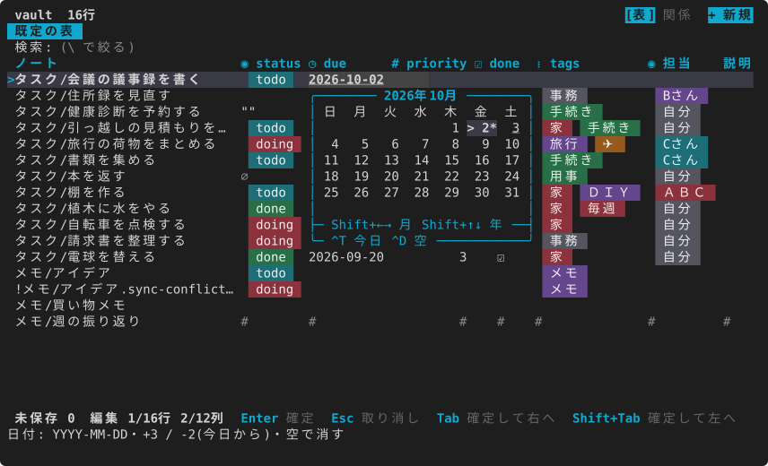

日時の列では、カレンダーの下に時刻の欄が出ます(写しは見本の会議 `examples/studio/Meetings`)。`Ctrl+O` で時刻の欄に移り、`↑` `↓` で15分、`Shift+↑` `Shift+↓` で1時間動かします。

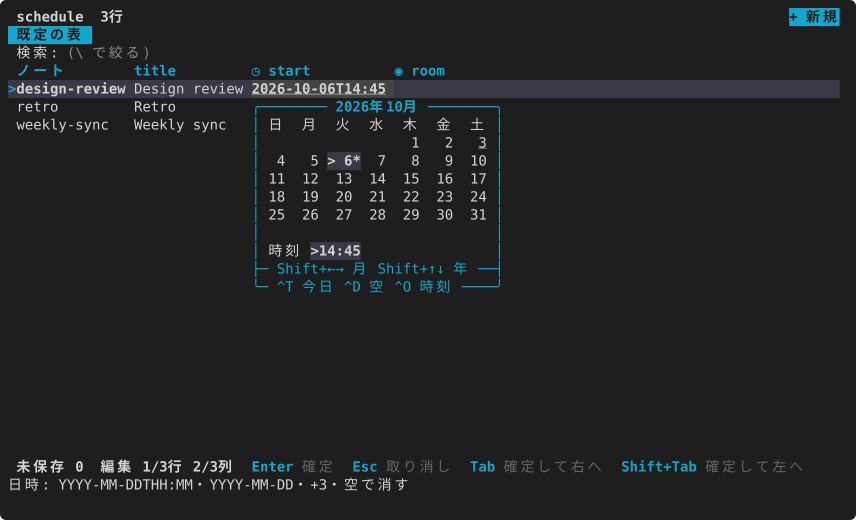

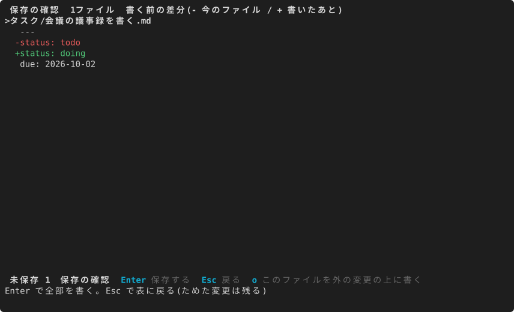

- セルを空にするには `Backspace` か `Delete`。保存すると `key:` と書かれ、キーは残る。
- 未保存のまま `q` を押すと、`s` で保存して終わる・`d` で捨てて終わる・`Esc` で戻る、を選ぶ。
- 1つのノートのプロパティを全部見るには `K`(詳細の表示)。長い値も全文で出て、`Enter` で直せる。
- ノートの本文や改行を含む値は、`e` でエディタで開いて直す。戻ると読み直す。エディタは設定の `editor`(無ければ `$VISUAL`、`$EDITOR`、`vi` の順)。

mdgrid が書くのは直したキーの値だけです。無いキーは1行足し、フロントマターの無いノートには先頭にフロントマターを足します(本文は変えない)。保存の前にノートが外で変わっていたら、確認の画面でそれを示し、上に書くか(`o`)を選ばせます。詳しくは [書き戻しの安全](../../safety.ja.md)。

ノートを git のリポに置いているなら、保存のあとに git まで進められます。設定ファイル(`config.toml`)に書きます。既定は何もしません。

```toml
[git]
auto = "commit"    # off・add・commit・push(どこまでやるか)
when = "save"      # save(保存のたび)・quit(終了のときに1回)
message = "auto"   # auto(自動の文)・ask(保存のたびに1行の欄で聞く)
```

コミットに入るのは mdgrid が書いた(か画面から作った)ノートだけで、ほかの変更中のファイルは巻き込みません。git が失敗しても保存は済んだままで、理由が1行出ます。項目の詳しい説明は [`[git]`](../../config.ja.md#git--保存のあとの-git)。

## 探す・絞る・並べる

| したいこと | キー |
|---|---|
| 語を探して強調し、一致を移る | `/` で打って `Enter`、`n`・`N` |
| 語を含む行だけにする | `\` で打つ(打つたびに絞られ、件数が出る)。`Esc` で解く |
| 選んだセルと同じ値の行だけにする | `,`(`*` なら強調だけ) |
| この列で並べ替える | `s` か見出しのクリック(昇順 → 降順 → 解除) |
| 並べ替えを組む(複数の列・向き・順) | `S` か検索の欄の右の **並べ替え** |
| 行番号へ飛ぶ | `:` で番号を打って `Enter` |
| 列を隠す・戻す | `-`・`+` |
| 列を動かす・幅を変える | `H`・`L`、`<`・`>` |
| 左の列を固定して横に流す | `F` |

検索は、小文字だけの語なら大文字小文字を区別しません。`Esc` は、選択 → 絞り込み → 検索の強調の順に解きます。

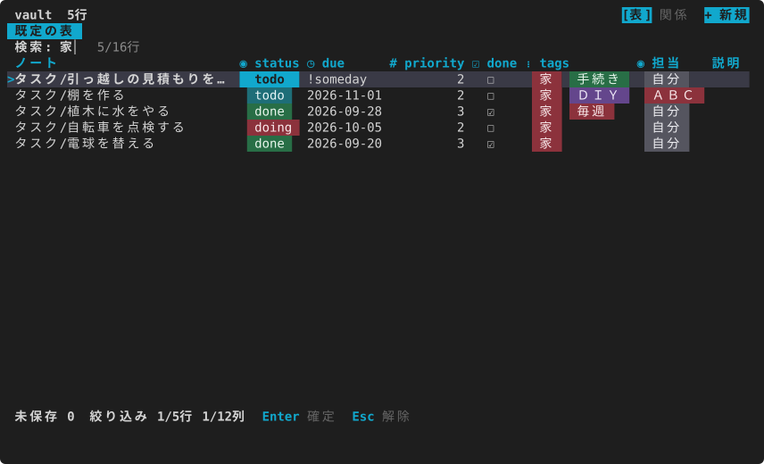

並べ替えは、今のビューに覚えて次に開いたときも同じ並びです(`.base` は変えません)。並べ替えの窓では、決まりを足す(`Enter` で列を選ぶ)・向きを変える(`Enter`)・外す(`d`)・順を入れ替える(`K`・`J`)ができ、変えるとすぐ表に効きます。`\` の絞り込みは一時的です。ビューとして残すには [見せ方を決めて保存する](#見せ方を決めて保存する)。

## 名前を付けた条件で絞る

よく使う条件は、設定の `[conditions]` に名前を付けて1回だけ書きます。書き方の全部は[設定の文書](../../config.ja.md#conditions--名前を付けた条件)にあります。

```toml
[conditions.week]
expr = 'due <= today() + "7d" && status != "done"'
label = "今週まで"
key = 1
```

| したいこと | すること |
|---|---|
| 当たる行だけにする・戻す | 書いた数字のキー(上なら `1`)を押す。2つ入れると、両方に当たる行だけ |
| ほかの式と組む | `cond("week") && priority > 1` のように、式の中で名前で呼ぶ |
| その場で式で絞る | `:` で「式で絞り込む」を選び、式を打って `Enter`(空で `Enter` なら解く) |
| ビューにいつも掛ける | `o` のフィルターの区画で、条件を「当たる行だけ」か「当たる行を隠す」にして反映 |
| どの表でも隠す | 条件に `hide = true`。隠した数が設定の帯に出て、その条件の数字のキーで出し直せる |
| 数を外に出す | `mdgrid --count --filter 'cond("week")'`(tmux の帯やシェルのプロンプトに) |

数字のキーと式の絞り込みは、ビューを移っても続き、別の表へ移るか開き直すと解けます。設定の帯の項目を外しても解けます。


## 通知の欄で知らせる

設定に `[[notices]]` を書くと、ヘッダーの上に通知の欄が出ます。件数の項目は[名前を付けた条件](#名前を付けた条件で絞る)に当たる行を数え、連絡の項目はノートの本文の頭の行を出します。書き方の全部は[設定の文書](../../config.ja.md#notices--通知の欄)にあります。

```toml
[[notices]]
cond = "overdue"
text = "期限切れ {count} 件"
scope = "workspace"

[[notices]]
note = "~/notes/inbox.md"
lines = 2
```

| したいこと | すること |
|---|---|
| 欄へ移る | `m`(か欄をクリック)。`←`・`→` で項目を選び、`Esc` で表へ戻る |
| 当の行を見る | 件数の項目で `Enter`。今の表ならその条件で絞り、ほかの表も数える項目なら、当たる行のある表を並べる |
| 連絡を書き足す | 連絡の項目で `Enter`。エディタでノートが開き、戻ると欄を読み直す |
| 外に出す | `mdgrid --notices`(1項目1行。tmux の帯・シェルのプロンプト・Herdr のサイドバーに) |

数は、開いたとき・保存したあと・外で変わったとき・日付が変わったときに数え直します。ほかの表を数える項目は、表を先に出してから裏で数え、数え終わるまで「…」を出します。


## ワークスペースを横断して探す

どの表に書いたか覚えていない行は、[ワークスペース](#ワークスペースで表をまとめる)の表の全部からまとめて探せます。ワークスペースを開いていなければ、[登録した表](#使う表を登録して切り替える)の全部から探します。初めに設定で入れます(書かなければパレットにも出ません)。

```toml
[search]
across = true
```

1. `:` でパレットを開き、「ワークスペースを横断して探す」(`across_search`)を選ぶ。
2. 探す語を打って `Enter`。読み終えた表から結果が出て、読み終えるまで「3 / 5 を読みました」と出ます。
3. `↑`・`↓` で行を選んで `Enter`。その表が開き、検索の欄に同じ語が入って、その行が選ばれます。

結果は表ごとにまとまり、行ごとにノートの名前と、当たった列と値が並びます。当て方は検索の欄(`\`)と同じで、語に大文字が無ければ大文字と小文字を区別しません。途中で `Esc` を押せば止まって、元の表のまま戻ります。読めない表は飛ばして、結果の終わりに名前が出ます。ためた変更があるときは、引き出しで表を移るときと同じく、先に保存するかを聞かれます。


## まとめて直す

ノートの名前は、操作の一覧(`x`)かパレット(`:`)の「ノートの名前を変える」で変えられます。古い名前を指すリンク(`[[古い名前]]`)は新しい名前への書き換えがためられるので、`Ctrl+S` で差分を見て保存します。

1. `Space` で行に印を付ける(付けて1行下へ動く)。`v` で範囲、`Ctrl+A` で全部。
2. 印を付けた行のどれかで、直したい列のセルを `Enter` で開いて値を決める。
3. 印の付いた行に同じ値が入る。入れられない行(読むだけのノートなど)は飛ばし、数と理由が出る。

リストの列では、全部の行が持つ値は `[x]`、一部の行だけが持つ値は `[-]` で出ます。付け外しした値のほかは、各行の要素がそのまま残ります。

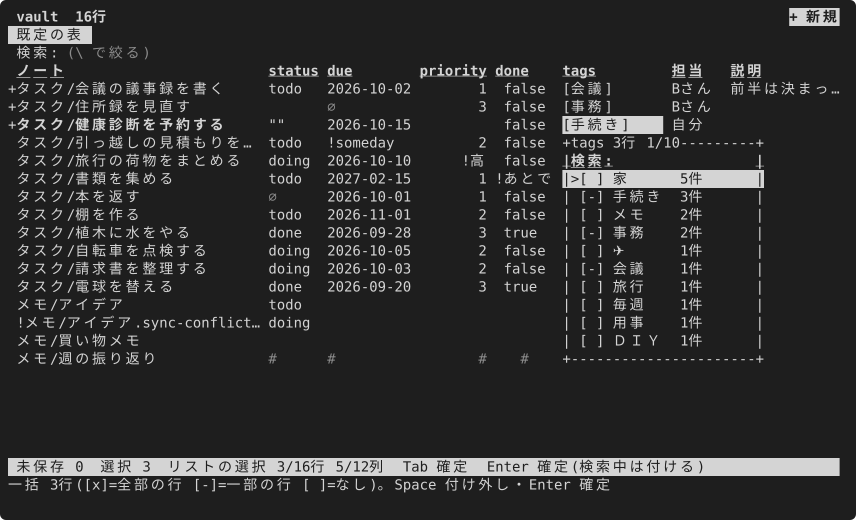

保存までは書かないので、`Ctrl+S` の差分でまとめて確かめられます。

## 日付を言葉で入れる

日付と日時のセルには、`2026-10-15` や `+3` のほかに、日付の言葉を打てます。`来週の金` まで打った所では欄の横に「読めない」と出て、`曜` を足すと `2026-11-27(金)` に変わり、カレンダーもその日を選びます。`Enter` で、その日がためる変更になります。読めない言葉のまま `Enter` を押しても欄は閉じず、ノートには何も書きません。


読む言葉と、今日が 2026-11-21(土)のときに入る日です。英語の言葉も、画面の言語にかかわらず読みます。

| 打つ言葉 | 入る日 |
|---|---|
| `今日`・`明日`・`明後日`・`昨日`、`today`・`tomorrow`・`yesterday` | 11-21・11-22・11-23・11-20 |
| `3日後`・`in 3 days`・`3d`・`+3d` | 3日後(11-24) |
| `2日前`・`3 days ago`・`-2d` | その日数の前(`2日前` は 11-19) |
| `2週間後`・`in 2 weeks`・`+2w` | 2週間後(12-05) |
| `1か月後`・`in 1 month`・`+1m`、`1年後`・`+1y` | 同じ日(無ければその月の最後の日) |
| `金曜`・`金曜日`・`fri`・`friday` | 今日より後の最初の金曜(11-27) |
| `今週の金曜`・`this fri` | 今の週の金曜(11-20) |
| `来週の金曜`・`next fri` | 次の週の金曜(11-27) |
| `来週`・`next week` | 次の週の初めの日(11-22) |
| `来月`・`next month` | 次の月の1日(12-01) |
| `月末`・`eom` | 今月の最後の日(11-30) |
| `来月末`・`end of next month` | 次の月の最後の日(12-31) |

週の区切りは設定の [`dates.week_start`](../../config.ja.md#datesweek_start)(既定は日曜)に従います。`week_start = "mon"` なら、日曜の 11-22 に打った `今週の月曜` は 11-16 です。

日時の列で言葉を打つと、日だけが変わって時刻は残ります。`2026-11-21T15:00` のセルに `明日` なら `2026-11-22T15:00` です。

印を付けた行をまとめて直すときも同じ言葉が使えます。絞り込みの比べる値(`due` の「< より前」に `明日` など)では、打ったときの今日で日付に直して条件に残します。明日開いても条件は同じ日付のままです。

## vim のキーで直す

vim に指が慣れていると、セルの値を直すたびに Esc で入力が閉じたり、語ごとに消せなかったりするのがもどかしいはずです。設定のファイル(`~/.config/mdgrid/config.toml`)にこう書くと、mdgrid の入力の欄が vim と同じ2つのモードを持ちます。

```toml
[keys]
vim = true
```

セルの `Enter`、`/` の探す欄、`\` の検索の欄、`:` のパレット、新しいノートの名前など、1行の入力の欄はどれも挿入のモードで開き、いつもどおり打てます。Esc を押すと欄は開いたままノーマルのモードに移り、下の帯の `-- 挿入 --` が `-- ノーマル --` に変わって、カーソルが四角になります。

ノーマルのモードでは `h` `l` `0` `$` で字ごとに、`w` `b` `e` で語ごとに動きます。語の切れ目は vim と同じで、漢字・ひらがな・カタカナの間でも切れます。`会議の見積もり` の頭で `dw` を押すと `会議` だけが消えて `の見積もり` が残ります。`x` `X` `D` `dd` で消し、`cw` `C` `cc` で消してから打ち直し、`i` `a` `I` `A` で挿入のモードへ戻ります。`u` は入力の欄の中の直しを1つずつ戻します。もう一度 Esc を押すと入力を取りやめ、Enter はどちらのモードでも値を決めます。

表の画面にも3つのキーが足されます。

- `dd` は選んでいる行のノートを、名前を確かめてからごみ箱へ動かします。`Space` で印を付けた行や `v` で選んだ範囲があれば、その全部をまとめて動かします(範囲を選んでいる間は `d` だけ)。`u` 1回で全部戻ります。
- `p` は mdgrid の中で最後に写した値を入れます。`y` でセルを写したなら選んでいるセルへ、`Y` で行を写したなら同じ名前の列へ。`file.name` と計算の列は変わりません。
- `.` は、直前に1つのセルに入れた値を、選んでいる行の同じ列にもう一度入れます。status を `done` にして `j` `.` `j` `.` と続ければ、下の行も次々に `done` になります。

`p` と `.` で入れた値は「ためた変更」になるので、`Ctrl+S` の差分で確かめてから書きます。`5j` のような回数は数えず、数字のキーはほかの機能に使います。足すキーは [キーの割り当て](../../keys.ja.md#input_normal) にあり、ほかのキーと同じく `[keys.table]` と `[keys.input_normal]` で割り当て直したり外したりできます。

パレットの `q!` は、ためた変更を確かめずに捨てて終わります。こちらは vim モードでなくても使えます。

## 新しいノートを作る

1. `a` かビューの帯の右の端の「+ 新規」を押す。名前と、表の列ごとの欄が並んだ窓が開く。
2. 名前を打つ。`下/名前` と打てばその下のフォルダに作る(無いフォルダも作る)。`Enter`・`Tab` で次の欄、`Shift+Tab` で前の欄へ。欄は列の型に合った入れ方(候補・カレンダー・リスト)で直す。
3. どの欄からでも `Ctrl+S`(最後の欄なら `Enter`)で、すぐにファイルができ、作った行が選ばれる。`Ctrl+E` なら作ってすぐエディタで開く。

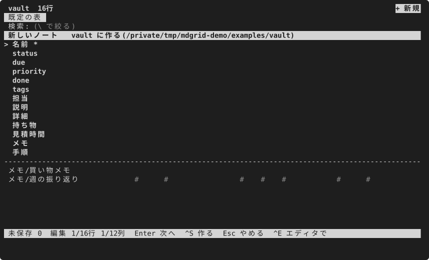

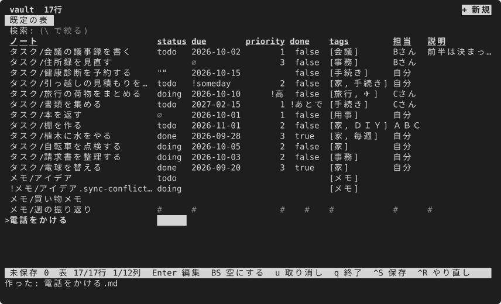

- フォルダを2つ以上開いたときは、先に作る場所を選びます。
- `status == "doing"` のように値が1つに決まる絞り込みのビューで作ると、その値が入り、ビューに残ります。
- 開いたフォルダの外や、既にある名前には作りません。`--readonly` では作れません。
- 窓の欄・必須の欄・前もって入れる値(`{date+7}`・`{now}` などの変数を使える)・作成日のように欄に出さずに入れる値・本文の雛形・窓を使うかすぐエディタで開くか(`mode = "editor"`)は、設定の [`new_note`](../../config.ja.md#new_note) で決めます。

画面を開かずにコマンドから作ることもできます。スクリプトや AI のエージェントがタスクを足すときに使えます。

```sh
mdgrid ~/notes/tasks --new-note "牛乳を買う" --set due=2026-11-20 --set priority=p1 --set tags=家,買い物
```

- 画面と同じ設定(`new_note` の作る場所・前もって入れる値・本文の雛形)で作り、作ったノートのパスを1行出します。
- `--set 列=値` は窓の欄に打つのと同じで、何度でも書けます。値は列の型で読みます。リストの列は `,` で区切り、空の値(`--set status=`)はその列を書きません。
- 既にある名前・フォルダの外を指す名前・型に合わない値・必須の列が空のときは、何も作らずに理由を1行出して終わります(終了コード 2)。

## ノートを消す・戻す

間違って作ったノートは、作った直後に `u` を押せば片づきます。ファイルは消えずに、開いたフォルダの `.trash/`(ごみ箱)へ動きます。やっぱり要るなら `Ctrl+R` で元の場所に戻ります。

前からあるノートを片づけるときは、次の順です。

1. 消したい行で、操作の一覧(`x`)かパレット(`:`)の「ノートを消す」を選ぶ。
2. 名前を確かめて `y` と `Enter`。ノートがごみ箱へ動き、表から行が無くなる。ほかの答えと `Esc` では何もしない。
3. 取り消すなら `u`。元の場所に戻り、その行が選ばれる。


mdgrid を閉じたあとでも、パレットの「ごみ箱から戻す」で戻せます。ごみ箱のノートが名前・元の場所・消した日時つきで並ぶので、選んで `Enter` を押します。


- 戻す先に同じ名前のノートがもうあるときは、戻さずに知らせます。どちらのノートも変わりません。
- ためた変更のあるノートは消せません。先に保存するか、`u` で取り消します。
- ほかのノートがリンクで指しているときは、確かめの問いにその数が出ます。リンクは書き換えません。
- ごみ箱の中身を mdgrid が消すことはありません。片づけるときは `.trash/mdgrid/` をファイルの道具で消します。
- `--readonly` と CSV・TSV の表では、消すことも戻すこともできません。

## .base を開く

```sh
mdgrid /tmp/mdgrid-sample/Tasks.base
mdgrid /tmp/mdgrid-sample/Tasks.base --view "This week"
```

`.base` の table ビューがタブに並び、先頭(か `--view` の名前)が開きます。`[`・`]` で切り替えます。filters・order・sort・groupBy・limit・displayName・formulas を読み、グループの見出しの行は `Enter` で畳めます。

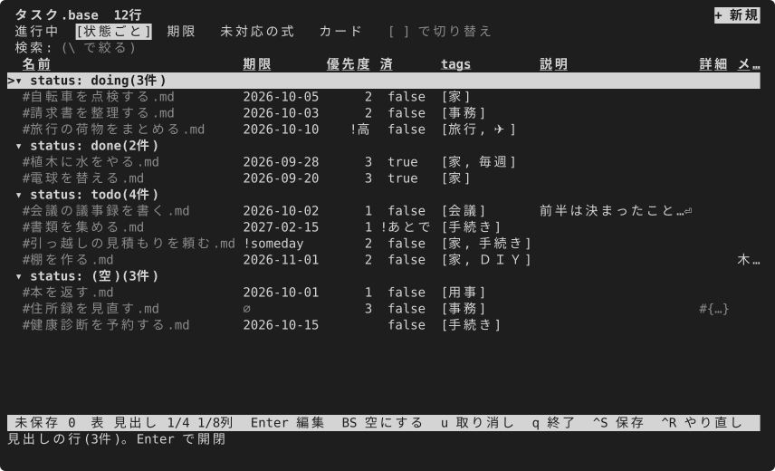

- 評価できない式の列は推測せず、薄い `?` を出します。選ぶと、どの式かが下に出ます。
- table 以外のビュー(カードなど)は開かずに理由を出します。
- mdgrid は `.base` を書き換えません。

解釈する項目・演算子・関数の一覧は [Obsidian Bases の対応範囲](../../obsidian-bases.ja.md) にあります。

## CSV・TSV を台帳として開く

```sh
mdgrid /tmp/mdgrid-sample/equipment.csv
```

`.csv`・`.tsv` のファイルを1つ渡すと、1行目を列の名前、2行目からを行にした表で開きます。値の直し・取り消し・保存の前の差分・絞り込み・並べ替え・グループ分け・ビューの保存・`--print` は、ノートのフォルダと同じように使えます。

- 保存では、直した値の文字だけを書き換えます。ほかの行、引用符の付け方、改行の形(LF・CRLF)、先頭の BOM はそのままです。値に `,`・`"`・改行が入るときだけ引用符で囲みます。
- 1つのファイルなので、何行直しても、保存の確認ではそのファイルの差分を1つにまとめて見せ、1回で書きます。開いたあとに外でファイルが変わっていたら書きません。
- `a` はファイルの末尾に空の行を1つ足し(すぐ書きます)、その行の1列目の入力を開きます。
- 文字は UTF-8 だけを読みます。Shift_JIS などのファイルは、理由を出して開きません(UTF-8 で保存し直すと開けます)。列の数が見出しと合わない行は、読むだけになり、選ぶと理由が出ます。
- ノートだけの機能(エディタで開く・ノートの名前の変更・キーの名前の変更と削除・列を足す・リンクと関係マップ・親子の並べ方・`.base` に書き出す)は出さず、キーで呼んでも理由を出して何もしません。
- 改行は LF と CRLF を読みます。CR だけの改行のファイルは、理由を出して開きません。同じ名前の列は2つ目から `名前#列の番号`、名前の無い列は `#列の番号` という列になります。
- `--print --with-path` の path は `台帳.csv#2` のように「ファイル#行の番号」で、`--apply` でその行に戻せます。
- CSV とノートの間のリンク(リレーション)は、まだありません。CSV の表は、表の一覧やワークスペースに登録して開けますが、リンクと関係マップの範囲には入りません。

## 見せ方を決めて保存する

`o` でビューの設定を開きます。左に区画が番号つきで並び、右に選んだ区画の項目が出ます。並べ替えなら `3` の1打で移れて、`Tab` で順に巡ることもできます。`h` で左の一覧に入れば `j`・`k` で区画を選べて、右もそれに合わせて替わります。項目へ戻るのは `l` か `Enter`。いまキーが効いている側には `>` の印が付きます。

- 列: 見せる列と順
- フィルター: 条件を足す。列を選ぶと値の一覧が件数つきで出て、残す・隠す値にチェックを付けられる
- 並べ替え・グループ
- 親子: オンにすると、子のノートの `parent: "[[親]]"`(キーは区画で選べる)で、子を親の下に字下げして並べる。子を持つ行の ▾ / ▸ か `Z` で畳む・開く。並べ替えは兄弟の中で効き、親が表に無い子は一番上の段に出る。同じ区画で WBS をオンにすると、名前の前に番号(`1.2.1`)を付け、進み具合のキー(既定 `status`)の値ごとに「割合 ラベル」(例 `100 完了`。`-` で外す)を打って対応表を作る。子の無い行はラベル、子のある行は子孫の割合の平均を出す。対応表はビューの設定として残る
- 表示: 行番号・一行おきの色・列の区切り線・タブ・検索の欄・設定の帯
- ビュー: 表の上のタブ。`Space` で出す・隠す、`K` / `J` で順、`Enter` で既定にする・名前を変える・削除、末尾の行で「[ ] で切り替え」の案内を出すか。ここの変更は「反映」を待たずにすぐ `views.toml` に残る(開いているビューは隠せず、`.base` のビューは名前を変えたり消したりできない)
- 見た目: 「保存先」(全体・このワークスペース・この表・このビュー)を選び、テーマ・組・丸い札の端を `Enter` で選ぶ。テーマと組の横に、今の値がどこから来たか(「(この表)」など)が出る。「反映」で画面に効かせ、選んだ場所(`ui.toml`・`workspaces.toml`・`views.toml`・ビューの設定)に残す(`config.toml` とワークスペースの印は書き換えない)。「+ 今の見た目を名前を付けて保存」でテンプレートにし、一覧から選んで当てる・`d` で消す。「この範囲の上書きを外す」で広い範囲のとおりに戻す

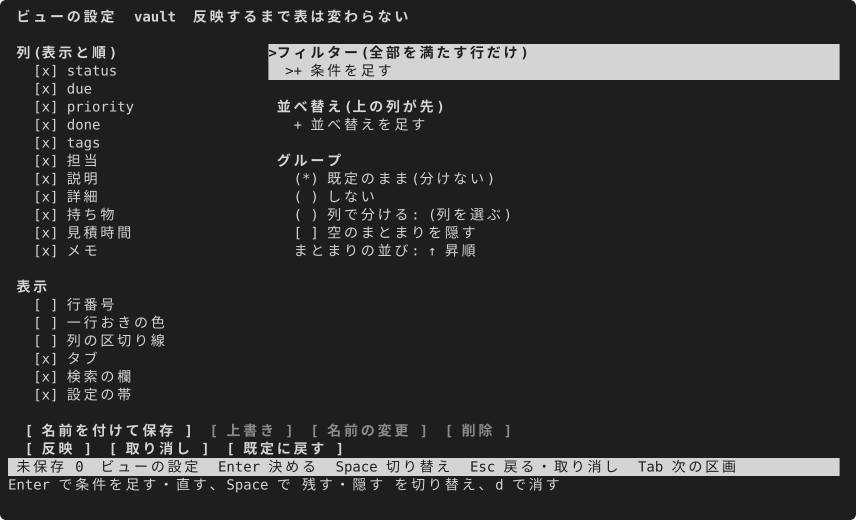

「反映」で表に効かせ、「名前を付けて保存」で mdgrid のビューとして残します。パレット(`:`)か操作の一覧(`x`)の **既定のビューにする** で、今のビューを次に開いたときのビューにできます(先頭のタブを選ぶと先頭に戻ります)。保存したビューは同じ画面の「上書き」「名前の変更」「削除」で直し、「既定に戻す」で設定を既定に戻せます。保存したビューは「既定の表」の横のタブになり(`[display] tabs = "auto"` なら、タブの行はここから出ます)、設定の置き場の `views.toml` に書かれます。効いている条件は表の上の設定の帯に並び、`f` で帯に入って `Backspace` で外せます。

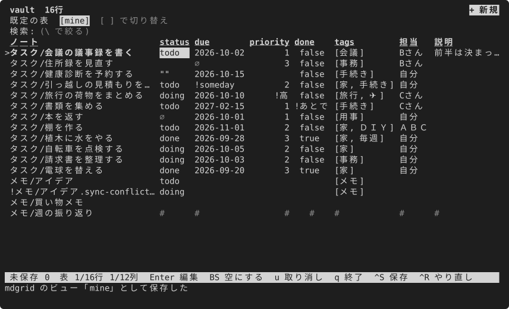

Obsidian と行き来するには、パレット(`:`)から:

- `export_base`: 今のビューを、名前を決めた新しい `.base` に書き出す(既にある `.base` は書き換えない)
- `import_base`: `.base` のビューを mdgrid のビューとして取り込む(持てない部分は、落とした項目として出る)

`--readonly` のときはビューの設定を覚えません。

## フォルダを自分のコマンドにする

mdgrid は開いたフォルダ(か `.base`)ごとに、見せる列とその並び・幅、`o` で決めた絞り込み・並べ替え・まとまり、畳んだまとまり、タブとして保存したビューを覚えていて、次に同じフォルダを開くと全部が戻ります。なので、シェルの alias を書くだけで、フォルダが自分のコマンドになります。

`~/.zshrc` か `~/.bashrc` に、フォルダごとに1行書きます:

```sh
alias tasks='mdgrid ~/notes/Tasks'
alias books='mdgrid ~/notes/Books'
alias meetings='mdgrid ~/notes/Meetings --readonly'   # 見るだけ
alias standup='mdgrid ~/notes/タスク.base --view 状態ごと'   # .base を1つのビューで開く
```

- `tasks` と打てば、前に使ったときのままのタスクの表が開きます。
- 覚えないもの: `\` の簡易の絞り込み、`--readonly` で開いたときに変えたこと(見出しや並べ替えの窓での並べ替えは覚えます)。
- fish では `alias --save tasks 'mdgrid ~/notes/Tasks'` です。

出す側も、シェルの関数で同じように作れます:

```sh
todo() { mdgrid ~/notes/Tasks --print --format md --filter 'status != "done"' --sort due; }
pick-task() { mdgrid ~/notes/Tasks --pick path; }
```

## 使う表を登録して切り替える

よく開く表(フォルダか `.base`)は、名前と分類を付けて登録できます。開いている表でパレット(`:`)の **この表を登録** を選び、名前(今のビューかフォルダの名前が入っている)と分類(今の分類から選ぶか、新しく打つ)を決めます。同じ名前があれば置き換えるかを聞きます。

登録すると、引数なしの `mdgrid` で、分類ごとに並んだ一覧が今のフォルダの表の上に出ます。名前・分類・パスのどれでも打って絞り、Enter で開きます(登録したビューで開く)。

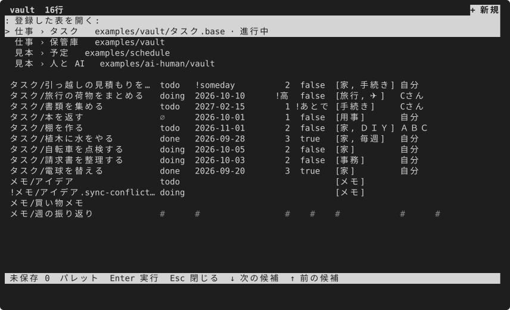

先頭の「今のフォルダ」か Esc で、今のフォルダの表のままです。表を開いている間も、パレットの **登録した表を開く** で同じ一覧が出ます。保存していない変更があれば、移る前に保存するか捨てるかを聞きます。

登録は、設定のフォルダの `places.toml`(`~/.config/mdgrid/places.toml`)に入ります。手で書いてもかまいません:

```toml
[[place]]
name = "タスク"
group = "仕事"
path = "~/notes/Tasks"

[[place]]
name = "本"
group = "趣味"
path = "~/notes/本.base"
view = "読んでいる"
```

`path` の先頭の `~` はホームのフォルダです。読めない行(`name` か `path` が無い、名前が重なる)は警告を出して飛ばします。ノートには何も書きません。

## 表示をセッションとして保存する

週に一度、進行中のタスクのうち会議の付くものだけを、期日の順に見る。そういう表示を毎回組み直すのは手間です。絞り込みと並べ替えと列を組んだ表示に名前を付けて、セッションとして保存しておけば、`mdgrid -s 進行中` の1行でその表示のまま開きます。

表を絞って並べ、列を決めたら、パレット(`:`)の **セッションを保存** を選んで名前を打ちます。同じ名前があれば、置き換えるかを聞きます。`--readonly` で開いていても保存できます(ノートには何も書きません)。


セッションに入るのは、開いている表(フォルダか `.base`)とビュー、`\` の絞り込み、同じ値の絞り込み、式の絞り込み、数字のキーで入れた条件(いつも隠す条件を止めたことも)、並べ替え、見せる列の並びと隠した列、読むだけで開いたかどうか。セルの値は入りません。開くたびにノートから読むので、保存したあとに直した値も今の値で出ます。

```sh
mdgrid -s 進行中      # その表示で開く
mdgrid --sessions     # 保存したセッションの名前と開くフォルダを1行ずつ出す
```

セッションは、設定のフォルダの `sessions.toml`(`~/.config/mdgrid/sessions.toml`)に入ります。手で書いても、dotfiles に入れてほかのマシンへ持っていってもかまいません:

```toml
[sessions."進行中"]
folders = ["~/notes/Tasks"]
columns = ["title", "status", "due"]
hidden = ["priority"]

[[sessions."進行中".filters]]
kind = "value"      # 同じ値の絞り込み。ほかに text(\ の語)・expr(式)・cond(数字のキーの条件)・show(止めたいつも隠す条件)
key = "status"
value = "進行中"

[[sessions."進行中".sort]]
key = "due"
dir = "asc"
```

英数字と `-`・`_` のほかの字を使う名前は、`"進行中"` のように引用符で囲みます(TOML の決まり)。`~` はホームのフォルダです。知らない項目は警告を出して飛ばし、セッションにあって今の表に無い列も、その列だけ飛ばして知らせます。無い名前・壊れた `sessions.toml`・開くフォルダが無いときは、理由を1行出して終わります。`-s` とパスは一緒に渡せません。

セッションで開いた表で終えると、その列と並べ替えは、同じフォルダをふつうに開いたときの見た目にも残ります(画面で変えたことと同じく、最後の見た目を覚えるため)。セッションの中身を変えるには、同じ名前でもう一度保存します。

## 窓を立て直したときに同じ表に戻る

パソコンを再起動したあとも、ターミナルの窓を元どおりに並べ直してくれる道具があります。mdgrid は、そういう道具が窓を立て直したときに、前と同じ表とビューで開き直せます。戻るのは表とビューまでで、選んでいた行やスクロールの位置、保存していない変更は戻りません。

[Herdr](https://herdr.dev) の窓では、何も設定しなくても効きます。mdgrid は今の表とビューで開き直す命令を Herdr に伝え、別の表やビューへ移るたびに伝え直します。Herdr のサーバーが止まって立て直すと、Herdr が同じ窓でその命令を走らせます。自分で `q` で終えた窓は Herdr に返すので、立て直しても開き直しません。Herdr のエージェントの一覧には、名前 `mdgrid` で並びます。

mdgrid の窓をいくつも開いていても、Herdr のサイドバーでどれがどの表か見分けられます。窓の題に `タスク · 進行中` のように表とビューの名前が出て、ビューを移ると替わり、`q` で終えると消えます。表の名前は、ワークスペースの表なら付けた名前、そうでなければ `.base` のファイル名かフォルダの名前です。ビューが1つしか無い表では表の名前だけになります。

止めたいときは設定に書きます:

```toml
[terminal]
herdr = false
```

tmux のように mdgrid から命令を受け取れない道具には、`mdgrid --continue` を使います。mdgrid は、起動したフォルダごとに最後に開いていた表とビューを `~/.local/state/mdgrid/` に覚えていて、そのフォルダで `mdgrid --continue` と打つとそこへ戻ります。覚えた画面が無いときや、その表がもう無いときは、引数なしの `mdgrid` と同じに開きます。tmux の復元のプラグイン [tmux-resurrect](https://github.com/tmux-plugins/tmux-resurrect) なら、`~/.tmux.conf` にこう書いておくと、復元のときに mdgrid の窓で `mdgrid --continue` が走ります:

```tmux
set -g @resurrect-processes '"~mdgrid->mdgrid --continue"'
```

`--continue` に `--readonly` を添えると、読むだけで開きます。パスや `--view` とは一緒に渡せません。

## 最近開いた表へ戻る

画面で開いた表(フォルダか `.base`)は、そのとき見ていたビューと一緒に、新しい順に 20 件まで覚えています。登録もワークスペースへの追加もしていない表に、あとから戻るための記録です。

パレット(`:`)の **最近開いた表** で一覧が出ます。1行に、表の名前とビュー・最後に開いた日時・置き場のフォルダ。打った文字で絞り、Enter でその表を最後に見ていたビューで開きます。今開いている表は並びません。保存していない変更があれば、移る前に保存するか捨てるかを聞きます。


表を登録してあれば、引数なしの `mdgrid` の一覧にも、「今のフォルダ」の次の「最近」の分類に5件まで並びます。

シェルからは `mdgrid --recent` です。パス・ビューの名前・最後に開いた日時をタブで区切って、1件1行で出します:

```sh
$ mdgrid --recent
/home/u/notes/tasks.base	進行中	2026-11-21 09:30
/home/u/notes/projects		2026-11-20 18:02
```

fzf で選んで、そのビューで開く例:

```sh
line=$(mdgrid --recent | fzf) &&
  view=$(printf '%s\n' "$line" | cut -f2) &&
  mdgrid "$(printf '%s\n' "$line" | cut -f1)" ${view:+--view "$view"}
```

覚える場所は見た目の状態の置き場(`~/.local/state/mdgrid/recent.toml`)で、ノートのフォルダには何も書きません。消えたフォルダや `.base` は、一覧と `--recent` に出す前に外します。

## お気に入りのワークスペースを行き来する

仕事のワークスペースと趣味のワークスペースのように、よく行き来するものはお気に入りに入れておきます。表の一覧の引き出し(`w`)で、ほかのワークスペースの見出しを選んで `f` を押すと入り、見出しに `★` が付きます。もう一度 `f` で外れます。今いるワークスペースは、パレットの **今のワークスペースをお気に入りにする** で入れます(もう入っていれば外します)。

表・関係マップ・木・ガント・カンバン・グラフのどの画面でも、`W`(かパレットの **ワークスペースを切り替える**)で、お気に入りを入れた順に番号つきで並べた一覧が開きます。数字のキーでその番号へ、`↑` `↓` と Enter で選んだ所へ移ります。Esc なら何もせずに元の画面です。


移った先は、この起動のあいだにそのワークスペースで最後に見ていた表とビューです。まだ開いていなければ、印の `open` の表か最初の表で開きます。

起動したときに開いた所(ワークスペースでないフォルダ・`.base`・見つけたルートフォルダ・ワークスペース)から離れると、一覧の先頭に「最初に開いた所」が出ます。選ぶと、起動したときの表に、そこで最後に見ていたビューで戻ります。どこへ移るときも、保存していない変更があれば先に保存するか捨てるかを聞きます。

お気に入りは `workspaces.toml` の最上位の `favorites` に、入れた順で入ります。`workspaces.toml` のワークスペースは名前で、印のワークスペースは根のパスで書きます。手で書いてもかまいません:

```toml
favorites = ["仕事", "趣味", "~/lab"]
```

ノートのフォルダとワークスペースの印には書きません。名前のワークスペースが消えたり、印の根が無くなったりした項目は、一覧に出さずに警告します。

## リンクで表をつなぐ(リレーション)

ノートのフロントマターにほかのノートへのリンクを書くと、ノートのフォルダどうしを、つながった表(タスク → 案件 → 顧客)として扱えます。キーはノートのファイル名なので id の列は要らず、多対多はリンクのリストで書けるので中間の表も要りません。

```yaml
project: "[[Clinic Booking App]]"     # 案件1つ
owner: "[[Leo Park]]"
depends_on:                           # 複数
  - "[[Design the booking screens]]"
  - "[Build the appointment API](Build%20the%20appointment%20API.md)"   # Markdown のリンクも、ただのパスも使える
```

- リンクのセルは、行き先のノートの名前で出ます。行き先の無い `[[…]]` は、名前の前に `?` が付きます。
- 値の多くがリンクの列で Enter を押すと、行き先のフォルダのノートが名前で並びます。選んだノートは、その列で使われている形(無ければ `[[名前]]`)で書きます。リストの列では複数を付けられます。
- `:open_link`(か `x` の一覧の **リンクの行き先を開く**)で行き先を開きます。同じ表ならその行へ移り、違えばノートを含む登録した表(無ければノートのフォルダ)を開いて、その行を選びます。保存していない変更があれば先に確かめます。
- `:linked_rows` で、今のノートを指しているノートを、どの表のどの列からかと一緒に並べます。選ぶとそのノートを開きます。
- フォルダを開いても `.base` を開いても同じに効き、行き先は開いたフォルダの外でもかまいません。つなぐフォルダを登録しておくと(上の節)、名前がフォルダをまたいで解けます。ただのパスは、`/` を含むか `.md` で終わり、ノートが実際にあるときだけリンクとみなすので、普通の言葉は文字のままです。

見本 `examples/studio` は、この形でタスク・案件・顧客・人・会議をつないでいます: `mdgrid examples/studio/Tasks`。

**関係マップ。** `R`(か右上の画面の型のメニューの **関係マップ**)で、表を箱(行の数と列)にし、リンクの列から行き先の表へ矢印を引いた図が出ます(`N` → `1`、リンクのリストなら `N` → `N`)。`↑` `↓` で表を、`←` `→` でつながりを選ぶと、詳細と(縦に広い端末では)つながった行が変わります。並びは端末の幅に合わせて変わります。クリックでも操作できます(表は1回で選び、もう一度で開く。線や矢印でつながりを選び、つながった行でそのノートを開く)。もう一度 `R` で表に戻ります。図に出るのは今のワークスペース(下)の表、無ければ登録した表です。

## ワークスペースで表をまとめる

ワークスペースは、名前の付いた表(フォルダか `.base`)の集まりです。開いた表がどれかに入っていれば、リンク・つながった行・関係マップ・右上の画面の型のメニューは、そのワークスペースの表だけを使います(仕事のルートフォルダと趣味のルートフォルダが混ざらない)。ヘッダーのパンくずに `<ワークスペース> › <表>` と出ます。

パレット(`:`)で **この表でワークスペースを作る**・**この表をワークスペースに足す**(選ぶか、新しい名前を打つ)・**この表をワークスペースから外す**・**ワークスペースを開く**(選んで、その表を選ぶ)。シェルからは(パスを書かなければ、`--add-to` と `--remove-from` は今のフォルダ):

```sh
mdgrid ~/notes/tasks --add-to 仕事
mdgrid ~/notes/projects --add-to 仕事 --as プロジェクト
mdgrid --workspaces                          # 一覧
mdgrid -w 仕事                               # 仕事 の最初の表を開く
mdgrid -w 仕事 ~/notes/tasks                 # この表を 仕事 の中で開く
mdgrid ~/notes/tasks --remove-from 仕事
mdgrid --remove-workspace 仕事               # ノートには触らない
```

ワークスペースは、設定のフォルダの `workspaces.toml`(`places.toml` の隣)に入ります:

```toml
[[workspace]]
name = "仕事"

[[workspace.table]]
name = "タスク"
path = "~/notes/tasks"

[[workspace.table]]
name = "プロジェクト"
path = "~/notes/projects"
view = "進行中"
```

ノートの側に置きたいとき(共有するリポなど)は、その根で `mdgrid --init-workspace`(か `mdgrid <フォルダ> --init-workspace`)を動かします。`.mdgrid/workspace.toml` ができ、`[[table]]` を書かなければ、根の直下のノートのあるフォルダが全部、表になります(`.base` はルートフォルダ全体を指すので自動では入れません。入れたければ `[[table]]` に書きます)。

根のフォルダを開いたときに決めた表を開きたいときは、印の最上位に `open = "<表の名前>"` を書きます(`[[table]]` の `name`。自動の表ならフォルダの名前)。たとえば README や AGENTS.md の並ぶ台帳のフォルダで、`.base` の表だけを開けます。フォルダの全部のノートを見たいときは `--raw` を添えます。

範囲の決め方(先に当たったもの): `-w` → 開いたフォルダから上へたどって最初の `.mdgrid/workspace.toml` → その表を含む `workspaces.toml` の最初のワークスペース → 検知 → 登録した表。検知は設定の `[workspace] detect`(既定は `[".obsidian"]`。旧い値 `"vault"`・`"git"` も読む)で、いちばん近いルートフォルダ(`.obsidian/` のあるフォルダ)を、`".git"` を足せばリポの根も、直下のフォルダを表とする名前の無いワークスペースとみなします。`detect = []` で検知しません。

## 表を縦に並べる

タスクを片付けながらプロジェクトの進み具合も目に入れておきたい、というとき、表を行き来する代わりに、別の表を同じ画面の上下に並べられます。

1. 表の画面でパレット(`:`)の **下に表を並べる** を選び、今のワークスペースの表から1つ選ぶ。今の表の下にその表が並び、画面が上下に分かれる。
2. 表ごとに頭の1行に「表の名前 · ビュー · 行の数」が出て、今キーが効く表には `▶` が付く。`Ctrl+w` `j`・`k` で下・上の表へ移る。行や見出しをクリックしても、その表に移る。
3. `/` で探す・`\` の検索・絞り込み・並べ替え・`[` `]` のビュー・セルの編集・`a` の新しいノートは、どれも `▶` の表にだけ効く。
4. `Ctrl+w` `+`・`-` で選んでいる表を1行ずつ高く・低くし、`Ctrl+w` `c`(パレットの **この表を閉じる**)で並びから外す。

並べられるのは4つまでで、表ごとに見出しと3行が要ります。端末を低くすると、選んでいない表から下の順に見出しの1行だけに畳みます。ガント・カンバン・グラフ・木の画面に替えたときと、ヘルプやパレットを開いたときは、選んでいる表だけを画面いっぱいに出し、戻ると並びに戻ります。

直した値は、どの表で直しても1つにたまります。同じノートを2つの表に出していれば、片方で直した値はもう片方にもたまった値として見え、`Ctrl+S` で両方の直しを1回で書きます。差分の確認には全部の表の変更が表ごとの見出しつきで並び、確定で全部書きます。ためた変更のある表を閉じるときは、その表の変更を保存するか捨てるかを確かめます。

### 並べ方をページとして残す

よく見比べる組は、パレットの **並べ方に名前を付けて残す** で名前を付けると、今のワークスペースのページになります。ページは表・それぞれのビュー・高さの比を覚え、表の一覧の引き出し(`w`)の表の上に並びます。選ぶと並べた形で開きます。シェルからも開けます:

```sh
mdgrid -w 仕事 --page 朝                 # workspaces.toml のワークスペース
mdgrid ~/notes --page 朝                 # 印 .mdgrid/workspace.toml のワークスペース
```

ページは `workspaces.toml` のワークスペースか、印 `.mdgrid/workspace.toml` に入るので、手で書いても直してもかまいません。画面から残すとき、印にはファイルの末尾に書き足すだけで、ほかの行とコメントは変えません。

```toml
[[workspace.page]]       # 印では [[page]]
name = "朝"
tables = [
  { table = "タスク", view = "今日", height = 2 },
  { table = "プロジェクト", view = "進行中", height = 1 },
]
```

Herdr の窓では、ページを開いている間は窓の題がページの名前になり、窓を立て直すと同じページで開き直します。`mdgrid --continue` も同じです。名前の無い、その場で並べた形のときは、選んでいる表とビューで開き直します。

## スターターから台帳を作る

よくある台帳(タスク・人と AI で分けるタスク・ブックマーク・読書と視聴の記録・人と会議)は、印とノートの雛形をそろえた「スターター」から作れます。一覧は `mdgrid --starters`、作るのは `mdgrid <フォルダ> --init-workspace --starter <名前>` です(`--with-samples` で見本のノートも入れる)。フォルダが無ければ作り、書く先のファイルが1つでもあれば何も書かずに止まります。

```sh
mdgrid --starters
mdgrid ~/notes/books --init-workspace --starter reading --with-samples
mdgrid ~/notes/books
```

画面からは、パレット(`:`)の **スターターから台帳を作る** で、スターターを選び、作る場所(開いているフォルダからの相対。既定はスターターの名前)を打ち、見本を入れるかを `y`/`n` で答えると、作った台帳が開きます。Esc はどの段でも取りやめです。

`tasks-ai` は、人と AI のエージェントで仕事を分ける台帳です。タスクの `actor`(human・ai・both)で「人だけ」「AI だけ」のタブに分かれ、状態ごと・担当ごとのグラフ(`P`)、ガント(`C`)、カンバン(`B`)がそのまま開きます。もう1つの表「ルーチン」には繰り返しの仕事を置き、その回のタスクの `routine` の列からリンクします(`w` かヘッダーのパンくずで表を切り替え、`R` でつながりを見る)。次の回のタスクは mdgrid が作るのではなく、人かエージェントが `--new-note` などで足します。

スターターを丸ごと写す代わりに、台帳の印に「元にするスターター」だけを書くこともできます。印に自分で書いた項目が常に勝ち、書いていない所はスターターのものが効きます。mdgrid を上げてスターターが新しくなると、印を書き換えなくても新しい中身が効きます。

```toml
# <台帳>/.mdgrid/workspace.toml
starter = "tasks"
options = ["ai"]          # スターターの部品。tasks には ai(担当で分ける)と priority-words(high・medium・low)
starter_lang = "ja"       # 表とビューの名前の言語を決めておく(無ければ今の言語)

# ここから下は自分の上書き。スターターの同じ項目より勝つ。
[rules.priority]
values = ["p1", "p2", "p3", "p4"]
```

表とビューは名前で突き合わせます。同じ名前のビューに項目を書けばそこだけ変わり、新しい名前のビューは後ろに足されます。スターターやオプションの名前が見つからないときは、警告を1行出して、印に書いた中身だけで開きます。今のところ、この形の印は手で書きます(`--init-workspace --starter` は丸ごと写します)。

自分のスターターは、設定のフォルダの `starters/<名前>/` に、組み込みと同じ形(`starter.toml`・`ledger/`・`samples/`)で置きます。作った台帳の `.mdgrid/` を `ledger/` に写すのがいちばん早い方法です。

## ほかのコマンドと組む

今見えている表(絞り込み・並べ替え・隠した列を当てたもの)をそのまま残すには、パレット(`:`)で **表をファイルに書き出す** を選び、ファイルの名前を打ちます。形は拡張子(`.csv`・`.tsv`・`.json`・`.md`)で決まります。先頭の列は各ノートのパスなので、CSV と JSON は `--apply` で戻せます。

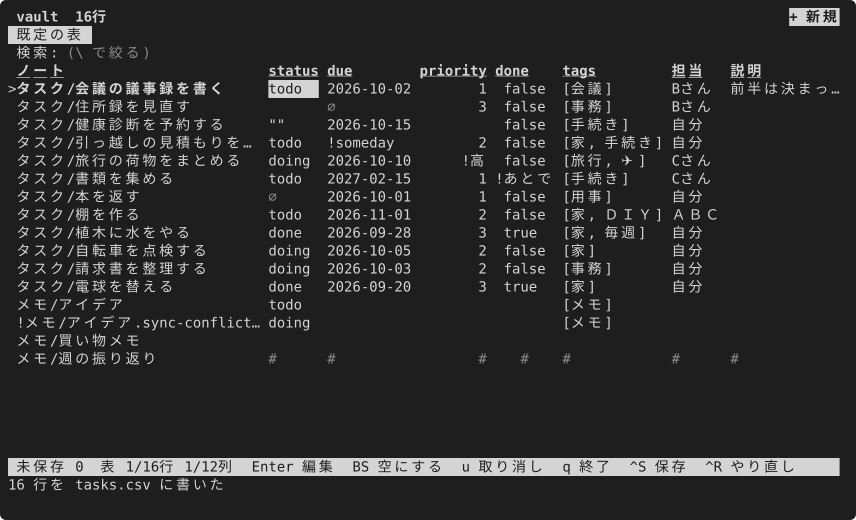

画面を出さずに、ビューの表を標準出力に出します(既定は csv。ノートは書き換えない)。

```sh
mdgrid /tmp/mdgrid-sample/Tasks.base --print
mdgrid /tmp/mdgrid-sample/Tasks.base --print --format json | jq .
mdgrid /tmp/mdgrid-sample/Tasks --print --format md > 表.md
mdgrid /tmp/mdgrid-sample/Tasks --print --format tsv > 表.tsv
```

フォルダを `--print` すると、ノートの名前の列は出ません(列はフロントマターのキーだけ)。

画面で行を選んで、そのパスか列の値を出します。画面は読むだけで、`Enter` で印を付けた行(無ければ選んでいる行)を1行ずつ出して終わります。`q` で取りやめると何も出さず、終了コードは 1 です。

```sh
mdgrid /tmp/mdgrid-sample/Tasks --pick path | xargs -o vi    # 選んだノートを開く
mdgrid /tmp/mdgrid-sample/Tasks --pick status
```

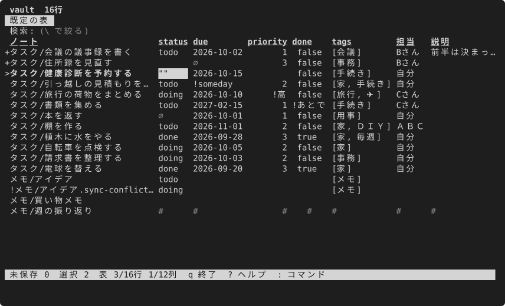

表のセルは `y`(か `Ctrl+C`)、行全体は `Y` でクリップボードにコピーできます。

## テーマを選ぶ

設定に `theme = "nord"` のように1行書くと、画面の色が変わります。7つのテーマの見本と選び方は [テーマ](themes.md) のページにあります。

## 直せないとき

| 見えること | わけ | どうするか |
|---|---|---|
| 行のセルに `#` が並ぶ | フロントマターを安全に書けないノート(キーの重複・BOM・改行コードの混在など) | 選ぶと理由が出る。エディタ(`e`)で直す。理由の一覧は [読むだけのノート](../../safety.ja.md#読むだけのノート) |
| `Enter` で「読むだけ」と出る | ネストした値・ブロックスカラー・`file.*` や `formula.*` の列 | [読むだけの値](../../safety.ja.md#読むだけの値) |
| 改行を含む値が直せない | 1行の入力では直せない | `e` でエディタで開く |
| 日付や数が受け付けられない | 実在しない日付、数として読めない値 | 入力は開いたままなので打ち直す |
| 行の頭に `!` | 同期の道具が作った競合ファイルか、変更をためている間に外で変わったノート | 競合ファイルは手で片付ける。外で変わったノートは保存の確認で上に書くか(`o`)、変更を捨てる(`d`) |
| 何も書けない | `--readonly` で開いた | 付けずに開き直す |

直している間に外でノートが変わると、mdgrid は自動で読み直します(編集中は止まる)。保存のときに変わっていたら、確認の画面でそれを示します。
