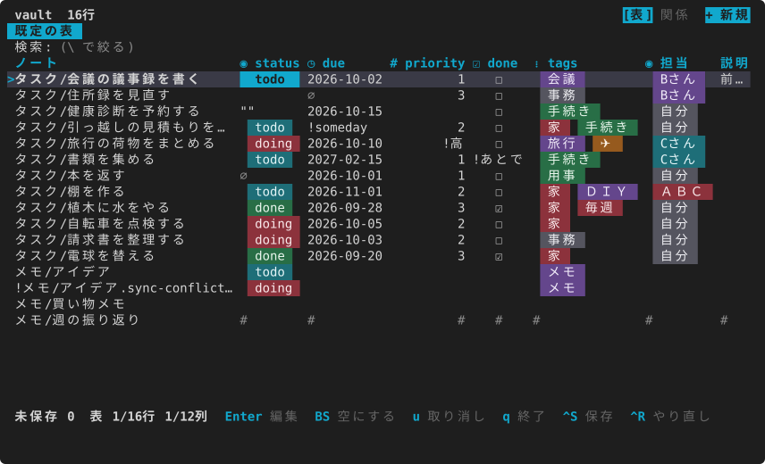
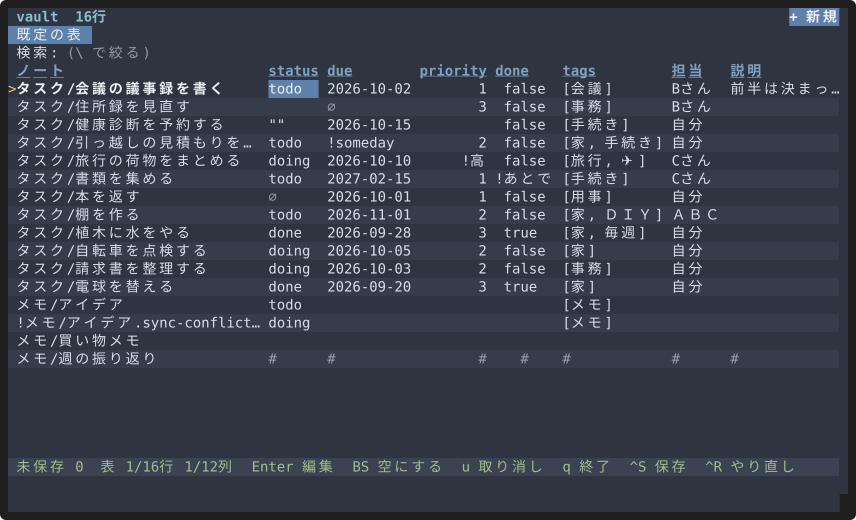
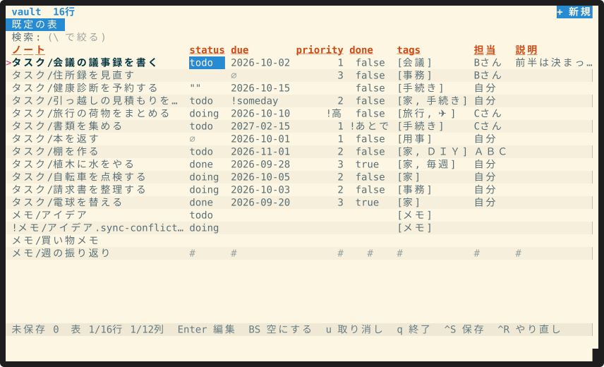
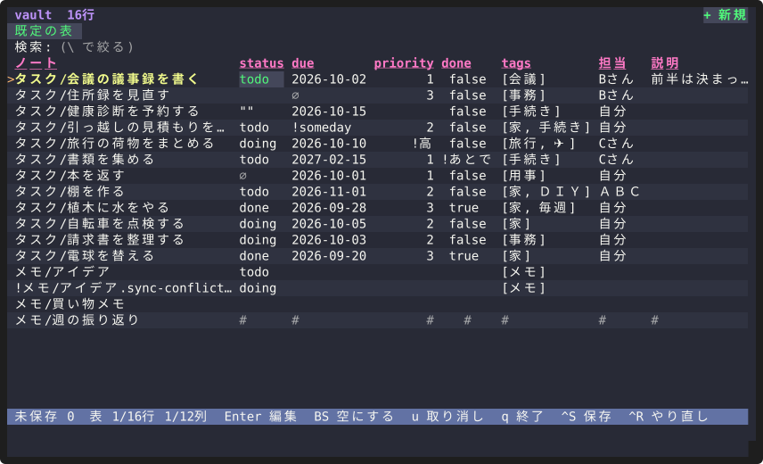
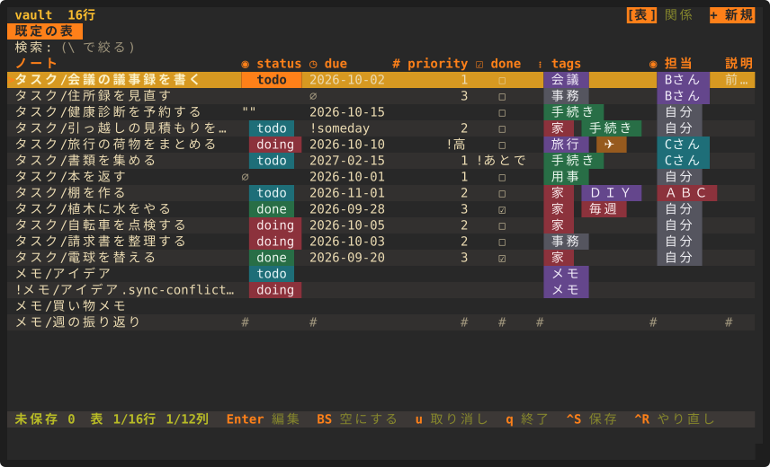
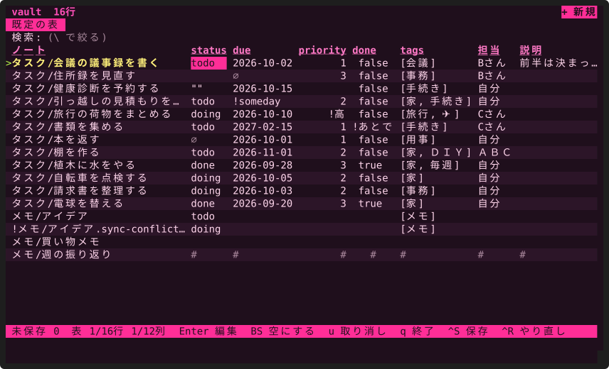
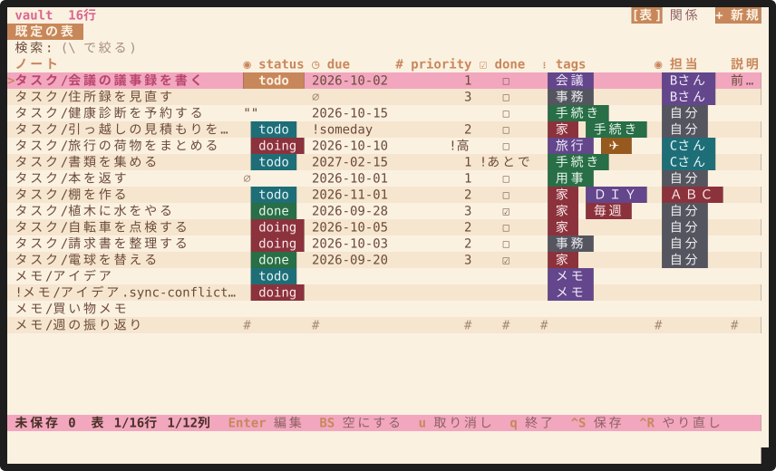

# テーマ

[English](../en/themes.md) · [目次](index.md)

画面の色の組み合わせ(テーマ)を12から選べます(端末の地に合わせる `auto` も)。テーマを元に、アクセントなどの色を自分で決めることもできます([カスタム](#色を自分で決めるカスタム))。変わるのは色だけで、文字と印(`*` のためた変更、`>` の選んでいる行など)はそのままです。

## 選び方

いちばん手早いのは画面で選ぶ方法です。`o` でビューの設定を開き、`8` で「見た目」の区画へ移って、テーマの行で `Enter` を押すと一覧が出ます。選んでから「反映」を押すと、すぐその色になります。


区画の上の「保存先」で、どこに残すかを決めます。既定の「全体」なら、どの表を開いてもそのテーマです(`ui.toml` に残ります)。「このワークスペース」「この表」「このビュー」を選べば、そこだけ変えられます。テーマの横の「(全体)」「(印)」などは、今の色がどこから来たかです。

台帳の印(`.mdgrid/workspace.toml`)にテーマが書いてあっても、画面で選んだテーマのほうが効きます。印のテーマは、台帳を作った人の勧める既定という扱いです。自分で何も選んでいなければ、印のテーマで開きます。

設定のファイル(`~/.config/mdgrid/config.toml`)に書いても同じです。

```toml
[look]
theme = "nord"
```

範囲ごとの決まりは [ワークスペース・表・ビューごとの見た目](appearance.md#ワークスペース表ビューごとの見た目) にあります。

設定を書き換える前に試すなら、見本の設定を `--config` で渡します(リポの根で)。

```sh
mdgrid --config examples/themes/nord.toml /tmp/mdgrid-sample/Tasks.base
```

| 名前 | 見た目 |
|---|---|
| [`default`(既定)](#default) | 今の見た目。端末の色のまま、選択と帯は反転 |
| [`nord`](#nord) | 落ち着いた青 |
| [`solarized-light`](#solarized-light) | 明るい地 |
| [`dracula`](#dracula) | 紫と桃のアクセント |
| [`gruvbox`](#gruvbox) | 暖かい茶と橙 |
| [`pink-monster`](#pink-monster) | 濃い赤紫の地に蛍光の桃と黄緑 |
| [`dozy-pink`](#dozy-pink) | 淡い桃とクリーム |
| [`sumi`](#sumi) | 墨。暗い地・薄い灰・青緑のアクセント |
| [`slate`](#slate) | 石板。紫寄りのアクセント |
| [`saas`](#saas) | 明るい灰の地・藍のアクセント |
| [`saas-dark`](#saas-dark) | saas の暗い地の版 |
| [`paper`](#paper) | 明るい地・青のアクセント |
| `auto` | 端末の地が明るければ `saas`、暗ければ `sumi`。組は `theme = { light = "paper", dark = "saas-dark" }` で選べる |

## 色を自分で決める(カスタム)

テーマの一覧の最後にある「カスタム」を選ぶと、今のテーマを元にして、地・文字・アクセント・選んだ行の地など16の役割の色を1つずつ変えられます。気に入ったテーマのアクセントだけ好きな色にする、といった使い方です。


役割の行で `Enter` を押すと、色の見本(orange・teal など14色)が並びます。見本に無い色は、一覧の最後の「#rrggbb を打つ」で `#e0a458` のように打ちます。「テーマのまま」を選ぶと、その役割は元のテーマの色に戻ります。

反映すると、保存先に元のテーマと変えた色だけが残ります。全体に残したときの `ui.toml` はこうなります。

```toml
[look]
theme = "sumi"

[look.colors]
accent = "#ea8c34"
```

色を変えた見た目は、テーマの欄に「カスタム(元: sumi)」と出ます。一覧で名前のテーマを選び直せば、変えた色は外れます。「名前を付けて保存」でテンプレートにすると、色ごと残ります。

## 見本

<a id="default"></a>

### `default` — 既定の見た目

今の見た目。端末の色のまま、選択と帯は反転。設定を書かないときもこれ。



<a id="nord"></a>

### `nord` — Nord

落ち着いた青。設定: `theme = "nord"`。



<a id="solarized-light"></a>

### `solarized-light` — Solarized Light

明るい地。設定: `theme = "solarized-light"`。



<a id="dracula"></a>

### `dracula` — Dracula

紫と桃のアクセント。設定: `theme = "dracula"`。



<a id="gruvbox"></a>

### `gruvbox` — Gruvbox

暖かい茶と橙。設定: `theme = "gruvbox"`。



<a id="pink-monster"></a>

### `pink-monster` — Pink Monster

濃い赤紫の地に蛍光の桃と黄緑。設定: `theme = "pink-monster"`。



<a id="dozy-pink"></a>

### `dozy-pink` — Dozy Pink

淡い桃とクリーム。設定: `theme = "dozy-pink"`。



<a id="sumi"></a>

### `sumi` — Sumi

墨。暗い地・薄い灰・青緑のアクセント。設定: `theme = "sumi"`。


<a id="slate"></a>

### `slate` — Slate

石板。紫寄りのアクセント。設定: `theme = "slate"`。


<a id="saas"></a>

### `saas` — SaaS

明るい灰の地・藍のアクセント。設定: `theme = "saas"`。


<a id="saas-dark"></a>

### `saas-dark` — SaaS Dark

saas の暗い地の版。設定: `theme = "saas-dark"`。


<a id="paper"></a>

### `paper` — Paper

明るい地・青のアクセント。設定: `theme = "paper"`。


## 注意

- `NO_COLOR`・`--no-color`・`color = false`・`TERM=dumb` では、テーマを書いても色を使いません。
- トゥルーカラーに対応しない端末(`COLORTERM` が `truecolor` でない)では、近い 256 色で塗ります。
- 知らない名前を書くと、起動のときに警告が出て `default` で開きます。
- 右下の隅の1マスは、端末の自動の折り返しを避けるため塗りません。明るいテーマでは、そこだけ端末の地の色が見えます。
- 一行おきの色(`[display] zebra = true`)もテーマの色で塗ります。`default` 以外の見本の画面はこれを入れて撮っています。
- 設定の全項目は [設定](../../config.ja.md#theme)。
