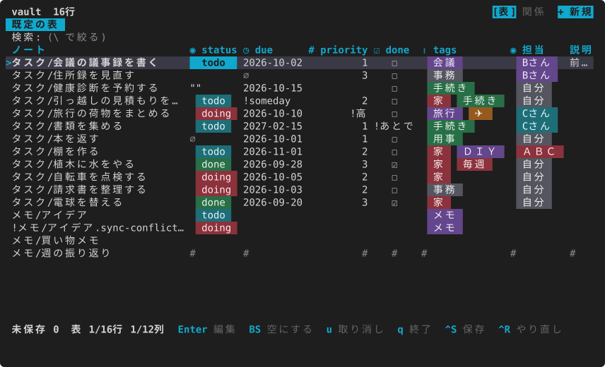
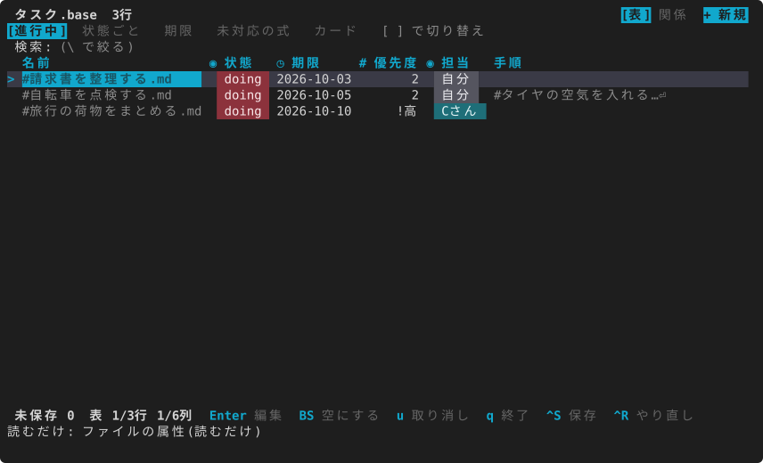
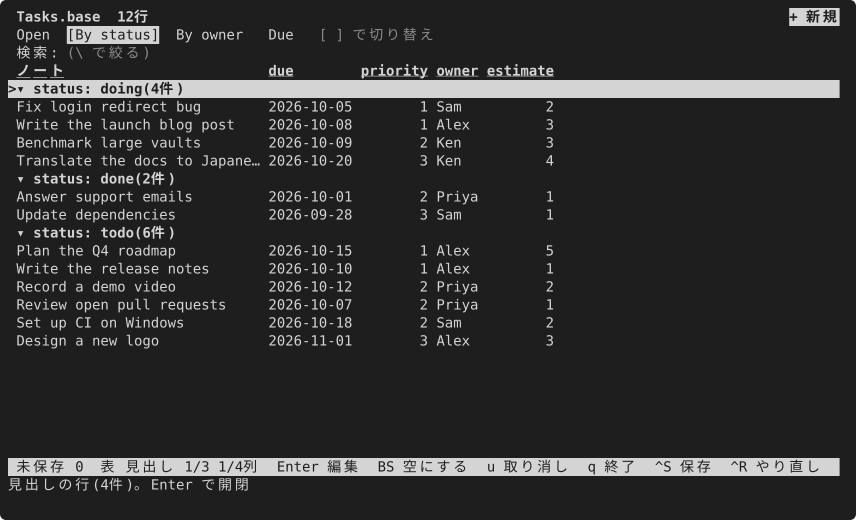
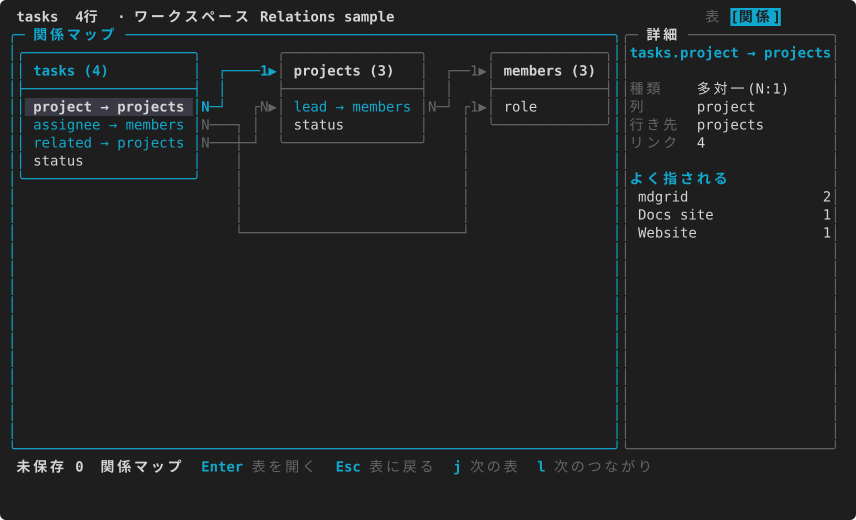
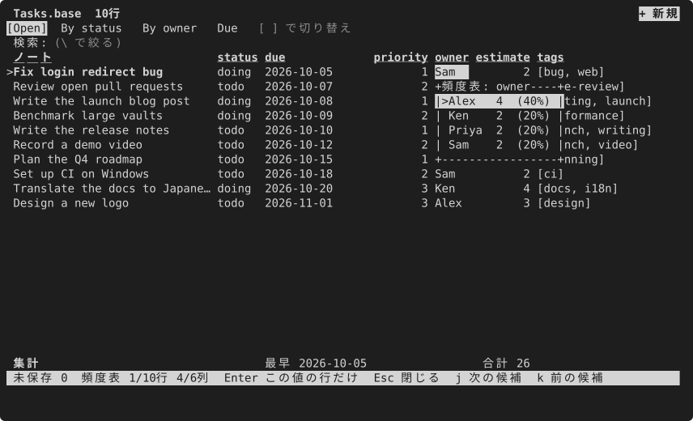
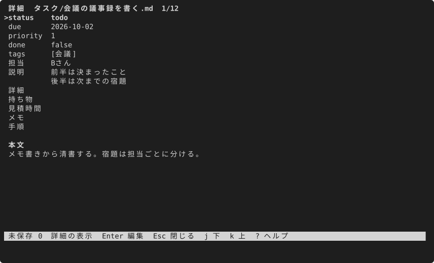
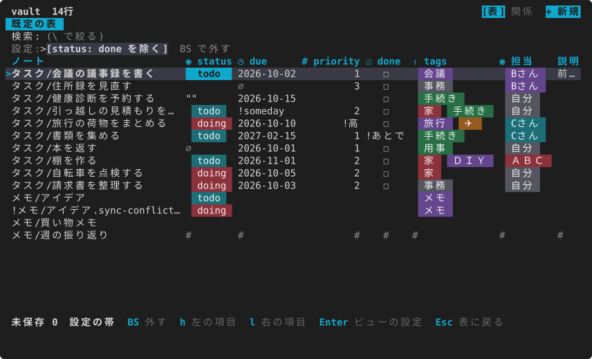
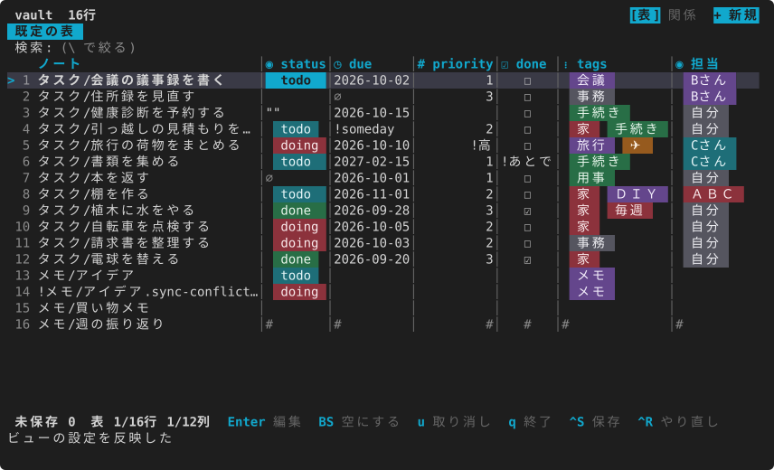
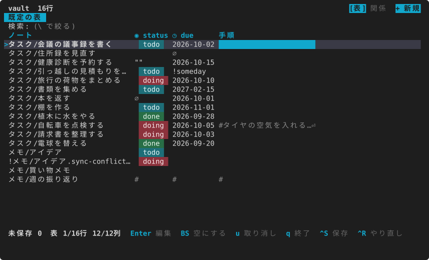
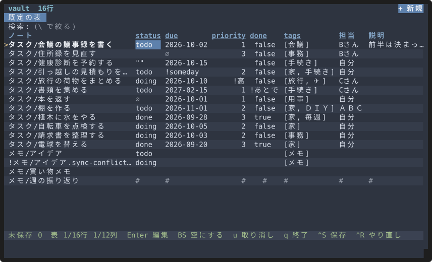

# 見せ方の一覧

[English](../en/views.md) · [目次](index.md)

同じノートを、画面を変えて見られます。切り替えはキー1つか、ビューの設定から。どの画面もノートには何も書かず、`Esc` で表に戻ります。ここでは画面を1枚ずつ並べました。やり方は各項のリンク先にあります。

## 表

いちばん基本の画面です。1行が1つのノート、列がフロントマターのキー。先頭の列はファイル名です。セルで `Enter` を押すとその場で直せて、下の帯に未保存の数と今押せるキーが出ます。

[はじめかた](getting-started.md#画面の見方)に画面の読み方があります。

## ビューのタブ

列・絞り込み・並べ替えの組み合わせに名前を付けたものがビューで、表の上にタブで並び、`[` と `]` で行き来できます。`.base` を開けば、その中の table ビューがそのままタブに。自分で作ったビューは設定のフォルダに残り、ノートの横には置きません。

[見せ方を決めて保存する](tasks.md#見せ方を決めて保存する)

## まとまり(グループ)

列の値でまとめて、見出しの行で区切った形。見出しで `Enter` を押せば畳めます。`.base` のグループも同じ見た目になり、進み具合ごとにタスクを眺めるのに向いています。

[見せ方を決めて保存する](tasks.md#見せ方を決めて保存する)(ビューの設定の「並べ替え・グループ」)

## 木

ワークスペースの印(`.mdgrid/workspace.toml`)の表に `tree = { path = "folder" }` と書いておくと、`T` でその列の階層(`bar > Dev > Web` など)がフォルダの木になります。左が木と件数、右が選んだフォルダのノートです。ブックマークや資料の整理に向いていて、組み込みのスターター bookmarks はこの形で作られます。木の画面は 0.4.0 からあります。

[設定の `tree`](../../config.ja.md)、[スターターから台帳を作る](tasks.md#スターターから台帳を作る)

## ガント

`C` で、今のビューの行を時間軸の横棒にします。始まりと終わりの列は印の `gantt = { start = "start", end = "due" }` で決め、設定が無くても `start`・`due` のような名前の日付の列から推定します。親子の字下げと WBS が効いていれば、その並び・番号・進み具合(棒の塗り)のまま。親に日付が無ければ子の範囲が親の棒になります。`+` `-` で日・週・月、`t` で今日へ。ガントの画面は 0.4.0 からあります。

[キーの割り当て](../../keys.ja.md)の `gantt` の節、[設定](../../config.ja.md)

## 親子の字下げと WBS

ノートに `parent: "[[親]]"` があれば、ビューの設定の「親子」で、子を親の下に字下げして並べられます。`Z` で畳む・開く。同じ区画で WBS をオンにすると `1.2.1` の番号が付き、進み具合の列の値から割合を出します(子のある行は子孫の平均)。見本のノートには親子が無いので、ここには画面を置いていません。動きは[リリースの録画](https://github.com/S6U5/mdgrid/releases/latest/download/demo-tree.gif)で見られます。

[見せ方を決めて保存する](tasks.md#見せ方を決めて保存する)

## 関係マップ

`R` で、ワークスペースの表を箱、リンクの列を矢印にした図になります。どの表がどの表を指しているかを確かめ、`Enter` でその表へ移れます。

[関係マップ](concepts.md#関係マップ)

## 値の分布

`%` を押すと、今の列の値ごとの件数と割合。`Enter` でその値の行だけに絞れます。status が何件ずつあるか、担当が偏っていないか、といったことを見るのに。

[キーの割り当て](../../keys.ja.md)の `freq` の節

## 1つのノートの詳細

`K` で、選んだ行の全部のキーと値を縦に並べます。列が多くて横に収まらないときの画面です。

[キーの割り当て](../../keys.ja.md)の `detail` の節

## 絞り込みの帯

効いている絞り込み・並べ替え・まとまりが、表の上に札で並びます。`f` で帯に入り、`Backspace` で1つ外せます。何で絞っていたか分からなくなる、ということがありません。

[探す・絞る・並べる](tasks.md#探す絞る並べる)

## 行番号・しましま・列の線

ビューの設定の「表示」で、行番号、一行おきの色、列の区切り線を付けられます。ビューごとに覚えます。

[見せ方を決めて保存する](tasks.md#見せ方を決めて保存する)

## 列の固定

`F` で、その列までを左に固定します。横に動かしても、ファイル名と status は見えたままです。

[キーの割り当て](../../keys.ja.md)の `table` の節

## テーマ・部品の形

色のテーマは 12 から選べ、札やチェックボックスの形も変えられます。変わるのは見た目だけで、文字と印は同じです。[見た目のカタログ](../../catalog/index.html)で見比べて、出てきた設定を `config.toml` に貼ります。

[見た目を整える](appearance.md)、[テーマ](themes.md)

## 気軽に戻れる

開いた画面は `Esc` で表に戻ります(木と関係マップは `q` でも、詳細は `K`、帯は `f` でも)。表のままの見せ方では `q` は mdgrid を終えます。キーを忘れたら `?`、名前で探すなら `:`。画面を切り替えても、保存するまでファイルは変わりません。
